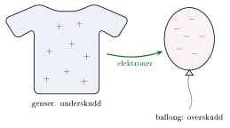

<!-- video: kommer (videoer/fysikk-forkurs/11-01-elektrisk-ladning) -->
{fig-alt="Video kommer"}

::: {.callout-tip title="Til ettertanke"}
Du gnir en ballong mot genseren din, og etterpå kan ballongen henge fast i taket. Hva er det som har skjedd?
:::

All materie er bygget opp av atomer. Et atom har en kjerne med positivt ladde **protoner** (og nøytrale nøytroner), og rundt kjernen beveger det seg negativt ladde **elektroner**. Et atom har like mange protoner som elektroner og er derfor elektrisk **nøytralt**: Den positive og den negative ladningen opphever hverandre.

Elektronene i de ytterste skallene kan forholdsvis lett flyttes fra ett legeme til et annet. Når du gnir ballongen mot genseren, flyttes elektroner fra genseren over til ballongen. Ballongen får da et overskudd av elektroner og blir negativt ladet, mens genseren får et underskudd og blir positivt ladet.

{.tikz-fig style="width:460px" fig-alt="En genser med plusstegn og en ballong med minustegn. En grønn pil merket elektroner går fra genseren til ballongen. Genseren har fått underskudd av elektroner, ballongen overskudd."}

Ladning blir verken laget eller ødelagt, den bare flyttes. Dette kalles **ladningsbevaring**. Til sammen har genseren og ballongen like mye ladning som før, altså null.

## Elementærladningen

Elektrisk ladning har symbolet $q$ (eller $Q$) og enheten coulomb (C). Den minste frie ladningen som finnes i naturen, er ladningen til et proton. Den kalles elementærladningen.

::: {.callout-important title="Elementærladningen"}
$$
\mathrm{e} = 1.602\cdot 10^{-19}\ \mathrm{C}
$$
Et proton har ladningen $+\mathrm{e}$, og et elektron har ladningen $-\mathrm{e}$. Ladningen til et legeme er derfor alltid et helt antall elementærladninger:
$$
q = N\cdot \mathrm{e}
$$
der $N$ er antall elektroner i overskudd (eller underskudd).
:::

::: {.eksempel}
**Eksempel: Ladningen på en ballong.** En ballong er gnidd mot en genser og har fått ladningen $q = -0.10\ \mathrm{\mu C}$.

a)  Hvor mange elektroner har ballongen i overskudd?

b)  Hvilken ladning har genseren fått?

::: {.losning}
**a)** Vi løser $q = N\cdot\mathrm{e}$ for $N$ og bruker størrelsen av ladningen:
$$
N = \frac{|q|}{\mathrm{e}} = \frac{0.10\cdot 10^{-6}\ \mathrm{C}}{1.602\cdot 10^{-19}\ \mathrm{C}} = 6.24\cdot 10^{11} \approx \underline{\underline{6.2\cdot 10^{11}}}
$$
Det er mange elektroner, men likevel en svært liten andel av alle elektronene i ballongen.

**b)** Ladning er bevart. Elektronene som ballongen har fått, kommer fra genseren. Genseren har derfor fått ladningen $\underline{\underline{+0.10\ \mathrm{\mu C}}}$.
:::
:::

## Ledere, isolatorer og halvledere

Stoffer deles inn i tre grupper etter hvor godt de leder elektrisk strøm:

::: {.kort}
- **Ledere** har mange løst bundne elektroner som kan bevege seg fritt gjennom stoffet. Metaller som kobber og aluminium er gode ledere, og brukes derfor i ledninger.
- **Isolatorer** holder godt fast på elektronene sine, så ingen ladning kan bevege seg fritt. Eksempler er gummi, plast og glass. De brukes rundt ledninger, slik at strømmen ikke går dit den ikke skal.
- **Halvledere**, som silisium, ligger imellom. Ledningsevnen kan styres, og de er grunnlaget for dioder, transistorer og all moderne elektronikk.
:::

::: {.callout-important title="Merk: Kraften mellom ladninger"}
Ladninger med likt fortegn frastøter hverandre, og ladninger med motsatt fortegn tiltrekker hverandre. Kraften blir mindre jo lenger fra hverandre ladningene er. Dette beskrives av [Coulombs lov](07-coulombs-lov.qmd), som har samme form som Newtons gravitasjonslov.

Det forklarer også ballongen i taket: Den negative ballongen skyver elektronene i taket litt unna, slik at overflaten nærmest ballongen blir svakt positiv. Siden de positive ladningene er nærmest, blir ballongen trukket mot taket.
:::

:::: {.oppgaver}

::: {.oppgave tittel="Ladningen på en ballong"}
En ballong er gnidd mot en genser og har fått ladningen $q = -0.20\ \mathrm{\mu C}$.

a)  Hvor mange elektroner har ballongen i overskudd?

b)  Hvilken ladning har genseren fått?

::: {.losning}
**a)** $N = \dfrac{|q|}{\mathrm{e}} = \dfrac{0.20\cdot 10^{-6}\ \mathrm{C}}{1.602\cdot 10^{-19}\ \mathrm{C}} = 1.25\cdot 10^{12} \approx \underline{\underline{1.2\cdot 10^{12}}}$

**b)** Ladningen er bevart, så genseren har fått $\underline{\underline{+0.20\ \mathrm{\mu C}}}$.
:::
:::

::: {.oppgave tittel="Én coulomb"}
<!-- tillegg: Claude -->
Hvor mange elektroner må til for å få ladningen $-1.0\ \mathrm{C}$? Hvorfor møter vi sjelden så store ladninger på ting i hverdagen?

::: {.losning}
$N = \dfrac{1.0\ \mathrm{C}}{1.602\cdot 10^{-19}\ \mathrm{C}} = \underline{\underline{6.2\cdot 10^{18}}}$

En coulomb er en enorm ladning å samle på ett legeme. Ladninger med likt fortegn frastøter hverandre så kraftig at de straks ville spre seg eller lade ut gjennom lufta. Typiske ladninger fra gnidning er noen mikrocoulomb eller mindre.
:::
:::

::: {.oppgave tittel="Leder eller isolator?" niva="Middels"}
<!-- tillegg: Claude -->
Forklar med elektroner hvorfor en ledning er laget av kobber inni og har plast utenpå.

::: {.losning}
Kobber er en leder: Det har frie elektroner som kan bevege seg gjennom metallet, så strømmen går lett i ledningen. Plast er en isolator: Elektronene sitter fast, så ingen ladning kan gå gjennom plasten. Plasten hindrer at strømmen går gjennom oss eller over til andre ledninger når vi tar på ledningen.
:::
:::

::::
