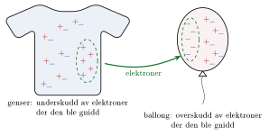
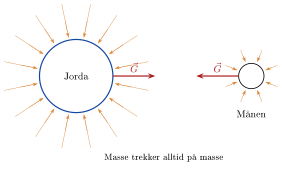
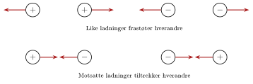
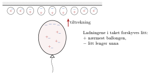

Visste du at elektrisitet og magnetisme er to sider av samme sak? Det er dette faktum som ligger bak det vi for eksempel kaller elektromagnetisk induksjon. Elektrisitet og magnetisme sett under ett ble utviklet av James Clerk Maxwell på 1800-tallet, og kalles *elektromagnetisme*. Det er én av de fire grunnleggende naturkreftene i universet. Denne videoen gir en introduksjon:



La oss nå likevel konsentrere oss om *elektrisitet*, som et eget fenomen, selv om det altså egentlig er en del av det vi kaller elektromagnetisme.

::: {.callout-tip title="Til ettertanke"}
Du gnir en ballong mot genseren din, og etterpå kan ballongen henge fast i taket. Hva er det som har skjedd?
:::

All materie er bygget opp av atomer. Disse atomene har masse. De veier altså noe. Men i tillegg har de noe som kalles *elektrisk ladning*. Et atom har en kjerne med positivt ladde **protoner** (og nøytrale nøytroner), og rundt kjernen beveger det seg negativt ladde **elektroner**. Et atom har like mange protoner som elektroner og er derfor elektrisk **nøytralt**: Den positive og den negative ladningen opphever hverandre.

Elektronene i de ytterste skallene kan forholdsvis lett flyttes fra ett legeme til et annet. Når du gnir ballongen mot genseren, flyttes elektroner fra genseren over til ballongen. Ballongen får da et overskudd av elektroner og blir negativt ladet, mens genseren får et underskudd og blir positivt ladet. Både ballongen og genseren er isolatorer, så de ekstra ladningene blir sittende der de ble gnidd. Resten av ballongen og genseren er fortsatt nøytral, med like mange positive og negative ladninger.

{.tikz-fig style="width:680px" fig-alt="To bilder. Til venstre, før: en genser og en ballong der hvert plusstegn har et minustegn ved siden av, og over står Q_tot = 0. Til høyre, etter gnidning: en grønn pil merket elektroner går fra genseren til ballongen. Et innringet område på genseren har bare plusstegn (Q > 0), og et innringet område på ballongen har bare minustegn (Q < 0). Over står fortsatt Q_tot = 0."}

Ladning blir verken laget eller ødelagt, den bare flyttes. Dette kalles **ladningsbevaring**. Til sammen har genseren og ballongen like mye ladning som før, altså null.

Mens *masse* alltid er positiv, kan elektrisk ladning være både positiv og negativ. Gravitasjonsfeltet rundt en masseklump (jorda, for eksempel, eller et atom) trekker alltid andre masseklumper mot seg.

{.tikz-fig style="width:420px" fig-alt="Jorda og månen. En pil fra jorda peker mot månen, og en pil fra månen peker mot jorda, begge merket G. Rundt jorda og månen går svake oransje feltlinjer rett inn mot sentrum: masse trekker alltid på masse."}

De oransje linjene kalles **feltlinjer**, og de viser *tyngdefeltet* $\vec{\mathrm{g}}$. Tyngdefeltet viser hvilken vei en masse vil bevege seg om vi plasserer den der og bare tyngdekraften virker på den. Rundt en masse peker feltlinjene alltid rett innover, fordi gravitasjon bare kan trekke.

Med ladning er det ikke slik. Her har vi to forskjellige fortegn, og får derfor flere muligheter. To legemer med like ladninger frastøter hverandre, mens to legemer med motsatt ladning tiltrekker hverandre.

{.tikz-fig style="width:560px" fig-alt="De fire mulighetene for to ladninger, med svake oransje feltlinjer. Pluss og pluss, og minus og minus, skyves fra hverandre, og feltlinjene bøyer unna hverandre mellom ladningene. Pluss og minus, og minus og pluss, trekkes mot hverandre, og feltlinjene går i buer fra plussladningen til minusladningen."}

Også rundt ladninger finnes det et felt: det **elektriske feltet** $\vec E$. På samme måte som tyngdefeltet $\vec{\mathrm{g}}$ viser hvilken vei en masse vil bevege seg på grunn av tyngdekraften, viser det elektriske feltet $\vec E$ hvilken vei en *positiv* ladning vil bevege seg på grunn av den elektriske kraften. Derfor går feltlinjene ut fra positive ladninger og inn mot negative. En negativ ladning dyttes motsatt vei av feltlinjene. Mellom to like ladninger bøyer feltlinjene unna hverandre. Mellom to motsatte ladninger går de i buer fra plussladningen til minusladningen. To motsatte ladninger ved siden av hverandre kalles en **dipol**. Det mønsteret møter vi igjen når vi skal se på batteriet.

Nå kan vi svare på spørsmålet om ballongen i taket. Taket er nøytralt, så hvorfor blir ballongen hengende? Når den negativt ladde ballongen kommer nær taket, dyttes elektronene i atomene i taket litt bort, mens de positive kjernene trekkes litt nærmere. Atomene blir **polarisert**. Da er den positive ladningen i taket litt nærmere ballongen enn den negative. Tiltrekningen fra det som er nærmest, blir sterkere enn frastøtningen fra det som er lenger unna, og ballongen blir hengende.

{.tikz-fig style="width:520px" fig-alt="En ballong med minustegn på toppen henger under et tak. Atomene i taket er tegnet som små ringer med pluss og minus. Rett over ballongen er atomene strukket ut, med pluss nederst mot ballongen og minus øverst. Langt unna ballongen er pluss og minus i midten av hvert atom. En rød pil merket tiltrekning peker fra ballongen opp mot taket."}

## Elementærladningen

En annen viktig forskjell mellom et legemes *masse* og *ladning* er at ladning kommer i pakker. Massen til et legeme kan variere kontinuerlig. Slik er det ikke med ladning. Den minste mulige pakken for ladning kalles *elementærladningen*, og alle andre ladninger er et helt antall ganger elementærladningen. Det finnes altså en minsteladning i universet!

Elektrisk ladning har symbolet $q$ (eller $Q$) og enheten coulomb (C). Den minste frie ladningen som finnes i naturen, er altså elementærladningen, som for øvrig også er ladningen til et proton.

::: {.callout-important title="Elementærladningen"}
$$
\mathrm{e} = 1.602\cdot 10^{-19}\ \mathrm{C}
$$
Et proton har ladningen $+\mathrm{e}$, og et elektron har ladningen $-\mathrm{e}$. Ladningen til et legeme er derfor alltid et helt antall elementærladninger:
$$
q = N\cdot \mathrm{e}
$$
der $N$ er antall elektroner i overskudd (eller underskudd).
:::

::: {.eksempel}
**Eksempel: Ladningen på en ballong.** En ballong er gnidd mot en genser og har fått ladningen $q = -0.10\ \mathrm{\mu C}$.

a)  Hvor mange elektroner har ballongen i overskudd?

b)  Hvilken ladning har genseren fått?

::: {.losning}
**a)** Vi løser $q = N\cdot\mathrm{e}$ for $N$ og bruker størrelsen av ladningen:
$$
N = \frac{|q|}{\mathrm{e}} = \frac{0.10\cdot 10^{-6}\ \mathrm{C}}{1.602\cdot 10^{-19}\ \mathrm{C}} = 6.24\cdot 10^{11} \approx \underline{\underline{6.2\cdot 10^{11}}}
$$
Det er mange elektroner, men likevel en svært liten andel av alle elektronene i ballongen.

**b)** Ladning er bevart. Elektronene som ballongen har fått, kommer fra genseren. Genseren har derfor fått ladningen $\underline{\underline{+0.10\ \mathrm{\mu C}}}$.
:::
:::

## Ledere, isolatorer og halvledere

Stoffer deles inn i tre grupper etter hvor godt de leder elektrisk strøm:

::: {.kort}
- **Ledere** har mange løst bundne elektroner som kan bevege seg fritt gjennom stoffet. Metaller som kobber og aluminium er gode ledere, og brukes derfor i ledninger.
- **Isolatorer** holder godt fast på elektronene sine, så ingen ladning kan bevege seg fritt. Eksempler er gummi, plast og glass. De brukes rundt ledninger, slik at strømmen ikke går dit den ikke skal.
- **Halvledere**, som silisium, ligger imellom. Ledningsevnen kan styres, og de er grunnlaget for dioder, transistorer og all moderne elektronikk.
:::

::: {.callout-important title="Merk: Kraften mellom ladninger"}
Ladninger med likt fortegn frastøter hverandre, og ladninger med motsatt fortegn tiltrekker hverandre. Kraften blir mindre jo lenger fra hverandre ladningene er. Dette beskrives av [Coulombs lov](07-coulombs-lov.qmd), som har samme form som Newtons gravitasjonslov.

Det forklarer også ballongen i taket: Den negative ballongen skyver elektronene i taket litt unna, slik at overflaten nærmest ballongen blir svakt positiv. Siden de positive ladningene er nærmest, blir ballongen trukket mot taket.
:::

:::: {.oppgaver}

::: {.oppgave tittel="Ladningen på en ballong"}
En ballong er gnidd mot en genser og har fått ladningen $q = -0.20\ \mathrm{\mu C}$.

a)  Hvor mange elektroner har ballongen i overskudd?

b)  Hvilken ladning har genseren fått?

::: {.losning}
**a)** $N = \dfrac{|q|}{\mathrm{e}} = \dfrac{0.20\cdot 10^{-6}\ \mathrm{C}}{1.602\cdot 10^{-19}\ \mathrm{C}} = 1.25\cdot 10^{12} \approx \underline{\underline{1.2\cdot 10^{12}}}$

**b)** Ladningen er bevart, så genseren har fått $\underline{\underline{+0.20\ \mathrm{\mu C}}}$.
:::
:::

::: {.oppgave tittel="Én coulomb"}
<!-- tillegg: Claude -->
Hvor mange elektroner må til for å få ladningen $-1.0\ \mathrm{C}$? Hvorfor møter vi sjelden så store ladninger på ting i hverdagen?

::: {.losning}
$N = \dfrac{1.0\ \mathrm{C}}{1.602\cdot 10^{-19}\ \mathrm{C}} = \underline{\underline{6.2\cdot 10^{18}}}$

Én coulomb er en enorm ladning å samle på ett legeme. Ladninger med likt fortegn frastøter hverandre så kraftig at de straks ville spre seg eller lade ut gjennom lufta. Typiske ladninger fra gnidning er noen mikrocoulomb eller mindre.
:::
:::

::: {.oppgave tittel="Leder eller isolator?" niva="Middels"}
<!-- tillegg: Claude -->
Forklar med elektroner hvorfor en ledning er laget av kobber inni og har plast utenpå.

::: {.losning}
Kobber er en leder: Det har frie elektroner som kan bevege seg gjennom metallet, så strømmen går lett i ledningen. Plast er en isolator: Elektronene sitter fast, så ingen ladning kan gå gjennom plasten. Plasten hindrer at strømmen går gjennom oss eller over til andre ledninger når vi tar på ledningen.
:::
:::

::::
