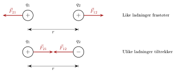



<!-- tillegg: Claude: «Under arbeid» er fjernet, og siden er bygd ut med ladning, superposisjon, figurer, eksempler og oppgaver. Lærerens tekst er beholdt; konstantene står nå i rett skrift etter notasjonsreglene. -->

<!-- tillegg: Claude -->
Gni en ballong mot håret og løft den sakte bort. Hårstråene reiser seg og strekker seg etter ballongen, selv om ingenting berører dem. Hold ballongen inntil veggen, og den blir hengende. Det er en kraft som virker gjennom lufta, akkurat som tyngdekraften, men denne kraften er mye sterkere. På denne siden ser vi på hva som skaper den: elektrisk ladning. Vi skal se hvordan kraften mellom to ladninger avhenger av ladningene og av avstanden, og hvordan vi legger sammen kreftene når det er flere ladninger.

Elektrisk ladning er det som gir opphav til elektriske krefter. To ladede legemer tiltrekker eller frastøter hverandre — akkurat som gravitasjon tiltrekker to masser, men med en viktig forskjell: elektrisk kraft kan *både* tiltrekke og frastøte.

## Elektrisk ladning

<!-- tillegg: Claude -->
Det finnes to typer ladning, som vi kaller **positiv** og **negativ**. Navnene er bare en avtale, men de passer godt, for like mengder positiv og negativ ladning opphever hverandre. Et legeme med like mye av begge er **nøytralt**.

Protonene i atomkjernen er positive, og elektronene rundt kjernen er negative. Begge har like stor ladning, elementærladningen $\mathrm{e} = 1.602\cdot10^{-19}\ \mathrm{C}$. Tre egenskaper ved ladning er verdt å huske:

::: {.kort}
- **Like frastøter, ulike tiltrekker.** To positive ladninger skyver hverandre bort. En positiv og en negativ trekker hverandre mot seg.
- **Ladning er bevart.** Ladning kan flyttes, men ikke lages eller forsvinne. Når ballongen blir negativ, blir håret like mye positivt.
- **Ladning kommer i porsjoner.** All ladning er et helt antall elementærladninger: $q = N\cdot\mathrm{e}$. Det finnes ingen halve elektroner.
:::

Når du gnir ballongen mot håret, er det elektroner som går over fra håret til ballongen. Protonene sitter fast i atomkjernene og flytter seg ikke. Et legeme blir altså **negativt** når det får elektroner i overskudd, og **positivt** når det mangler elektroner.

::: {.eksempel}
<!-- tillegg: Claude -->
**Eksempel: Ballongen.** Etter gnidningen har ballongen ladningen $-50\ \mathrm{nC}$. Hvor mange elektroner har den fått fra håret, og hvilken ladning har håret fått?

::: {.losning}
Antallet elektroner er ladningen delt på ladningen til ett elektron:
$$
N = \frac{|q|}{\mathrm{e}} = \frac{50\cdot10^{-9}\ \mathrm{C}}{1.602\cdot10^{-19}\ \mathrm{C}} = \underline{\underline{3.1\cdot10^{11}}}
$$
Ladningen er bevart, så håret har mistet like mange elektroner og har fått ladningen $\underline{\underline{+50\ \mathrm{nC}}}$.

Det høres mye ut, men et hårstrå alene inneholder rundt $10^{20}$ elektroner. Bare en ørliten brøkdel er flyttet.
:::
:::

::: {.callout-tip title="Til ettertanke: Hvorfor blir ballongen hengende på veggen?"}
<!-- tillegg: Claude -->
Veggen er nøytral, så hvorfor tiltrekker den ballongen? Når den negative ballongen kommer nær veggen, skyver den elektronene i veggen litt bort. Overflaten nærmest ballongen blir svakt positiv, og den negative siden havner litt lenger unna. Kraften avtar med avstanden, så tiltrekningen fra den nære positive siden vinner over frastøtningen fra den fjerne negative. Dette kalles **influens** (polarisering), og det er også derfor en ladd kam kan løfte små papirbiter.
:::

## Coulombs lov

::: {.callout-note title="Definisjon: Coulombs lov"}
<!-- tillegg: Claude: konstanten k er skrevet som k_e i rett skrift (notasjonsreglene) -->
Kraften mellom to punktladninger $q_1$ og $q_2$ med avstand $r$ er:
$$
F_e = \mathrm{k_e} \frac{|q_1|\,|q_2|}{r^2}, \qquad \mathrm{k_e} = 8.99\cdot 10^{9}\ \mathrm{N\,m^{2}/C^{2}}
$$
Kraften er *tiltrekkende* dersom ladningene har motsatt fortegn, og *frastøtende* dersom de har likt fortegn.
:::

<!-- tillegg: Claude -->
Formelen gir **størrelsen** på kraften. **Retningen** finner du ved å se på fortegnene: Kraften virker alltid langs linja mellom ladningene, bort fra den andre ladningen hvis de er like, og mot den hvis de er ulike. Ladning $q_1$ virker på $q_2$ med kraften $\vec F_{12}$, og $q_2$ virker tilbake på $q_1$ med $\vec F_{21}$. Etter Newtons tredje lov er de to kreftene like store og motsatt rettet, også om den ene ladningen er mye større enn den andre.

<!-- tillegg: Claude -->
{.tikz-fig style="width:620px" fig-alt="Øverst to positive ladninger q1 og q2 i avstand r. Kraftpilene F21 og F12 peker bort fra hverandre. Nederst en positiv og en negativ ladning i avstand r, der kraftpilene peker mot hverandre."}

<!-- tillegg: Claude -->
Legg merke til tre ting i formelen:

::: {.kort}
- **Dobbel ladning, dobbel kraft.** Kraften er proporsjonal med hver av ladningene. Dobles $q_1$, dobles kraften.
- **Dobbel avstand, en firedel av kraften.** Kraften avtar med kvadratet av avstanden. Med tre ganger så stor avstand blir kraften $3^2 = 9$ ganger mindre.
- **Konstanten er enorm.** To ladninger på $1\ \mathrm{C}$ én meter fra hverandre ville virket på hverandre med nesten $9\cdot10^{9}\ \mathrm{N}$, omtrent tyngden av nesten en million tonn. Derfor er ladningene i hverdagen små: nano- og mikrocoulomb.
:::

::: {.graa}

**Gravitasjon vs. elektrisitet — to naturkrefter med samme form**

<!-- tillegg: Claude: konstantene i rett skrift og med enheter -->

|  | **Gravitasjon** | **Elektrisitet** |
|:---|:---|:---|
| Formel | $F_g = \mathrm{G}\,\dfrac{m_1 m_2}{r^2}$ | $F_e = \mathrm{k_e}\,\dfrac{|q_1||q_2|}{r^2}$ |
| «Ladning» | Masse $m$ | Elektrisk ladning $q$ |
| Konstant | $\mathrm{G} = 6.67\cdot 10^{-11}\ \mathrm{N\,m^2/kg^2}$ | $\mathrm{k_e} = 8.99\cdot 10^{9}\ \mathrm{N\,m^2/C^2}$ |
| Retning | Alltid tiltrekkende | Tiltrekker (±) eller frastøter (++) |

Merk at $\mathrm{k_e}$ er *enorm* sammenliknet med $\mathrm{G}$ — elektrisk kraft er typisk mange størrelsesordener sterkere enn gravitasjon på atomnivå.

:::

::: {.eksempel}
**Eksempel: Kraft mellom to ladninger.** To ladninger $q_1 = +2.0\ \mathrm{\mu C}$ og $q_2 = -3.0\ \mathrm{\mu C}$ befinner seg $r = 0.10\ \mathrm{m}$ fra hverandre. Finn kraften mellom dem.

::: {.losning}
$$
F_e = \mathrm{k_e}\frac{|q_1||q_2|}{r^2}
      = 8.99\cdot 10^{9}\ \mathrm{N\,m^{2}/C^{2}}
        \cdot \frac{2.0\cdot 10^{-6}\ \mathrm{C}\cdot3.0\cdot 10^{-6}\ \mathrm{C}}{(0.10\ \mathrm{m})^2}
      = \underline{\underline{5.4\ \mathrm{N}}}
$$
Siden ladningene har motsatt fortegn, er kraften *tiltrekkende*.
:::
:::

::: {.eksempel}
<!-- tillegg: Claude -->
**Eksempel: Hydrogenatomet.** I et hydrogenatom er elektronet i gjennomsnitt $5.29\cdot10^{-11}\ \mathrm{m}$ fra protonet. Sammenlikn den elektriske kraften og gravitasjonskraften mellom dem. Massene er $\mathrm{m_e} = 9.11\cdot10^{-31}\ \mathrm{kg}$ og $\mathrm{m_p} = 1.67\cdot10^{-27}\ \mathrm{kg}$.

::: {.losning}
Den elektriske kraften:
$$
F_e = \mathrm{k_e}\frac{\mathrm{e}^2}{r^2} = 8.99\cdot10^{9}\ \mathrm{N\,m^2/C^2}\cdot\frac{(1.602\cdot10^{-19}\ \mathrm{C})^2}{(5.29\cdot10^{-11}\ \mathrm{m})^2} = 8.24\cdot10^{-8}\ \mathrm{N}
$$
Gravitasjonskraften:
$$
F_g = \mathrm{G}\frac{\mathrm{m_e}\,\mathrm{m_p}}{r^2} = 6.67\cdot10^{-11}\ \mathrm{N\,m^2/kg^2}\cdot\frac{9.11\cdot10^{-31}\ \mathrm{kg}\cdot1.67\cdot10^{-27}\ \mathrm{kg}}{(5.29\cdot10^{-11}\ \mathrm{m})^2} = 3.63\cdot10^{-47}\ \mathrm{N}
$$
Forholdet er
$$
\frac{F_e}{F_g} = \frac{8.24\cdot10^{-8}\ \mathrm{N}}{3.63\cdot10^{-47}\ \mathrm{N}} = \underline{\underline{2.27\cdot10^{39}}}
$$
Avstanden forsvinner i forholdet, siden begge kreftene avtar som $1/r^2$. I atomer og molekyler er tyngdekraften helt uten betydning. Det er elektriske krefter som holder atomene sammen, og som gjør at bordet holder koppen oppe.
:::
:::

## Flere ladninger: kreftene legges sammen

<!-- tillegg: Claude -->
Virker flere ladninger på samme ladning $q$, regner vi ut kraften fra hver av dem for seg, som om de andre ikke var der. Den totale kraften er vektorsummen:
$$
\vec F = \vec F_1 + \vec F_2 + \dots
$$
Dette kalles **superposisjon**. Ligger alle ladningene på en rett linje, peker alle kreftene langs linja, og vi kan regne med fortegn: positivt mot høyre og negativt mot venstre.

::: {.steg}
1. Tegn ladningene og velg en positiv retning.
2. Finn størrelsen på hver kraft med Coulombs lov (bruk tallverdiene av ladningene).
3. Finn retningen på hver kraft ut fra fortegnene: frastøtning eller tiltrekning.
4. Legg sammen med fortegn.
:::

::: {.eksempel}
<!-- tillegg: Claude -->
**Eksempel: Tre ladninger på en linje.** Ladningen $q_1 = +2.0\ \mathrm{\mu C}$ ligger i $x = 0$, og $q_2 = -4.0\ \mathrm{\mu C}$ ligger i $x = 0.30\ \mathrm{m}$. Mellom dem, i $x = 0.10\ \mathrm{m}$, ligger $q = +1.0\ \mathrm{\mu C}$. Finn den totale kraften på $q$.

{.tikz-fig style="width:560px" fig-alt="En x-akse med q1 = +2.0 µC i 0 m, q = +1.0 µC i 0.10 m og q2 = −4.0 µC i 0.30 m. Under q er to piler mot høyre: F1 er dobbelt så lang som F2."}

::: {.losning}
Vi velger positiv retning mot høyre.

**Kraften fra $q_1$:** Avstanden er $0.10\ \mathrm{m}$. Begge er positive, så $q_1$ skyver $q$ bort, altså mot høyre.
$$
F_1 = 8.99\cdot10^{9}\ \mathrm{N\,m^2/C^2}\cdot\frac{2.0\cdot10^{-6}\ \mathrm{C}\cdot1.0\cdot10^{-6}\ \mathrm{C}}{(0.10\ \mathrm{m})^2} = 1.80\ \mathrm{N}
$$

**Kraften fra $q_2$:** Avstanden er $0.30\ \mathrm{m} - 0.10\ \mathrm{m} = 0.20\ \mathrm{m}$. Ladningene er ulike, så $q_2$ trekker $q$ mot seg, også mot høyre.
$$
F_2 = 8.99\cdot10^{9}\ \mathrm{N\,m^2/C^2}\cdot\frac{4.0\cdot10^{-6}\ \mathrm{C}\cdot1.0\cdot10^{-6}\ \mathrm{C}}{(0.20\ \mathrm{m})^2} = 0.899\ \mathrm{N}
$$

**Summen:** Begge kreftene peker mot høyre:
$$
F = F_1 + F_2 = 1.80\ \mathrm{N} + 0.899\ \mathrm{N} = \underline{\underline{2.7\ \mathrm{N}}}\ \text{mot høyre}
$$
Legg merke til at $q_2$ har dobbelt så stor ladning som $q_1$, men gir bare halvparten så stor kraft. Den er dobbelt så langt unna, og det gir en firedel av kraften.
:::
:::

<!-- tillegg: Claude -->
Programmet under tegner kraften mellom to ladninger som funksjon av avstanden. Endre ladningene og se hvordan grafen endrer seg. Prøv også å doble avstanden og les av hva som skjer med kraften.

```{.python .kjor}
import numpy as np
import matplotlib.pyplot as plt

ke = 8.99e9          # Coulombs konstant (N m^2/C^2)
q1 = 2.0e-6          # ladning 1 (C)
q2 = -3.0e-6         # ladning 2 (C)

r = np.linspace(0.05, 0.50, 200)      # avstand (m)
F = ke * abs(q1) * abs(q2) / r**2     # størrelsen på kraften (N)

plt.plot(r, F)
plt.xlabel("Avstand r (m)")
plt.ylabel("Kraft F (N)")
plt.title("Tiltrekning" if q1 * q2 < 0 else "Frastøtning")
plt.grid(True)
plt.show()

for avstand in [0.10, 0.20, 0.40]:
    print(f"r = {avstand:.2f} m:  F = {ke*abs(q1)*abs(q2)/avstand**2:.3f} N")
```

:::: {.oppgaver}

::: {.oppgave tittel="Glasstaven"}
<!-- tillegg: Claude -->
En glasstav gnis med silke og får ladningen $+12\ \mathrm{nC}$.

a)  Har glasstaven fått eller mistet elektroner? Hvor mange?

b)  Hvilken ladning har silken fått?

::: {.losning}
**a)** Staven er positiv, så den har **mistet** elektroner. Protonene flytter seg ikke.
$$
N = \frac{q}{\mathrm{e}} = \frac{12\cdot10^{-9}\ \mathrm{C}}{1.602\cdot10^{-19}\ \mathrm{C}} = \underline{\underline{7.5\cdot10^{10}}}
$$

**b)** Ladningen er bevart. Elektronene har gått over til silken, som får ladningen $\underline{\underline{-12\ \mathrm{nC}}}$.
:::
:::

::: {.oppgave tittel="Endre avstand og ladning"}
<!-- tillegg: Claude -->
To små ladde kuler virker på hverandre med kraften $F = 0.80\ \mathrm{N}$. Hva blir kraften hvis

a)  avstanden dobles?

b)  avstanden halveres?

c)  begge ladningene dobles, og avstanden dobles?

Løs oppgaven uten å regne ut ladningene.

::: {.losning}
Kraften er proporsjonal med $|q_1||q_2|$ og omvendt proporsjonal med $r^2$.

**a)** Dobbel avstand gir $2^2 = 4$ ganger mindre kraft:
$$
F = \frac{0.80\ \mathrm{N}}{4} = \underline{\underline{0.20\ \mathrm{N}}}
$$

**b)** Halv avstand gir $2^2 = 4$ ganger større kraft:
$$
F = 4\cdot0.80\ \mathrm{N} = \underline{\underline{3.2\ \mathrm{N}}}
$$

**c)** Produktet av ladningene blir $2\cdot2 = 4$ ganger større, og $r^2$ blir også 4 ganger større. Virkningene opphever hverandre:
$$
F = 0.80\ \mathrm{N}\cdot\frac{4}{4} = \underline{\underline{0.80\ \mathrm{N}}}
$$
:::
:::

::: {.oppgave tittel="Like store ladninger" niva="Middels"}
<!-- tillegg: Claude -->
To små kuler har like stor ladning og ligger $0.20\ \mathrm{m}$ fra hverandre. De frastøter hverandre med kraften $0.90\ \mathrm{N}$.

a)  Hvor stor er ladningen på hver kule?

b)  Kan du avgjøre om ladningene er positive eller negative?

::: {.losning}
**a)** Med $|q_1| = |q_2| = q$ gir Coulombs lov $F = \mathrm{k_e}\,q^2/r^2$. Vi løser for $q$:
$$
q = r\sqrt{\frac{F}{\mathrm{k_e}}} = 0.20\ \mathrm{m}\cdot\sqrt{\frac{0.90\ \mathrm{N}}{8.99\cdot10^{9}\ \mathrm{N\,m^2/C^2}}} = 2.0\cdot10^{-6}\ \mathrm{C} = \underline{\underline{2.0\ \mathrm{\mu C}}}
$$

**b)** Nei. Kraften er frastøtende, så ladningene har **likt fortegn**, men to positive og to negative ladninger gir nøyaktig samme kraft.
:::
:::

::: {.oppgave tittel="Hvor blir kraften null?" niva="Middels"}
<!-- tillegg: Claude -->
Ladningen $q_1 = +4.0\ \mathrm{\mu C}$ ligger i $x = 0$, og $q_2 = +1.0\ \mathrm{\mu C}$ ligger i $x = 0.30\ \mathrm{m}$. En tredje ladning $q$ skal plasseres på $x$-aksen slik at den totale kraften på den blir null.

a)  Forklar hvorfor punktet må ligge mellom de to ladningene.

b)  Finn punktet.

c)  Spiller det noen rolle om $q$ er positiv eller negativ?

::: {.losning}
**a)** Utenfor de to ladningene ville begge kreftene peke samme vei (begge skyver bort, eller begge trekker mot), så de kan ikke oppheve hverandre. Mellom dem peker de motsatt vei.

**b)** La punktet ligge i avstanden $x$ fra $q_1$. Da er avstanden til $q_2$ lik $0.30\ \mathrm{m} - x$. Kreftene skal være like store:
$$
\mathrm{k_e}\frac{|q_1|\,|q|}{x^2} = \mathrm{k_e}\frac{|q_2|\,|q|}{(0.30\ \mathrm{m} - x)^2}
\quad\implies\quad
\frac{4.0}{x^2} = \frac{1.0}{(0.30\ \mathrm{m}-x)^2}
$$
Vi tar kvadratroten av begge sider (alle størrelser er positive):
$$
\frac{2.0}{x} = \frac{1.0}{0.30\ \mathrm{m} - x}
\quad\implies\quad
0.60\ \mathrm{m} - 2.0\,x = x
\quad\implies\quad
x = \underline{\underline{0.20\ \mathrm{m}}}
$$
Det er rimelig at punktet ligger nærmest den minste ladningen: Den må være nær for å kunne veie opp for den store.

**c)** Nei. Både $\mathrm{k_e}$ og $|q|$ forkortes bort. Er $q$ negativ, snur begge kreftene, og de opphever hverandre fortsatt.
:::
:::

::: {.oppgave tittel="To hengende kuler" niva="Utfordrende"}
<!-- tillegg: Claude -->
To like små kuler med masse $2.0\ \mathrm{g}$ henger i hver sin tråd med lengde $0.50\ \mathrm{m}$ fra samme punkt i taket. Kulene får like stor ladning og frastøter hverandre, slik at hver tråd danner vinkelen $10^\circ$ med loddlinja.

a)  Tegn kreftene på den ene kula: tyngden $G$, snorkraften $S$ og den elektriske kraften $F_e$.

b)  Vis at $F_e = m\mathrm{g}\tan 10^\circ$, og regn ut $F_e$.

c)  Finn avstanden mellom kulene og ladningen på hver kule.

::: {.losning}
**a)** Tyngden $G$ peker rett ned, den elektriske kraften $F_e$ peker vannrett bort fra den andre kula, og snorkraften $S$ peker langs tråden opp mot festepunktet.

**b)** Kula er i ro, så summen av kreftene er null. Vi dekomponerer snorkraften:

- Loddrett: $S\cos10^\circ = m\mathrm{g}$
- Vannrett: $S\sin10^\circ = F_e$

Deler vi den andre likningen på den første, får vi $\tan10^\circ = F_e/(m\mathrm{g})$, altså
$$
F_e = m\mathrm{g}\tan10^\circ = 2.0\cdot10^{-3}\ \mathrm{kg}\cdot9.81\ \mathrm{m/s^2}\cdot\tan10^\circ = 3.46\cdot10^{-3}\ \mathrm{N} = \underline{\underline{3.5\ \mathrm{mN}}}
$$

**c)** Hver kule er $L\sin10^\circ$ fra loddlinja, så avstanden mellom dem er
$$
r = 2L\sin10^\circ = 2\cdot0.50\ \mathrm{m}\cdot\sin10^\circ = \underline{\underline{0.17\ \mathrm{m}}}
$$
Coulombs lov med like ladninger gir $F_e = \mathrm{k_e}q^2/r^2$:
$$
q = r\sqrt{\frac{F_e}{\mathrm{k_e}}} = 0.174\ \mathrm{m}\cdot\sqrt{\frac{3.46\cdot10^{-3}\ \mathrm{N}}{8.99\cdot10^{9}\ \mathrm{N\,m^2/C^2}}} = 1.08\cdot10^{-7}\ \mathrm{C} \approx \underline{\underline{0.11\ \mathrm{\mu C}}}
$$
En ladning på en tidels mikrocoulomb er nok til å skyve kulene merkbart fra hverandre.
:::
:::

::::
