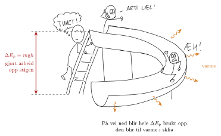
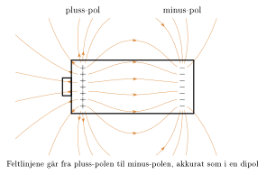
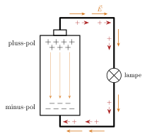

<!-- video: kommer (videoer/fysikk-forkurs/11-02-strom-spenning-og-kretser) -->
{fig-alt="Video kommer"}

::: {.callout-tip title="Til ettertanke"}
Når du slår på lysbryteren, lyser lampa nesten med en gang. Betyr det at elektronene farer gjennom ledningen fra bryteren til lampa på et øyeblikk?
:::

## Elektrisk strøm

Elektrisk strøm er ladning i bevegelse. I en metalledning er det de frie elektronene som beveger seg. Strømmen $I$ forteller hvor mye ladning som passerer et tverrsnitt av ledningen per tid.

::: {.callout-note title="Definisjon: Elektrisk strøm"}
Når ladningen $q$ passerer et tverrsnitt i løpet av tiden $t$, er strømmen
$$
I = \frac{q}{t}
$$
Enheten er ampere, $1\ \mathrm{A} = 1\ \mathrm{C/s}$.
:::

Elektronene i en ledning beveger seg faktisk svært langsomt, typisk under en millimeter per sekund. Men ledningen er full av frie elektroner fra før. Når kretsen sluttes, begynner alle elektronene i hele ledningen å bevege seg nesten samtidig, omtrent som vann i en hageslange som allerede er full. Hver vanndråpe går ikke så fort, men likevel renner vannet umiddelbart ut av den andre enden av slangen når du åpner krana. På samme måte er det altså med elektronene, og derfor lyser lampa med en gang.

::: {.callout-important title="Merk: Strømretning"}
Vi sier at strømmen går fra den positive polen ($+$) på batteriet, gjennom kretsen, og tilbake til den negative polen ($-$). Dette er den *tekniske strømretningen*, og den ble bestemt før man kjente til elektronene. Elektronene beveger seg faktisk motsatt vei, fra $-$ til $+$. I regning bruker vi alltid den tekniske strømretningen.
:::

Strømmen fra et batteri går alltid samme vei. Det kalles **likestrøm**. Strømmen i stikkontakten skifter retning mange ganger i sekundet og kalles **vekselstrøm**. Her ser vi bare på likestrøm.

## Spenning

For at det skal gå strøm, må noe drive ladningene rundt i kretsen. Det er det batteriet gjør, ved å sette opp det vi kaller et *elektrisk felt*. For å forstå hvordan, ser vi først på Dashman på sklia.

{.tikz-fig style="width:620px" fig-alt="Tegning av Dashman på en lekeplass. Dashman er tegnet tre ganger: Han klatrer opp stigen og tenker «TUNGT!», står på toppen av sklia og sier «ARTI LÆL!», og suser ned svingen i sklia mens han roper «ÆH!». En rød dobbeltpil langs stigen er merket ΔE_p = mgh, gjort arbeid opp stigen. Oransje bølgete piler fra sklia er merket varme, og teksten under sier at hele ΔE_p blir til varme i sklia på vei ned."}

Det er tungt å klatre opp stigen. Dashman må gjøre et arbeid mot tyngdekraften, og på toppen har den potensielle energien hans økt med $\Delta E_p = m\mathrm{g}h$. Så sklir han ned. Det er *tyngdefeltet* $\vec{\mathrm{g}}$, som alltid peker nedover, som driver ham fra toppen til bunnen. På vei ned blir den potensielle energien brukt opp: Friksjonen mellom Dashman og sklia gjør den om til varme. Når han er nede, er hele $\Delta E_p$ gitt fra seg.

På samme måte finnes det et elektrisk felt mellom polene på et batteri. Ved pluss-polen er det samlet masse positiv ladning, og ved minus-polen masse negativ ladning. Feltlinjene går fra den ene polen til den andre, akkurat som i dipolen fra forrige delkapittel (figuren til venstre).

::: {layout-ncol=2}
{.tikz-fig style="width:100%" fig-alt="Et stående batteri med pluss-polen øverst og minus-polen nederst. Øverst er det en klynge av plusstegn, nederst en klynge av minustegn. Svake oransje feltlinjer går fra pluss-polen ned til minus-polen, både rett gjennom batteriet og i buer rundt det, som i en dipol."}

{.tikz-fig style="width:100%" fig-alt="Det samme stående batteriet, nå med en ledning fra pluss-polen øverst, bort og ned gjennom en lampe, og tilbake til minus-polen nederst. Oransje piler merket E langs ledningen viser at feltet følger ledningen fra pluss til minus. Små røde plusstegn med piler viser at ladningene beveger seg samme vei gjennom ledningen."}
:::

Pluss-polen er «toppen av sklia», og minus-polen er «bunnen». Ladningene ved pluss-polen har høyere potensiell energi enn ved minus-polen, og forskjellen svarer til $\Delta E_p$ i figuren med Dashman. Det har kostet energi å samle ladningene slik. I batteriet er det kjemiske reaksjoner som har gjort den jobben, slik Dashman gjorde jobben da han klatret opp stigen.

Så lenge polene ikke er koblet sammen, skjer det ingenting. Lufta rundt batteriet er en isolator, så ladningene har ingen vei å gå. Kobler vi polene sammen med en leder, for eksempel en kobberledning gjennom en lampe, ordner ladningene i ledningen seg slik at det elektriske feltet følger ledningen hele veien fra pluss-polen til minus-polen (figuren til høyre). Da «sklir» ladningene gjennom ledningen, fra pluss-polen til minus-polen. Det er dette som er elektrisk strøm. På veien gir ladningene fra seg energien sin til det som er koblet inn i kretsen, for eksempel en brødrister, en lampe eller en mobillader. Når de kommer fram til minus-polen, er all energien brukt opp, akkurat som for Dashman nederst i sklia.

Etter hvert som ladningene har sust gjennom kretsen, blir batteriet utladet. Et oppladbart batteri kan da lades opp igjen. Vi tilfører energi utenfra, og den energien flytter ladningene tilbake til «toppen av sklia», på samme måte som Dashman må gjøre et arbeid for å klatre opp stigen igjen.

Batteriets evne til å drive ladninger gjennom kretsen, kalles **spenning**. Spenningen mellom to punkter er forskjellen i elektrisk *potensial* mellom dem. Elektrisk potensial er egentlig det samme som *potensiell energi per ladning*. Spenningen forteller oss derfor hvor mye energi hver coulomb ladning gir fra seg på veien fra pluss-polen til minus-polen. Vi kaller det altså *spenning* og måler det i *volt* (V). 1 volt betyr at hver coulomb ladning som går gjennom kretsen, gir fra seg 1 joule energi.

{.tikz-fig style="width:640px" fig-alt="Et diagram der potensialet er tegnet oppover og veien gjennom kretsen bortover. Til venstre står batteriet som et tårn med pluss-polen (en knott) øverst og minus-polen nederst, og en rød dobbeltpil viser U = 12 V. En grønn linje går vannrett fra pluss-polen langs ledningen, faller 8 V gjennom en rosa brødrister med brødskiver, går vannrett langs en ny ledning, faller de siste 4 V gjennom en lyspære og går vannrett videre. En grønn stiplet pil går tilbake til minus-polen nederst på batteriet. Oransje bølgete piler viser at energien blir til varme i brødristeren og til lys og varme i lampa."}

::: {.callout-note title="Definisjon: Spenning"}
Spenningen $U$ mellom to punkter er endringen i potensiell energi $\Delta E_p$ per ladning $q$, altså arbeidet $W$ som trengs per ladning for å flytte ladningen fra det ene punktet til det andre:
$$
U = \frac{\Delta E_p}{q} = \frac{W}{q}
$$
Enheten er volt, $1\ \mathrm{V} = 1\ \mathrm{J/C}$.
:::

Et batteri på $9.0\ \mathrm{V}$ gir altså $9.0\ \mathrm{J}$ energi til kretsen for hver coulomb ladning som går fra pluss-polen til minus-polen. Spenningen mellom polene på et batteri kalles **polspenningen**.

::: {.callout-important title="Hvor langt holder sammenligningen med sklia?"}
Sklia er et godt bilde på spenning, men den har begrensninger:

- **Ingen økende fart.** Dashman får mer og mer fart på vei ned. Det gjør ikke ladningene i en ledning. De kolliderer hele tiden med atomene i lederen og kryper av gårde med nesten konstant og svært lav fart. Energien blir til varme og lys (i brødristeren, lampa …), ikke til fart.
- **Alle beveger seg samtidig.** Ladningene sklir ikke én og én. Ledningen er full av ladninger, og alle begynner å bevege seg på en gang, som vannet i hageslangen.
- **Det trengs en lukket vei.** Dashman kan skli ned uansett. Ladningene kan bare bevege seg når det er en sammenhengende vei av ledere fra pluss-polen til minus-polen. Ellers går det ingen strøm, selv om spenningen er der.
- **Det er elektronene som beveger seg.** I en metalledning er det de negative elektronene som beveger seg, og de går motsatt vei, fra minus-polen til pluss-polen. «Positiv ladning som sklir ned fra pluss-polen» er den tekniske strømretningen. Den gir riktige svar når vi regner.
:::

::: {.eksempel}
**Eksempel: Strøm i en ladekabel.** En mobil lades med strømmen $2.0\ \mathrm{A}$ i $30\ \mathrm{min}$, fra en lader med spenningen $5.0\ \mathrm{V}$.

a)  Hvor mye ladning har gått gjennom ladekabelen?

b)  Hvor mange elektroner tilsvarer det?

c)  Hvor mye energi har laderen levert?

::: {.losning}
**a)** Tiden er $t = 30\cdot 60\ \mathrm{s} = 1800\ \mathrm{s}$:
$$
q = I\cdot t = 2.0\ \mathrm{A}\cdot 1800\ \mathrm{s} = \underline{\underline{3.6\cdot 10^{3}\ \mathrm{C}}}
$$

**b)**
$$
N = \frac{q}{\mathrm{e}} = \frac{3.6\cdot 10^{3}\ \mathrm{C}}{1.602\cdot 10^{-19}\ \mathrm{C}} = \underline{\underline{2.2\cdot 10^{22}}}
$$

**c)** Fra definisjonen av spenning er $W = U\cdot q$:
$$
W = 5.0\ \mathrm{V}\cdot 3.6\cdot 10^{3}\ \mathrm{C} = \underline{\underline{1.8\cdot 10^{4}\ \mathrm{J}}}
$$
:::
:::

## Elektriske kretser

Hva er egentlig en elektrisk krets? En elektrisk krets, eller bare en krets, er rett og slett en lukket vei som strømmen kan gå rundt i. Det går bare strøm når kretsen er **lukket**. Er det et brudd et sted, for eksempel en åpen bryter, er kretsen **åpen**, og det går ingen strøm noe sted i den.

{.tikz-fig style="width:560px" fig-alt="To like kretser med et batteri U, en bryter og en lampe. Til venstre er bryteren åpen, og det går ingen strøm. Til høyre er bryteren lukket, og piler merket I viser strømmen ut fra batteriets pluss-pol, gjennom bryteren og lampa og tilbake."}

### Kretsskjema

Når vi tegner en krets, bruker vi et **kretsskjema**: en skjematisk tegning der hver komponent har sitt eget standardsymbol, og ledningene er rette streker. Den lange streken på batterisymbolet er den positive polen.

{.tikz-fig style="width:640px" fig-alt="Kretssymbolene for batteri (en lang og en kort strek, pluss ved den lange), motstand (et rektangel), lyspære (en sirkel med kryss), bryter (en åpen skrå strek), amperemeter (sirkel med A) og voltmeter (sirkel med V)."}

### Måling av strøm og spenning

Et **amperemeter** måler strømmen gjennom en komponent, og et **voltmeter** måler spenningen over den. Amperemeteret kobles i *serie* med komponenten, og voltmeteret i *parallell* over den:

{.tikz-fig style="width:420px" fig-alt="En krets med batteriet U0, et amperemeter A og en lampe i serie. Et voltmeter V er koblet i parallell over lampa. En pil merket I viser strømmen gjennom amperemeteret."}

Hva serie- og parallellkobling betyr, og hvorfor instrumentene må kobles slik, ser vi på i [Serie- og parallellkobling](04-serie-og-parallellkobling.qmd).

::: {.callout-tip title="Til ettertanke"}
Strømmen går nesten uhindret gjennom et godt amperemeter, mens det nesten ikke går strøm gjennom et godt voltmeter. Hvorfor? (Tenk på at måleinstrumentet ikke skal endre kretsen det måler på.)
:::

<!-- tillegg: Claude -->
Programmet regner ut ladning, antall elektroner og energi for en lading. Prøv med dine egne tall fra mobilladeren.

```{.python .kjor}
e = 1.602e-19     # elementærladningen (C)
I = 2.0           # strømmen (A)
t = 30 * 60       # tiden (s)
U = 5.0           # spenningen fra laderen (V)

q = I * t         # ladning som har gått gjennom kabelen
N = q / e         # antall elektroner
W = U * q         # energien laderen har levert

print(f"q = {q:.3g} C,  N = {N:.3g} elektroner,  W = {W:.3g} J")
```

:::: {.oppgaver}

::: {.oppgave tittel="Lading av mobil"}
En mobil lades med strømmen $1.5\ \mathrm{A}$ i $2.0\ \mathrm{h}$. Laderen har spenningen $5.0\ \mathrm{V}$.

a)  Hvor mye ladning har gått gjennom ladekabelen?

b)  Hvor mange elektroner tilsvarer det?

c)  Hvor mye energi har laderen levert?

::: {.losning}
**a)** $t = 2.0\cdot 3600\ \mathrm{s} = 7200\ \mathrm{s}$: $\quad q = It = 1.5\ \mathrm{A}\cdot 7200\ \mathrm{s} = \underline{\underline{1.1\cdot 10^{4}\ \mathrm{C}}}$

**b)** $N = \dfrac{q}{\mathrm{e}} = \dfrac{1.08\cdot 10^{4}\ \mathrm{C}}{1.602\cdot 10^{-19}\ \mathrm{C}} = \underline{\underline{6.7\cdot 10^{22}}}$

**c)** $W = Uq = 5.0\ \mathrm{V}\cdot 1.08\cdot 10^{4}\ \mathrm{C} = \underline{\underline{5.4\cdot 10^{4}\ \mathrm{J}}}$
:::
:::

::: {.oppgave tittel="Strøm og ladning"}
a)  En lommelykt trekker strømmen $0.50\ \mathrm{A}$ i $10\ \mathrm{min}$. Hvor mye ladning har gått gjennom lyspæra?

b)  Hvor mange elektroner tilsvarer det?

c)  En gnist overfører ladningen $1.0\ \mathrm{C}$ på $2.0\ \mathrm{ms}$. Hvor stor er strømmen?

::: {.losning}
**a)** $q = It = 0.50\ \mathrm{A}\cdot 600\ \mathrm{s} = \underline{\underline{3.0\cdot 10^{2}\ \mathrm{C}}}$

**b)** $N = \dfrac{3.0\cdot 10^{2}\ \mathrm{C}}{1.602\cdot 10^{-19}\ \mathrm{C}} = \underline{\underline{1.9\cdot 10^{21}}}$

**c)** $I = \dfrac{q}{t} = \dfrac{1.0\ \mathrm{C}}{2.0\cdot 10^{-3}\ \mathrm{s}} = \underline{\underline{5.0\cdot 10^{2}\ \mathrm{A}}}$. Stor strøm, men bare i et kort øyeblikk.
:::
:::

::: {.oppgave tittel="Måle strøm og spenning" niva="Middels"}
Et batteri er koblet til to lyspærer i serie.

a)  Tegn kretsen med et amperemeter som måler strømmen fra batteriet, og et voltmeter som måler spenningen over den ene lyspæra.

b)  Hvorfor må amperemeteret kobles i serie, mens voltmeteret kobles i parallell?

c)  Strømmen går nesten uhindret gjennom et godt amperemeter, mens det nesten ikke går strøm gjennom et godt voltmeter. Prøv å forklare hvorfor.

::: {.losning}
**a)** Batteriet, amperemeteret og de to pærene ligger etter hverandre i én sløyfe. Voltmeteret kobles med én ledning på hver side av den ene pæra.

**b)** Amperemeteret måler strømmen *gjennom* seg selv, så den strømmen vi vil måle, må gå gjennom det. Voltmeteret måler spenningen *mellom* to punkter, så det må kobles til de to endene av komponenten.

**c)** Måleinstrumentet skal ikke endre kretsen. Amperemeteret ligger i serie, og hvis det var vanskelig for strømmen å komme gjennom det, ville strømmen i hele kretsen blitt mindre. Voltmeteret ligger i parallell, og hvis det slapp mye strøm gjennom seg, ville det «stjålet» strøm fra komponenten det måler over.
:::
:::

::: {.oppgave tittel="Ladning gjennom en lampe"}
<!-- tillegg: Claude -->
Gjennom en lommelyktpære går det en strøm på $0.25\ \mathrm{A}$.

a)  Hvor mye ladning går gjennom pæra på $2.0\ \mathrm{min}$?

b)  Hvor mange elektroner er det?

::: {.losning}
**a)** $\Delta t = 2.0\cdot60\ \mathrm{s} = 120\ \mathrm{s}$:
$$
\Delta Q = I\,\Delta t = 0.25\ \mathrm{A}\cdot120\ \mathrm{s} = \underline{\underline{30\ \mathrm{C}}}
$$

**b)**
$$
N = \frac{\Delta Q}{\mathrm{e}} = \frac{30\ \mathrm{C}}{1.602\cdot10^{-19}\ \mathrm{C}} = \underline{\underline{1.9\cdot10^{20}}}
$$
:::
:::

::: {.oppgave tittel="Bilbatteriet"}
<!-- tillegg: Claude -->
Et bilbatteri har spenningen $12\ \mathrm{V}$, og det står «$60\ \mathrm{Ah}$» (amperetimer) på det. Det betyr at batteriet kan gi strømmen $1\ \mathrm{A}$ i $60\ \mathrm{h}$, eller $2\ \mathrm{A}$ i $30\ \mathrm{h}$, og så videre.

a)  Er amperetime en enhet for strøm, ladning eller energi? Gjør $60\ \mathrm{Ah}$ om til coulomb.

b)  Hvor mye energi kan batteriet levere?

::: {.losning}
**a)** Ampere ganger tid er ladning, $\Delta Q = I\,\Delta t$. Amperetime er altså en enhet for **ladning**:
$$
60\ \mathrm{Ah} = 60\ \mathrm{A}\cdot3600\ \mathrm{s} = 2.16\cdot10^{5}\ \mathrm{C} \approx \underline{\underline{2.2\cdot10^{5}\ \mathrm{C}}}
$$

**b)** Hver coulomb leverer $12\ \mathrm{J}$:
$$
W = qU = 2.16\cdot10^{5}\ \mathrm{C}\cdot12\ \mathrm{V} = 2.59\cdot10^{6}\ \mathrm{J} \approx \underline{\underline{2.6\ \mathrm{MJ}}}
$$
Det er omtrent $0.72\ \mathrm{kWh}$.
:::
:::

::: {.oppgave tittel="Hvor skal måleren stå?"}
<!-- tillegg: Claude -->
Du har en krets med et batteri og en lampe, og vil måle både strømmen gjennom lampa og spenningen over den.

a)  Hvordan kobler du amperemeteret? Hvordan kobler du voltmeteret?

b)  En medelev kobler amperemeteret direkte over batteriet, med en ledning til hver pol. Hva skjer, og hvorfor?

::: {.losning}
**a)** Amperemeteret settes inn **i serie** med lampa: Du åpner kretsen på ett sted og lar strømmen gå gjennom amperemeteret. Voltmeteret kobles **i parallell** over lampa, med én ledning på hver side av den.

**b)** Strømmen går nesten uhindret gjennom amperemeteret. Koblet direkte over batteriet blir det en **kortslutning**: Strømmen blir svært stor, batteriet tappes fort og blir varmt, og sikringen i amperemeteret kan gå (eller instrumentet ødelegges).
:::
:::

::: {.oppgave tittel="Sneglefart" niva="Utfordrende"}
<!-- tillegg: Claude -->
En kobberledning har tverrsnittsarealet $1.0\ \mathrm{mm^2}$ og fører strømmen $1.0\ \mathrm{A}$. Kobber har omtrent $8.5\cdot10^{28}$ frie elektroner per kubikkmeter.

a)  Tenk deg at elektronene beveger seg med farten $v$. Forklar at ladningen som passerer et tverrsnitt i løpet av tiden $\Delta t$, er $\Delta Q = n\,\mathrm{e}\,A\,v\,\Delta t$, der $n$ er antall frie elektroner per volum. Vis at $v = \dfrac{I}{n\,\mathrm{e}\,A}$.

b)  Finn farten til elektronene.

c)  Hvor lang tid bruker et elektron på å bevege seg $1.0\ \mathrm{m}$ langs ledningen?

::: {.losning}
**a)** På tiden $\Delta t$ flytter elektronene seg strekningen $v\,\Delta t$. Alle elektronene i en sylinder med grunnflate $A$ og lengde $v\,\Delta t$ passerer da tverrsnittet. Sylinderen har volumet $A\,v\,\Delta t$ og inneholder $n\,A\,v\,\Delta t$ elektroner, hver med ladning $\mathrm{e}$. Altså er $\Delta Q = n\,\mathrm{e}\,A\,v\,\Delta t$, og
$$
I = \frac{\Delta Q}{\Delta t} = n\,\mathrm{e}\,A\,v \quad\implies\quad v = \frac{I}{n\,\mathrm{e}\,A}
$$

**b)** Med $A = 1.0\ \mathrm{mm^2} = 1.0\cdot10^{-6}\ \mathrm{m^2}$:
$$
v = \frac{1.0\ \mathrm{A}}{8.5\cdot10^{28}\ \mathrm{m^{-3}}\cdot1.602\cdot10^{-19}\ \mathrm{C}\cdot1.0\cdot10^{-6}\ \mathrm{m^2}} = 7.3\cdot10^{-5}\ \mathrm{m/s} = \underline{\underline{0.073\ \mathrm{mm/s}}}
$$

**c)**
$$
t = \frac{1.0\ \mathrm{m}}{7.3\cdot10^{-5}\ \mathrm{m/s}} = 1.4\cdot10^{4}\ \mathrm{s} \approx \underline{\underline{3.8\ \mathrm{h}}}
$$
Elektronene kryper altså saktere enn en snegle. Lampa lyser likevel med en gang, fordi ledningen allerede er full av elektroner som begynner å bevege seg samtidig.
:::
:::

::::
