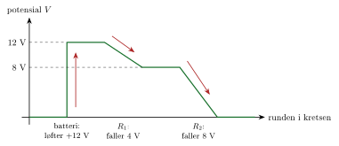

<!-- video: kommer (videoer/fysikk-forkurs/11-02-strom-spenning-og-kretser) -->
{fig-alt="Video kommer"}

::: {.callout-tip title="Til ettertanke"}
Når du slår på lysbryteren, lyser lampa nesten med en gang. Betyr det at elektronene farer gjennom ledningen fra bryteren til lampa på et øyeblikk?
:::

## Elektrisk strøm

Elektrisk strøm er ladning i bevegelse. I en metalledning er det de frie elektronene som beveger seg. Strømmen $I$ forteller hvor mye ladning som passerer et tverrsnitt av ledningen per tid.

::: {.callout-note title="Definisjon: Elektrisk strøm"}
Når ladningen $q$ passerer et tverrsnitt i løpet av tiden $t$, er strømmen
$$
I = \frac{q}{t}
$$
Enheten er ampere, $1\ \mathrm{A} = 1\ \mathrm{C/s}$.
:::

Elektronene i en ledning beveger seg faktisk svært langsomt, typisk under en millimeter per sekund. Men ledningen er full av frie elektroner fra før. Når kretsen sluttes, begynner alle elektronene i hele ledningen å bevege seg nesten samtidig, omtrent som vann i en hageslange som allerede er full. Derfor lyser lampa med en gang.

::: {.callout-important title="Merk: Strømretning"}
Vi sier at strømmen går fra den positive polen ($+$) på batteriet, gjennom kretsen, og tilbake til den negative polen ($-$). Dette er den *tekniske strømretningen*, og den ble bestemt før man kjente til elektronene. Elektronene beveger seg faktisk motsatt vei, fra $-$ til $+$. I regning bruker vi alltid den tekniske strømretningen.
:::

Strømmen fra et batteri går alltid samme vei. Det kalles **likestrøm**. Strømmen i stikkontakten skifter retning mange ganger i sekundet og kalles **vekselstrøm**. Her ser vi bare på likestrøm.

## Spenning

For at det skal gå strøm, må noe drive ladningene rundt i kretsen. Det er det batteriet gjør. Tenk på spenning som et «elektrisk høydekart»: Akkurat som en ball ruller ned fra høyt til lavt i tyngdefeltet, går strømmen fra høyt til lavt elektrisk potensial gjennom kretsen. Batteriet fungerer som en heis som løfter ladningene opp igjen.

{.tikz-fig style="width:520px" fig-alt="Et diagram over potensialet når vi går en runde i en krets med et batteri på 12 V og to motstander. Batteriet løfter potensialet fra 0 til 12 V. Over den første motstanden faller det 4 V, over den andre 8 V, og vi er tilbake på 0."}

::: {.callout-note title="Definisjon: Spenning"}
Spenningen $U$ mellom to punkter er arbeidet $W$ som trengs per ladning $q$ for å flytte ladningen fra det ene punktet til det andre:
$$
U = \frac{W}{q}
$$
Enheten er volt, $1\ \mathrm{V} = 1\ \mathrm{J/C}$.
:::

Et batteri på $9.0\ \mathrm{V}$ gir altså $9.0\ \mathrm{J}$ energi til hver coulomb ladning som går gjennom det. Spenningen mellom polene på et batteri kalles **polspenningen**.

::: {.eksempel}
**Eksempel: Strøm i en ladekabel.** En mobil lades med strømmen $2.0\ \mathrm{A}$ i $30\ \mathrm{min}$, fra en lader med spenningen $5.0\ \mathrm{V}$.

a)  Hvor mye ladning har gått gjennom ladekabelen?

b)  Hvor mange elektroner tilsvarer det?

c)  Hvor mye energi har laderen levert?

::: {.losning}
**a)** Tiden er $t = 30\cdot 60\ \mathrm{s} = 1800\ \mathrm{s}$:
$$
q = I\cdot t = 2.0\ \mathrm{A}\cdot 1800\ \mathrm{s} = \underline{\underline{3.6\cdot 10^{3}\ \mathrm{C}}}
$$

**b)**
$$
N = \frac{q}{\mathrm{e}} = \frac{3.6\cdot 10^{3}\ \mathrm{C}}{1.602\cdot 10^{-19}\ \mathrm{C}} = \underline{\underline{2.2\cdot 10^{22}}}
$$

**c)** Fra definisjonen av spenning er $W = U\cdot q$:
$$
W = 5.0\ \mathrm{V}\cdot 3.6\cdot 10^{3}\ \mathrm{C} = \underline{\underline{1.8\cdot 10^{4}\ \mathrm{J}}}
$$
:::
:::

## Elektriske kretser

En krets er en lukket vei som strømmen kan gå rundt i. Det går bare strøm når kretsen er **lukket**. Er det et brudd et sted, for eksempel en åpen bryter, er kretsen **åpen**, og det går ingen strøm noe sted i den.

{.tikz-fig style="width:560px" fig-alt="To like kretser med et batteri U, en bryter og en lampe. Til venstre er bryteren åpen, og det går ingen strøm. Til høyre er bryteren lukket, og piler merket I viser strømmen ut fra batteriets pluss-pol, gjennom bryteren og lampa og tilbake."}

Kretser tegnes med standardsymboler. Den lange streken på batterisymbolet er den positive polen.

{.tikz-fig style="width:640px" fig-alt="Kretssymbolene for batteri (en lang og en kort strek, pluss ved den lange), motstand (et rektangel), lyspære (en sirkel med kryss), bryter (en åpen skrå strek), amperemeter (sirkel med A) og voltmeter (sirkel med V)."}

Vi måler strøm med et **amperemeter** og spenning med et **voltmeter**:

::: {.kort}
- **Amperemeteret kobles i serie**, slik at strømmen vi vil måle, går gjennom det.
- **Voltmeteret kobles i parallell** over komponenten, slik at det måler spenningen mellom de to endene av den.
:::

{.tikz-fig style="width:420px" fig-alt="En krets med batteriet U0, et amperemeter A og en motstand R i serie. Et voltmeter V er koblet i parallell over motstanden. En pil merket I viser strømmen gjennom amperemeteret."}

::: {.callout-tip title="Til ettertanke"}
Et godt amperemeter har svært liten resistans, mens et godt voltmeter har svært stor resistans. Hvorfor? (Tenk på at måleinstrumentet ikke skal endre kretsen det måler på.)
:::

<!-- tillegg: Claude -->
Programmet regner ut ladning, antall elektroner og energi for en lading. Prøv med dine egne tall fra mobilladeren.

```{.python .kjor}
e = 1.602e-19     # elementærladningen (C)
I = 2.0           # strømmen (A)
t = 30 * 60       # tiden (s)
U = 5.0           # spenningen fra laderen (V)

q = I * t         # ladning som har gått gjennom kabelen
N = q / e         # antall elektroner
W = U * q         # energien laderen har levert

print(f"q = {q:.3g} C,  N = {N:.3g} elektroner,  W = {W:.3g} J")
```

:::: {.oppgaver}

::: {.oppgave tittel="Lading av mobil"}
En mobil lades med strømmen $1.5\ \mathrm{A}$ i $2.0\ \mathrm{h}$. Laderen har spenningen $5.0\ \mathrm{V}$.

a)  Hvor mye ladning har gått gjennom ladekabelen?

b)  Hvor mange elektroner tilsvarer det?

c)  Hvor mye energi har laderen levert?

::: {.losning}
**a)** $t = 2.0\cdot 3600\ \mathrm{s} = 7200\ \mathrm{s}$: $\quad q = It = 1.5\ \mathrm{A}\cdot 7200\ \mathrm{s} = \underline{\underline{1.1\cdot 10^{4}\ \mathrm{C}}}$

**b)** $N = \dfrac{q}{\mathrm{e}} = \dfrac{1.08\cdot 10^{4}\ \mathrm{C}}{1.602\cdot 10^{-19}\ \mathrm{C}} = \underline{\underline{6.7\cdot 10^{22}}}$

**c)** $W = Uq = 5.0\ \mathrm{V}\cdot 1.08\cdot 10^{4}\ \mathrm{C} = \underline{\underline{5.4\cdot 10^{4}\ \mathrm{J}}}$
:::
:::

::: {.oppgave tittel="Strøm og ladning"}
a)  En lommelykt trekker strømmen $0.50\ \mathrm{A}$ i $10\ \mathrm{min}$. Hvor mye ladning har gått gjennom lyspæra?

b)  Hvor mange elektroner tilsvarer det?

c)  En gnist overfører ladningen $1.0\ \mathrm{C}$ på $2.0\ \mathrm{ms}$. Hvor stor er strømmen?

::: {.losning}
**a)** $q = It = 0.50\ \mathrm{A}\cdot 600\ \mathrm{s} = \underline{\underline{3.0\cdot 10^{2}\ \mathrm{C}}}$

**b)** $N = \dfrac{3.0\cdot 10^{2}\ \mathrm{C}}{1.602\cdot 10^{-19}\ \mathrm{C}} = \underline{\underline{1.9\cdot 10^{21}}}$

**c)** $I = \dfrac{q}{t} = \dfrac{1.0\ \mathrm{C}}{2.0\cdot 10^{-3}\ \mathrm{s}} = \underline{\underline{5.0\cdot 10^{2}\ \mathrm{A}}}$. Stor strøm, men bare i et kort øyeblikk.
:::
:::

::: {.oppgave tittel="Måle strøm og spenning" niva="Middels"}
Et batteri er koblet til to lyspærer i serie.

a)  Tegn kretsen med et amperemeter som måler strømmen fra batteriet, og et voltmeter som måler spenningen over den ene lyspæra.

b)  Hvorfor må amperemeteret kobles i serie, mens voltmeteret kobles i parallell?

c)  Et godt amperemeter har svært liten resistans, mens et godt voltmeter har svært stor resistans. Prøv å forklare hvorfor.

::: {.losning}
**a)** Batteriet, amperemeteret og de to pærene ligger etter hverandre i én sløyfe. Voltmeteret kobles med én ledning på hver side av den ene pæra.

**b)** Amperemeteret måler strømmen *gjennom* seg selv, så den strømmen vi vil måle, må gå gjennom det. Voltmeteret måler spenningen *mellom* to punkter, så det må kobles til de to endene av komponenten.

**c)** Måleinstrumentet skal ikke endre kretsen. Amperemeteret ligger i serie, og stor resistans der ville gjort strømmen mindre. Voltmeteret ligger i parallell, og liten resistans der ville «stjålet» strøm fra komponenten det måler over.
:::
:::

::: {.oppgave tittel="Ladning gjennom en lampe"}
<!-- tillegg: Claude -->
Gjennom en lommelyktpære går det en strøm på $0.25\ \mathrm{A}$.

a)  Hvor mye ladning går gjennom pæra på $2.0\ \mathrm{min}$?

b)  Hvor mange elektroner er det?

::: {.losning}
**a)** $\Delta t = 2.0\cdot60\ \mathrm{s} = 120\ \mathrm{s}$:
$$
\Delta Q = I\,\Delta t = 0.25\ \mathrm{A}\cdot120\ \mathrm{s} = \underline{\underline{30\ \mathrm{C}}}
$$

**b)**
$$
N = \frac{\Delta Q}{\mathrm{e}} = \frac{30\ \mathrm{C}}{1.602\cdot10^{-19}\ \mathrm{C}} = \underline{\underline{1.9\cdot10^{20}}}
$$
:::
:::

::: {.oppgave tittel="Bilbatteriet"}
<!-- tillegg: Claude -->
Et bilbatteri har spenningen $12\ \mathrm{V}$, og det står «$60\ \mathrm{Ah}$» (amperetimer) på det. Det betyr at batteriet kan gi strømmen $1\ \mathrm{A}$ i $60\ \mathrm{h}$, eller $2\ \mathrm{A}$ i $30\ \mathrm{h}$, og så videre.

a)  Er amperetime en enhet for strøm, ladning eller energi? Gjør $60\ \mathrm{Ah}$ om til coulomb.

b)  Hvor mye energi kan batteriet levere?

::: {.losning}
**a)** Ampere ganger tid er ladning, $\Delta Q = I\,\Delta t$. Amperetime er altså en enhet for **ladning**:
$$
60\ \mathrm{Ah} = 60\ \mathrm{A}\cdot3600\ \mathrm{s} = 2.16\cdot10^{5}\ \mathrm{C} \approx \underline{\underline{2.2\cdot10^{5}\ \mathrm{C}}}
$$

**b)** Hver coulomb leverer $12\ \mathrm{J}$:
$$
W = qU = 2.16\cdot10^{5}\ \mathrm{C}\cdot12\ \mathrm{V} = 2.59\cdot10^{6}\ \mathrm{J} \approx \underline{\underline{2.6\ \mathrm{MJ}}}
$$
Det er omtrent $0.72\ \mathrm{kWh}$.
:::
:::

::: {.oppgave tittel="Hvor skal måleren stå?"}
<!-- tillegg: Claude -->
Du har en krets med et batteri og en lampe, og vil måle både strømmen gjennom lampa og spenningen over den.

a)  Hvordan kobler du amperemeteret? Hvordan kobler du voltmeteret?

b)  En medelev kobler amperemeteret direkte over batteriet, med en ledning til hver pol. Hva skjer, og hvorfor?

::: {.losning}
**a)** Amperemeteret settes inn **i serie** med lampa: Du åpner kretsen på ett sted og lar strømmen gå gjennom amperemeteret. Voltmeteret kobles **i parallell** over lampa, med én ledning på hver side av den.

**b)** Amperemeteret har nesten ingen motstand. Koblet direkte over batteriet blir det en **kortslutning**: Strømmen blir svært stor, batteriet tappes fort og blir varmt, og sikringen i amperemeteret kan gå (eller instrumentet ødelegges).
:::
:::

::: {.oppgave tittel="Sneglefart" niva="Utfordrende"}
<!-- tillegg: Claude -->
En kobberledning har tverrsnittsarealet $1.0\ \mathrm{mm^2}$ og fører strømmen $1.0\ \mathrm{A}$. Kobber har omtrent $8.5\cdot10^{28}$ frie elektroner per kubikkmeter.

a)  Tenk deg at elektronene beveger seg med farten $v$. Forklar at ladningen som passerer et tverrsnitt i løpet av tiden $\Delta t$, er $\Delta Q = n\,\mathrm{e}\,A\,v\,\Delta t$, der $n$ er antall frie elektroner per volum. Vis at $v = \dfrac{I}{n\,\mathrm{e}\,A}$.

b)  Finn farten til elektronene.

c)  Hvor lang tid bruker et elektron på å bevege seg $1.0\ \mathrm{m}$ langs ledningen?

::: {.losning}
**a)** På tiden $\Delta t$ flytter elektronene seg strekningen $v\,\Delta t$. Alle elektronene i en sylinder med grunnflate $A$ og lengde $v\,\Delta t$ passerer da tverrsnittet. Sylinderen har volumet $A\,v\,\Delta t$ og inneholder $n\,A\,v\,\Delta t$ elektroner, hver med ladning $\mathrm{e}$. Altså er $\Delta Q = n\,\mathrm{e}\,A\,v\,\Delta t$, og
$$
I = \frac{\Delta Q}{\Delta t} = n\,\mathrm{e}\,A\,v \quad\implies\quad v = \frac{I}{n\,\mathrm{e}\,A}
$$

**b)** Med $A = 1.0\ \mathrm{mm^2} = 1.0\cdot10^{-6}\ \mathrm{m^2}$:
$$
v = \frac{1.0\ \mathrm{A}}{8.5\cdot10^{28}\ \mathrm{m^{-3}}\cdot1.602\cdot10^{-19}\ \mathrm{C}\cdot1.0\cdot10^{-6}\ \mathrm{m^2}} = 7.3\cdot10^{-5}\ \mathrm{m/s} = \underline{\underline{0.073\ \mathrm{mm/s}}}
$$

**c)**
$$
t = \frac{1.0\ \mathrm{m}}{7.3\cdot10^{-5}\ \mathrm{m/s}} = 1.4\cdot10^{4}\ \mathrm{s} \approx \underline{\underline{3.8\ \mathrm{h}}}
$$
Elektronene kryper altså saktere enn en snegle. Lampa lyser likevel med en gang, fordi ledningen allerede er full av elektroner som begynner å bevege seg samtidig.
:::
:::

::::
