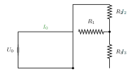

::: {.callout-warning title="Under arbeid"}

Denne siden skrives fortsatt.

:::

:::: {.oppgaver}

Kirchoff’s lover brukes til å regne ut strøm eller spenning i en elektrisk krets.

## Kirchoff’s første lov

Denne loven er også omtalt som *Kirchoff’s strømlov*. Denne loven går ut på at strømmen som går inn, eller ut av en node/knytepunkt til sammen blir 0. $$\sum{I}=I_1+I_2+...+I_n=0$$

## Kirchoff’s andre lov

Denne loven er også omtalt som *Kirchoff’s spenningslov*.

$$\sum{U}=U_1+U_2+...+U_n=0$$

## Fysisk tolkning

**Kirchhoffs 1. lov** (strømloven) følger av at ladning er bevart: ingen ladning kan «forsvinne» i et forgreningspunkt, så all strøm inn må ut igjen.

**Kirchhoffs 2. lov** (spenningsloven) følger av energibevaring: i en lukket sløyfe må summen av alle spenningsfall (over motstander) være lik summen av alle spenningsstigninger (fra kilder). Tilsvarende: vandrer du i en ring tilbake til startpunktet, er nettohøydeforskjellen null.

::: {.eksempel}

[Eksempel: Krets med Kirchhoffs lover]{.eks-tittel}
En krets har en spenningskilde $U_0 = 24\,\mathrm{V}$. Motstand $R_1 = 3.0\,\mathrm{\Omega}$ er i serie med en parallellkobling av $R_2 = 6.0\,\mathrm{\Omega}$ og $R_3 = 12\,\mathrm{\Omega}$.

::: center

{.tikz-fig style="width:366px"}

:::

::: {.losning}

**Steg 1 — Totalmotstand:**

Parallellkoblingen: $\frac{1}{R_p} = \frac{1}{6} + \frac{1}{12} = \frac{3}{12}$, så $R_p = 4.0\,\mathrm{\Omega}$.

Totalmotstanden: $R_{\text{tot}} = R_1 + R_p = 3.0\,\mathrm{\Omega} + 4.0\,\mathrm{\Omega} = 7.0\,\mathrm{\Omega}$.

**Steg 2 — Totalstrøm (Kirchhoffs 2. lov + Ohms lov):** $$U_0 = R_{\text{tot}}\,I_0 \implies I_0 = \frac{U_0}{R_{\text{tot}}} = \frac{24\,\mathrm{V}}{7.0\,\mathrm{\Omega}}
  = 3.43\,\mathrm{A} \approx \underline{\underline{3.4\,\mathrm{A}}}$$

**Steg 3 — Spenning over parallellkoblingen:** $$U_p = R_p\,I_0 = 4.0\,\mathrm{\Omega}\cdot3.43\,\mathrm{A} \approx 13.7\,\mathrm{V}$$

**Steg 4 — Strøm i grenene (Kirchhoffs 1. lov):** $$I_2 = \frac{U_p}{R_2} = \frac{13.7\,\mathrm{V}}{6.0\,\mathrm{\Omega}} \approx \underline{\underline{2.3\,\mathrm{A}}}, \qquad
  I_3 = \frac{U_p}{R_3} = \frac{13.7\,\mathrm{V}}{12\,\mathrm{\Omega}} \approx \underline{\underline{1.1\,\mathrm{A}}}$$ Sjekk K1: $I_2 + I_3 \approx 2.3\,\mathrm{A} + 1.1\,\mathrm{A} = 3.4\,\mathrm{A} = I_0$

:::

:::

::::

