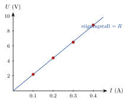

<!-- video: kommer (videoer/fysikk-forkurs/11-03-resistans-og-ohms-lov) -->
{fig-alt="Video kommer"}

::: {.callout-tip title="Til ettertanke"}
Hvorfor blir ledningen til en vannkoker nesten ikke varm, mens glødetråden i en gammeldags lyspære blir så varm at den lyser?
:::

Når elektronene beveger seg gjennom et stoff, kolliderer de med atomene. Stoffet hindrer altså strømmen litt. Dette kalles **resistans** eller motstand, $R$. En komponent som er laget for å ha en bestemt resistans, kalles også en *motstand*. Jo større resistans, desto større spenning trengs for å drive en bestemt strøm gjennom komponenten. I kollisjonene gir elektronene energi til atomene, og komponenten blir varm.

For mange materialer, særlig metaller ved konstant temperatur, er strømmen proporsjonal med spenningen. Det er Ohms lov:

::: {.callout-note title="Definisjon: Ohms lov"}
$$
U = R\cdot I
$$
der $U$ er spenningen over komponenten, $I$ er strømmen gjennom den og $R$ er resistansen. Enheten for resistans er ohm, $1\ \mathrm{\Omega} = 1\ \mathrm{V/A}$.
:::

Ohms lov kan skrives på tre måter, avhengig av hva vi skal finne:
$$
U = RI, \qquad I = \frac{U}{R}, \qquad R = \frac{U}{I}
$$
Formen $I = U/R$ viser at strømmen blir mindre jo større resistansen er.

<!-- tillegg: Claude -->
Plotter vi spenningen mot strømmen for en motstand som følger Ohms lov, får vi en rett linje gjennom origo. Stigningstallet er resistansen. Punktene under er målingene fra oppgaven «Måleserie for en motstand» lenger ned.

{.tikz-fig style="width:420px" fig-alt="Et U–I-diagram med fire målepunkter som ligger på en rett linje gjennom origo, fra 0.1 A og 2.2 V til 0.4 A og 8.8 V. Stigningstallet til linja er resistansen R."}

::: {.eksempel}
**Eksempel: Strøm gjennom en motstand.** En motstand på $47\ \mathrm{\Omega}$ kobles til et batteri på $9.0\ \mathrm{V}$. Hvor stor blir strømmen?

::: {.losning}
$$
I = \frac{U}{R} = \frac{9.0\ \mathrm{V}}{47\ \mathrm{\Omega}} = 0.191\ \mathrm{A} \approx \underline{\underline{0.19\ \mathrm{A}}}
$$
:::
:::

::: {.eksempel}
**Eksempel: Resistansen i en lyspære.** En lyspære kobles til $230\ \mathrm{V}$, og et amperemeter viser at strømmen er $0.26\ \mathrm{A}$. Hva er resistansen i lyspæra?

::: {.losning}
$$
R = \frac{U}{I} = \frac{230\ \mathrm{V}}{0.26\ \mathrm{A}} = 885\ \mathrm{\Omega} \approx \underline{\underline{8.8\cdot 10^{2}\ \mathrm{\Omega}}}
$$
:::
:::

::: {.callout-important title="Merk: Kortslutning"}
Kobler vi polene på et batteri sammen med bare en ledning, er resistansen nesten null. Etter Ohms lov, $I = U/R$, blir strømmen da svært stor. Ledningen og batteriet kan bli så varme at det begynner å brenne. Dette kalles **kortslutning**, og det er derfor vi har sikringer.
:::

<!-- tillegg: Claude -->
Programmet finner resistansen fra en måleserie ved å tilpasse en rett linje gjennom origo. Bytt ut målingene med dine egne.

```{.python .kjor}
import numpy as np
import matplotlib.pyplot as plt

I = np.array([0.10, 0.20, 0.30, 0.40])   # strøm (A)
U = np.array([2.2, 4.4, 6.5, 8.8])       # spenning (V)

R = (I @ U) / (I @ I)          # beste rette linje U = R*I gjennom origo
print(f"R = {R:.1f} ohm")

plt.plot(I, U, 'o', label='målinger')
plt.plot([0, 0.45], [0, R*0.45], label=f'U = {R:.1f} ohm · I')
plt.xlabel('I (A)'); plt.ylabel('U (V)'); plt.legend(); plt.grid(True)
plt.show()
```

:::: {.oppgaver}

::: {.oppgave tittel="Ohms lov i tre varianter"}
Bruk Ohms lov.

a)  En strøm på $0.050\ \mathrm{A}$ går gjennom en motstand på $220\ \mathrm{\Omega}$. Hva er spenningen over motstanden?

b)  En motstand på $4.0\ \mathrm{\Omega}$ kobles til et batteri på $12\ \mathrm{V}$. Hvor stor blir strømmen?

c)  Et batteri på $1.5\ \mathrm{V}$ gir strømmen $0.30\ \mathrm{A}$ gjennom en liten lyspære. Hva er resistansen i lyspæra?

::: {.losning}
**a)** $U = RI = 220\ \mathrm{\Omega}\cdot 0.050\ \mathrm{A} = \underline{\underline{11\ \mathrm{V}}}$

**b)** $I = \dfrac{U}{R} = \dfrac{12\ \mathrm{V}}{4.0\ \mathrm{\Omega}} = \underline{\underline{3.0\ \mathrm{A}}}$

**c)** $R = \dfrac{U}{I} = \dfrac{1.5\ \mathrm{V}}{0.30\ \mathrm{A}} = \underline{\underline{5.0\ \mathrm{\Omega}}}$
:::
:::

::: {.oppgave tittel="Ohms lov på batteri og lyspære"}
a)  En motstand på $33\ \mathrm{\Omega}$ kobles til et batteri på $12\ \mathrm{V}$. Hvor stor blir strømmen?

b)  En lyspære kobles til $230\ \mathrm{V}$, og strømmen er $0.43\ \mathrm{A}$. Hva er resistansen i pæra?

::: {.losning}
**a)** $I = \dfrac{12\ \mathrm{V}}{33\ \mathrm{\Omega}} = 0.364\ \mathrm{A} \approx \underline{\underline{0.36\ \mathrm{A}}}$

**b)** $R = \dfrac{230\ \mathrm{V}}{0.43\ \mathrm{A}} = 535\ \mathrm{\Omega} \approx \underline{\underline{5.3\cdot 10^{2}\ \mathrm{\Omega}}}$
:::
:::

::: {.oppgave tittel="Måleserie for en motstand" niva="Middels"}
En elev måler strøm og spenning for en motstand og får disse verdiene:

| $I$ / A | $0.10$ | $0.20$ | $0.30$ | $0.40$ |
|---|---|---|---|---|
| $U$ / V | $2.2$ | $4.4$ | $6.5$ | $8.8$ |

a)  Følger motstanden Ohms lov? Begrunn svaret.

b)  Finn resistansen.

c)  Hvilken spenning trengs for å få strømmen $0.25\ \mathrm{A}$?

::: {.losning}
**a)** Forholdet $U/I$ er $22$, $22$, $21.7$ og $22\ \mathrm{\Omega}$, altså nesten konstant. Punktene ligger på en rett linje gjennom origo, så motstanden **følger Ohms lov** (innenfor måleusikkerheten).

**b)** $R \approx \underline{\underline{22\ \mathrm{\Omega}}}$ (stigningstallet til linja).

**c)** $U = RI = 22\ \mathrm{\Omega}\cdot 0.25\ \mathrm{A} = \underline{\underline{5.5\ \mathrm{V}}}$
:::
:::

::: {.oppgave tittel="Vannkoker og glødetråd" niva="Middels"}
<!-- tillegg: Claude -->
Svar på spørsmålet i «Til ettertanke» øverst på siden: Hvorfor blir glødetråden i lyspæra glovarm, mens ledningen fram til den nesten ikke blir varm? Den samme strømmen går jo gjennom begge.

::: {.losning}
Glødetråden har mye større resistans enn ledningen. Elektronene kolliderer mye oftere med atomene i glødetråden og gir fra seg energi der. Med samme strøm blir spenningsfallet $U = RI$, og dermed energien som blir til varme per ladning, mye større i glødetråden enn i ledningen.
:::
:::

::::
