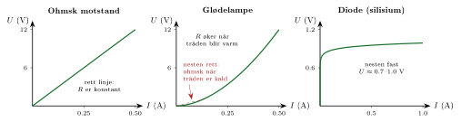
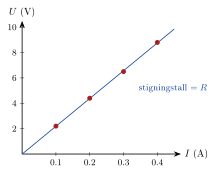

<!-- video: kommer (videoer/fysikk-forkurs/11-03-resistans-og-ohms-lov) -->
{fig-alt="Video kommer"}

::: {.callout-tip title="Til ettertanke"}
Hvorfor blir ledningen til en vannkoker nesten ikke varm, mens glødetråden i en gammeldags lyspære blir så varm at den lyser?
:::

Når elektronene beveger seg gjennom et stoff, kolliderer de med atomene. Stoffet hindrer altså strømmen litt. Dette kalles **resistans** eller motstand, $R$. En komponent som er laget for å ha en bestemt resistans, kalles også en *motstand*. Jo større resistans, desto større spenning trengs for å drive en bestemt strøm gjennom komponenten. I kollisjonene gir elektronene energi til atomene, og komponenten blir varm.

## Ohmske og ikke-ohmske komponenter

Måler vi spenningen $U$ over en komponent og strømmen $I$ gjennom den for mange forskjellige spenninger, kan vi tegne en $U$–$I$-kurve. Resistansen i hvert punkt på kurven er $R = U/I$. Figuren viser tre typiske kurver.

{.tikz-fig style="width:100%" fig-alt="Tre grafer side om side med strømmen I bortover og spenningen U oppover. Ohmsk motstand: en rett linje gjennom origo opp til 12 V ved 0.50 A. Glødelampe: kurven er nesten flat og rett nær origo, der tråden er kald, og blir så brattere og brattere opp til 12 V ved 0.50 A. Diode: spenningen stiger bratt til rundt 0.7 V og flater så ut, slik at den holder seg mellom 0.7 og 1.0 V mens strømmen øker til 1.0 A."}

::: {.kort}
- **Ohmsk motstand.** Kurven er en rett linje gjennom origo. Resistansen er den samme uansett strøm.
- **Glødelampe.** Når strømmen øker, blir wolframtråden varmere. Atomene vibrerer mer, elektronene kolliderer oftere, og resistansen øker. For en vanlig pære er resistansen omtrent ti ganger så stor når tråden gløder, som når den er kald. Ved små strømmer, mens tråden ennå er kald, er kurven nesten rett. Der er lampa tilnærmet ohmsk.
- **Diode.** Det går nesten ingen strøm før spenningen er kommet opp i rundt $0.6$–$0.7\ \mathrm{V}$. Etter det øker strømmen svært raskt, mens spenningen nesten står stille. Snur vi dioden, går det nesten ingen strøm i det hele tatt. En diode er langt fra ohmsk.
:::

Også en vanlig motstand er bare ohmsk innenfor et visst område. Går det for stor strøm gjennom den, blir den varm, og resistansen endrer seg, eller den brenner opp.

Vi gjør derfor en tilnærming: Videre ser vi bare på komponenter som er i en *ohmsk tilstand*, der resistansen er konstant. Da er strømmen proporsjonal med spenningen, og det er det Ohms lov sier:

::: {.callout-note title="Definisjon: Ohms lov"}
$$
U = R\cdot I
$$
der $U$ er spenningen over komponenten, $I$ er strømmen gjennom den og $R$ er resistansen. Enheten for resistans er ohm, $1\ \mathrm{\Omega} = 1\ \mathrm{V/A}$.
:::

Ohms lov kan skrives på tre måter, avhengig av hva vi skal finne:
$$
U = RI, \qquad I = \frac{U}{R}, \qquad R = \frac{U}{I}
$$
Formen $I = U/R$ viser at strømmen blir mindre jo større resistansen er.

<!-- tillegg: Claude -->
Plotter vi spenningen mot strømmen for en motstand som følger Ohms lov, får vi en rett linje gjennom origo. Stigningstallet er resistansen. Punktene under er målingene fra oppgaven «Måleserie for en motstand» lenger ned.

{.tikz-fig style="width:420px" fig-alt="Et U–I-diagram med fire målepunkter som ligger på en rett linje gjennom origo, fra 0.1 A og 2.2 V til 0.4 A og 8.8 V. Stigningstallet til linja er resistansen R."}

::: {.eksempel}
**Eksempel: Strøm gjennom en motstand.** En motstand på $47\ \mathrm{\Omega}$ kobles til et batteri på $9.0\ \mathrm{V}$. Hvor stor blir strømmen?

::: {.losning}
$$
I = \frac{U}{R} = \frac{9.0\ \mathrm{V}}{47\ \mathrm{\Omega}} = 0.191\ \mathrm{A} \approx \underline{\underline{0.19\ \mathrm{A}}}
$$
:::
:::

::: {.eksempel}
**Eksempel: Resistansen i en lyspære.** En lyspære kobles til $230\ \mathrm{V}$, og et amperemeter viser at strømmen er $0.26\ \mathrm{A}$. Hva er resistansen i lyspæra?

::: {.losning}
$$
R = \frac{U}{I} = \frac{230\ \mathrm{V}}{0.26\ \mathrm{A}} = 885\ \mathrm{\Omega} \approx \underline{\underline{8.8\cdot 10^{2}\ \mathrm{\Omega}}}
$$
:::
:::

## Prøv selv: strøm, spenning og resistans

Kretsen under har et batteri med spenning du kan justere, og en regulerbar motstand. Amperemeteret viser strømmen, og voltmeteret viser spenningen over motstanden. Prikkene er ladningene i ledningen. Se hva som skjer med strømmen når du øker spenningen, og når du øker resistansen. Hva skjer hvis du skrur spenningen helt opp og resistansen helt ned?

```{=html}
<div class="ohm-sim" id="ohm-sim">
<style>
.ohm-sim{max-width:680px;margin:1.2rem auto;padding:.8rem 1rem;border:1px solid rgba(160,170,175,.45);border-radius:12px;color:inherit}
.ohm-sim svg{width:100%;height:auto;display:block}
.ohm-sim .rad{display:flex;flex-wrap:wrap;gap:.6rem 1.4rem;align-items:center;margin:.5rem 0}
.ohm-sim label{display:flex;align-items:center;gap:.5rem;font-size:.95rem}
.ohm-sim input[type=range]{width:180px;accent-color:#e39d63}
.ohm-sim .tall{font-variant-numeric:tabular-nums;min-width:4.5em;display:inline-block}
.ohm-sim .varsel{color:#ff8a3d;font-weight:600;min-height:1.4em}
.ohm-sim button{font:inherit;font-size:.9rem;padding:.25rem .7rem;border-radius:8px;border:1px solid currentColor;background:transparent;color:inherit;cursor:pointer}
@keyframes ohm-puls{0%,100%{opacity:.75}50%{opacity:1}}
.ohm-sim .puls{animation:ohm-puls .6s infinite}
</style>
<svg viewBox="0 0 640 360" role="img" aria-label="En krets med et batteri, et amperemeter og en regulerbar motstand. Et voltmeter er koblet over motstanden. Prikker viser ladningene som strømmer rundt i kretsen.">
  <defs>
    <filter id="ohm-glod" x="-80%" y="-40%" width="260%" height="180%"><feGaussianBlur stdDeviation="9"/></filter>
  </defs>
  <!-- hovedsløyfa -->
  <path id="ohm-lop" d="M 90 175 L 90 60 L 500 60 L 500 300 L 90 300 Z" fill="none" stroke="currentColor" stroke-width="3" stroke-linejoin="round"/>
  <!-- voltmeteret i parallell over motstanden -->
  <path d="M 500 105 L 590 105 L 590 255 L 500 255" fill="none" stroke="currentColor" stroke-width="2"/>
  <circle cx="500" cy="105" r="4" fill="currentColor"/><circle cx="500" cy="255" r="4" fill="currentColor"/>
  <!-- batteriet -->
  <rect x="70" y="160" width="40" height="34" fill="var(--bs-body-bg, #24272a)" stroke="none"/>
  <line x1="66" y1="166" x2="114" y2="166" stroke="currentColor" stroke-width="3"/>
  <line x1="78" y1="186" x2="102" y2="186" stroke="currentColor" stroke-width="6"/>
  <text x="120" y="171" font-size="18" fill="currentColor">+</text>
  <text x="120" y="195" font-size="18" fill="currentColor">−</text>
  <text x="58" y="182" font-size="15" fill="currentColor" text-anchor="end">batteri</text>
  <!-- glød og motstand -->
  <rect id="ohm-halo" x="482" y="125" width="36" height="110" rx="8" fill="#ff7a1a" opacity="0" filter="url(#ohm-glod)"/>
  <rect x="486" y="125" width="28" height="110" rx="3" fill="var(--bs-body-bg, #24272a)" stroke="none"/>
  <rect id="ohm-mot" x="486" y="125" width="28" height="110" rx="3" fill="none" stroke="currentColor" stroke-width="2.5"/>
  <polygon id="ohm-glider" points="0,0 -16,-8 -16,8" fill="#e39d63"/>
  <text x="420" y="250" font-size="15" fill="currentColor" text-anchor="end">regulerbar</text>
  <text x="420" y="268" font-size="15" fill="currentColor" text-anchor="end">motstand R</text>
  <!-- ladningene -->
  <g id="ohm-ladninger"></g>
  <!-- amperemeter -->
  <circle cx="295" cy="60" r="24" fill="var(--bs-body-bg, #24272a)" stroke="currentColor" stroke-width="2.5"/>
  <text x="295" y="67" font-size="20" text-anchor="middle" fill="currentColor">A</text>
  <rect x="245" y="4" width="100" height="28" rx="5" fill="#111" stroke="currentColor"/>
  <text id="ohm-a" x="295" y="25" font-size="18" text-anchor="middle" fill="#7be35f" font-family="monospace">0.00 A</text>
  <!-- voltmeter -->
  <circle cx="590" cy="180" r="24" fill="var(--bs-body-bg, #24272a)" stroke="currentColor" stroke-width="2.5"/>
  <text x="590" y="187" font-size="20" text-anchor="middle" fill="currentColor">V</text>
  <rect x="540" y="300" width="100" height="28" rx="5" fill="#111" stroke="currentColor"/>
  <text id="ohm-v" x="590" y="321" font-size="18" text-anchor="middle" fill="#7be35f" font-family="monospace">0.0 V</text>
  <line x1="590" y1="204" x2="590" y2="298" stroke="currentColor" stroke-width="1" stroke-dasharray="3 3"/>
</svg>
<div class="rad">
  <label>Spenning <input type="range" id="ohm-u" min="0" max="12" step="0.5" value="6"> <span class="tall" id="ohm-ut">6.0 V</span></label>
  <label>Resistans <input type="range" id="ohm-r" min="2" max="60" step="1" value="30"> <span class="tall" id="ohm-rt">30 Ω</span></label>
</div>
<div class="rad">
  <span>Effekt i motstanden: <span class="tall" id="ohm-p">1.2 W</span></span>
  <button type="button" id="ohm-bytt">Vis elektronene</button>
</div>
<div class="varsel" id="ohm-varsel" aria-live="polite"></div>
<script>
(function () {
  var rot = document.getElementById('ohm-sim'); if (!rot || rot.dataset.klar) return; rot.dataset.klar = '1';
  var lop = document.getElementById('ohm-lop'), L = lop.getTotalLength();
  var g = document.getElementById('ohm-ladninger'), NS = 'http://www.w3.org/2000/svg';
  var uIn = document.getElementById('ohm-u'), rIn = document.getElementById('ohm-r');
  var N = 34, prikker = [], s = 0, elektroner = false, sist = null;
  for (var i = 0; i < N; i++) {
    var c = document.createElementNS(NS, 'g');
    c.innerHTML = '<circle r="7"></circle><text text-anchor="middle" y="4.5" font-size="12" font-weight="700" fill="#fff"></text>';
    g.appendChild(c); prikker.push(c);
  }
  function farge() {
    prikker.forEach(function (c) {
      c.firstChild.setAttribute('fill', elektroner ? '#3f7fe0' : '#d9443a');
      c.lastChild.textContent = elektroner ? '−' : '+';
    });
    document.getElementById('ohm-bytt').textContent = elektroner ? 'Vis teknisk strømretning (+)' : 'Vis elektronene (−)';
  }
  function verdier() { var U = +uIn.value, R = +rIn.value, I = U / R; return { U: U, R: R, I: I, P: U * I }; }
  function oppdater() {
    var v = verdier();
    document.getElementById('ohm-ut').textContent = v.U.toFixed(1) + ' V';
    document.getElementById('ohm-rt').textContent = v.R + ' Ω';
    document.getElementById('ohm-a').textContent = v.I.toFixed(2) + ' A';
    document.getElementById('ohm-v').textContent = v.U.toFixed(1) + ' V';
    document.getElementById('ohm-p').textContent = (v.P < 10 ? v.P.toFixed(1) : v.P.toFixed(0)) + ' W';
    // glideren: lang motstandstråd = stor R
    var y = 125 + 110 * (v.R - 2) / 58;
    document.getElementById('ohm-glider').setAttribute('transform', 'translate(484,' + y.toFixed(1) + ')');
    // gløding: fra 5 W begynner motstanden å gløde, fra 20 W er den for varm
    var x = Math.max(0, Math.min(1, (v.P - 5) / 20));
    var halo = document.getElementById('ohm-halo'), mot = document.getElementById('ohm-mot');
    halo.setAttribute('opacity', (x * 0.95).toFixed(2));
    var rr = Math.round(120 + 135 * x), gg = Math.round(40 + 180 * Math.max(0, x - 0.4) / 0.6), bb = Math.round(20 + 120 * Math.max(0, x - 0.8) / 0.2);
    mot.setAttribute('fill', x > 0 ? 'rgb(' + rr + ',' + gg + ',' + bb + ')' : 'none');
    mot.setAttribute('fill-opacity', (0.25 + 0.75 * x).toFixed(2));
    halo.classList.toggle('puls', v.P > 25);
    document.getElementById('ohm-varsel').textContent = v.P > 25 ? 'Motstanden gløder – den er altfor varm! Skru ned spenningen eller øk resistansen.' :
      v.P > 5 ? 'Motstanden begynner å bli varm.' : '';
  }
  function tegn(t) {
    var v = verdier();
    if (sist !== null) s += 60 * v.I * Math.min(0.05, (t - sist) / 1000);   // fart ∝ strøm
    sist = t;
    for (var i = 0; i < N; i++) {
      var d = ((i / N) * L + (elektroner ? -s : s)) % L; if (d < 0) d += L;
      var p = lop.getPointAtLength(d);   // stien går ut fra pluss-polen og rundt med klokka
      var iBatteri = Math.abs(p.x - 90) < 1 && p.y > 150 && p.y < 200;
      prikker[i].setAttribute('opacity', iBatteri ? 0 : 1);
      prikker[i].setAttribute('transform', 'translate(' + p.x.toFixed(1) + ',' + p.y.toFixed(1) + ')');
    }
    requestAnimationFrame(tegn);
  }
  uIn.addEventListener('input', oppdater); rIn.addEventListener('input', oppdater);
  document.getElementById('ohm-bytt').addEventListener('click', function () { elektroner = !elektroner; farge(); });
  farge(); oppdater(); requestAnimationFrame(tegn);
})();
</script>
</div>

```

Legg merke til at *alle* ladningene i kretsen begynner å bevege seg samtidig. Ledningen er full av ladninger hele veien rundt. I simuleringen er resistansen konstant, også når motstanden gløder. En ekte motstand ville ikke lenger vært ohmsk da.

::: {.callout-important title="Merk: Kortslutning"}
Kobler vi polene på et batteri sammen med bare en ledning, er resistansen nesten null. Etter Ohms lov, $I = U/R$, blir strømmen da svært stor. Ledningen og batteriet kan bli så varme at det begynner å brenne. Dette kalles **kortslutning**, og det er derfor vi har sikringer.
:::

<!-- tillegg: Claude -->
Programmet finner resistansen fra en måleserie ved å tilpasse en rett linje gjennom origo. Bytt ut målingene med dine egne.

```{.python .kjor}
import numpy as np
import matplotlib.pyplot as plt

I = np.array([0.10, 0.20, 0.30, 0.40])   # strøm (A)
U = np.array([2.2, 4.4, 6.5, 8.8])       # spenning (V)

R = (I @ U) / (I @ I)          # beste rette linje U = R*I gjennom origo
print(f"R = {R:.1f} ohm")

plt.plot(I, U, 'o', label='målinger')
plt.plot([0, 0.45], [0, R*0.45], label=f'U = {R:.1f} ohm · I')
plt.xlabel('I (A)'); plt.ylabel('U (V)'); plt.legend(); plt.grid(True)
plt.show()
```

:::: {.oppgaver}

::: {.oppgave tittel="Ohms lov i tre varianter"}
Bruk Ohms lov.

a)  En strøm på $0.050\ \mathrm{A}$ går gjennom en motstand på $220\ \mathrm{\Omega}$. Hva er spenningen over motstanden?

b)  En motstand på $4.0\ \mathrm{\Omega}$ kobles til et batteri på $12\ \mathrm{V}$. Hvor stor blir strømmen?

c)  Et batteri på $1.5\ \mathrm{V}$ gir strømmen $0.30\ \mathrm{A}$ gjennom en liten lyspære. Hva er resistansen i lyspæra?

::: {.fasit}
a) $11\ \mathrm{V}$ · b) $3.0\ \mathrm{A}$ · c) $5.0\ \mathrm{\Omega}$
:::
:::

::: {.oppgave tittel="Ohms lov på batteri og lyspære"}
a)  En motstand på $33\ \mathrm{\Omega}$ kobles til et batteri på $12\ \mathrm{V}$. Hvor stor blir strømmen?

b)  En lyspære kobles til $230\ \mathrm{V}$, og strømmen er $0.43\ \mathrm{A}$. Hva er resistansen i pæra?

::: {.fasit}
a) $0.36\ \mathrm{A}$ · b) $5.3\cdot 10^{2}\ \mathrm{\Omega}$
:::
:::

::: {.oppgave tittel="Måleserie for en motstand" niva="Middels"}
En elev måler strøm og spenning for en motstand og får disse verdiene:

| $I$ / A | $0.10$ | $0.20$ | $0.30$ | $0.40$ |
|---|---|---|---|---|
| $U$ / V | $2.2$ | $4.4$ | $6.5$ | $8.8$ |

a)  Følger motstanden Ohms lov? Begrunn svaret.

b)  Finn resistansen.

c)  Hvilken spenning trengs for å få strømmen $0.25\ \mathrm{A}$?

::: {.fasit}
b) $22\ \mathrm{\Omega}$ · c) $5.5\ \mathrm{V}$
:::
:::

::: {.oppgave tittel="Vannkoker og glødetråd" niva="Middels"}
<!-- tillegg: Claude -->
Svar på spørsmålet i «Til ettertanke» øverst på siden: Hvorfor blir glødetråden i lyspæra glovarm, mens ledningen fram til den nesten ikke blir varm? Den samme strømmen går jo gjennom begge.

:::

::::
