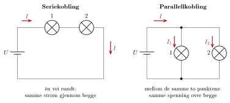
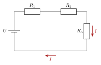
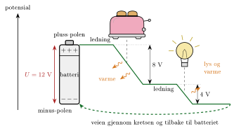
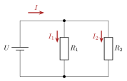
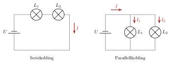

<!-- video: kommer (videoer/fysikk-forkurs/11-04-serie-og-parallellkobling) -->
{fig-alt="Video kommer"}

::: {.callout-tip title="Til ettertanke"}
I et gammeldags julelys slukker hele lenka når én pære går. Men når én lampe i stua går, lyser de andre fortsatt. Hva er forskjellen?
:::

## Elektriske kretser

Hva er egentlig en elektrisk krets? En elektrisk krets, eller bare en krets, er rett og slett en lukket vei som strømmen kan gå rundt i. Det går bare strøm når kretsen er **lukket**. Er det et brudd et sted, for eksempel en åpen bryter, er kretsen **åpen**, og det går ingen strøm noe sted i den.

{.tikz-fig style="width:560px" fig-alt="To like kretser med et batteri U, en bryter og en lampe. Til venstre er bryteren åpen, og det går ingen strøm. Til høyre er bryteren lukket, og piler merket I viser strømmen ut fra batteriets pluss-pol, gjennom bryteren og lampa og tilbake."}

## Kretsskjema

Når vi tegner en krets, bruker vi et **kretsskjema**: en skjematisk tegning der hver komponent har sitt eget standardsymbol, og ledningene er rette streker. Den lange streken på batterisymbolet er den positive polen.

{.tikz-fig style="width:640px" fig-alt="Kretssymbolene for batteri (en lang og en kort strek, pluss ved den lange), motstand (et rektangel), lyspære (en sirkel med kryss), bryter (en åpen skrå strek), amperemeter (sirkel med A) og voltmeter (sirkel med V)."}

## Serie eller parallell?

Har vi mer enn én komponent i en krets, kan de kobles på to grunnleggende måter.

::: {.callout-note title="Definisjon: Serie- og parallellkobling"}
- To komponenter er koblet i **serie** når de ligger etter hverandre, slik at det bare er én vei gjennom dem. All ladning som går gjennom den ene, må også gå gjennom den andre.
- To komponenter er koblet i **parallell** når begge endene deres er koblet til de samme to punktene i kretsen. Strømmen deler seg og går gjennom begge samtidig.
:::

{.tikz-fig style="width:640px" fig-alt="To kretser med et batteri U og to lamper, 1 og 2. Til venstre, seriekobling: lampene står etter hverandre i én sløyfe, og den samme strømmen I går gjennom begge. Til høyre, parallellkobling: lampene står ved siden av hverandre mellom de samme to punktene, markert med svarte prikker. Strømmen I deler seg i I1 gjennom lampe 1 og I2 gjennom lampe 2."}

Begge koblingene har en egenskap vi kan se direkte, uten å regne:

::: {.kort}
- **I serie går den samme strømmen gjennom alle komponentene.** Ladning blir verken laget eller ødelagt, og den kan heller ikke hope seg opp mellom komponentene. Like mye ladning per sekund må derfor gå gjennom hver av dem.
- **I parallell er spenningen den samme over alle komponentene.** Endene deres sitter i de samme to punktene, og potensialet i et punkt er det samme uansett hvilken vei vi kommer dit. Forskjellen i potensial er derfor den samme over hver gren.
:::

## Seriekobling

{.tikz-fig style="width:400px" fig-alt="Tre motstander R1, R2 og R3 koblet etter hverandre i én sløyfe med batteriet U. Den samme strømmen I går gjennom alle tre."}

Tenk tilbake på potensialdiagrammet med brødristeren og lampa i [Strøm og spenning](02-strom-og-spenning.qmd). Hver coulomb ladning gir fra seg energien sin litt etter litt på vei rundt kretsen. I hver komponent faller potensialet, og når ladningen er tilbake ved minus-polen, har det falt nøyaktig like mye som spenningen over batteriet. Derfor er

$$
U = U_1 + U_2 + U_3.
$$

{.tikz-fig style="width:560px" fig-alt="Potensialet langs en krets med et batteri på 12 V, en brødrister og en lampe i serie. Potensialet faller 8 V i brødristeren og 4 V i lampa, til sammen 12 V."}

Strømmen $I$ er den samme gjennom alle motstandene, så Ohms lov gir $U_1 = R_1I$, $U_2 = R_2I$ og $U_3 = R_3I$. Setter vi inn, får vi

$$
U = R_1I + R_2I + R_3I = (R_1 + R_2 + R_3)\,I.
$$

Kretsen oppfører seg altså som om det var én motstand $R_\text{tot} = R_1 + R_2 + R_3$. Det gir mening: Ladningene må gjennom alle hindringene etter hverandre, så hindringene legges sammen. Legg også merke til at spenningen fordeler seg i samme forhold som motstandene, $U_1 : U_2 = R_1 : R_2$. Den største motstanden får den største spenningen.

## Parallellkobling

{.tikz-fig style="width:380px" fig-alt="To motstander R1 og R2 i hver sin gren mellom de samme to ledningene fra batteriet U. Strømmen I fra batteriet deler seg i I1 gjennom R1 og I2 gjennom R2."}

Der ledningen deler seg, kan ikke ladning forsvinne eller hope seg opp. Det som kommer inn, må gå ut igjen gjennom grenene:

$$
I = I_1 + I_2.
$$

Spenningen $U$ er den samme over begge grenene, så Ohms lov gir $I_1 = U/R_1$ og $I_2 = U/R_2$. Setter vi inn, får vi

$$
I = \frac{U}{R_1} + \frac{U}{R_2} = U\left(\frac{1}{R_1} + \frac{1}{R_2}\right).
$$

Sammenligner vi med $I = U/R_\text{tot}$, ser vi at $\dfrac{1}{R_\text{tot}} = \dfrac{1}{R_1} + \dfrac{1}{R_2}$. Hver ny gren er en ekstra vei for ladningene, omtrent som et ekstra felt på en motorvei. Derfor går det *mer* strøm, og den totale resistansen blir *mindre*. Den minste motstanden får den største strømmen.

::: {.callout-note title="Definisjon: Serie- og parallellkobling av motstander"}
**Serie:**
$$
R_\text{tot} = R_1 + R_2 + \dots + R_n
$$
**Parallell:**
$$
\frac{1}{R_\text{tot}} = \frac{1}{R_1} + \frac{1}{R_2} + \dots + \frac{1}{R_n}
$$
For to motstander i parallell kan dette skrives $R_\text{tot} = \dfrac{R_1R_2}{R_1 + R_2}$.
:::

::: {.callout-important title="Merk: Parallellkobling gir mindre resistans"}
Når vi kobler en motstand i parallell med en annen, får strømmen en ekstra vei å gå. Den totale resistansen blir derfor alltid *mindre* enn den minste av motstandene.
:::

## Måling av strøm og spenning

Et **amperemeter** måler strømmen gjennom en komponent, og et **voltmeter** måler spenningen over den.

{.tikz-fig style="width:420px" fig-alt="En krets med batteriet U0, et amperemeter A og en lampe i serie. Et voltmeter V er koblet i parallell over lampa. En pil merket I viser strømmen gjennom amperemeteret."}

::: {.kort}
- **Amperemeteret kobles i serie** med komponenten. Da går den samme strømmen gjennom begge, og amperemeteret viser strømmen gjennom komponenten.
- **Voltmeteret kobles i parallell** over komponenten. Da sitter det i de samme to punktene, og viser spenningen over komponenten.
:::

::: {.callout-tip title="Til ettertanke"}
Strømmen går nesten uhindret gjennom et godt amperemeter, mens det nesten ikke går strøm gjennom et godt voltmeter. Hvorfor? (Tenk på at måleinstrumentet ikke skal endre kretsen det måler på.)
:::

Et måleinstrument skal ikke endre det det måler. Amperemeteret ligger i serie, så resistansen $R_A$ legges til: $R_\text{tot} = R + R_A$. For at strømmen ikke skal bli mindre, må $R_A$ være mye mindre enn $R$. Et godt amperemeter har derfor svært *liten* resistans. Voltmeteret ligger i parallell og er en ekstra vei for strømmen. For at nesten ingen strøm skal gå den veien, må resistansen $R_V$ være mye større enn $R$. Et godt voltmeter har derfor svært *stor* resistans.

::: {.eksempel}
**Eksempel: Motstander i serie.** Tre motstander er koblet i serie, som i figuren over. To av dem er $R_1 = 6.0\ \mathrm{\Omega}$ og $R_2 = 10\ \mathrm{\Omega}$. Den totale resistansen er $25\ \mathrm{\Omega}$. Hva er $R_3$?

::: {.losning}
$$
R_\text{tot} = R_1 + R_2 + R_3 \quad\implies\quad R_3 = R_\text{tot} - R_1 - R_2 = 25\ \mathrm{\Omega} - 6.0\ \mathrm{\Omega} - 10\ \mathrm{\Omega} = \underline{\underline{9\ \mathrm{\Omega}}}
$$
:::
:::

::: {.eksempel}
**Eksempel: Spenningsdeling i en seriekobling.** To motstander, $R_1 = 2.0\ \mathrm{\Omega}$ og $R_2 = 4.0\ \mathrm{\Omega}$, er koblet i serie til et batteri på $12\ \mathrm{V}$. Finn strømmen og spenningen over hver motstand.

::: {.losning}
Den totale resistansen er $R_\text{tot} = 2.0\ \mathrm{\Omega} + 4.0\ \mathrm{\Omega} = 6.0\ \mathrm{\Omega}$. Strømmen er den samme overalt:
$$
I = \frac{U}{R_\text{tot}} = \frac{12\ \mathrm{V}}{6.0\ \mathrm{\Omega}} = \underline{\underline{2.0\ \mathrm{A}}}
$$
Spenningene:
$$
U_1 = R_1I = 2.0\ \mathrm{\Omega}\cdot 2.0\ \mathrm{A} = \underline{\underline{4.0\ \mathrm{V}}}, \qquad U_2 = R_2I = 4.0\ \mathrm{\Omega}\cdot 2.0\ \mathrm{A} = \underline{\underline{8.0\ \mathrm{V}}}
$$
Kontroll: $U_1 + U_2 = 12\ \mathrm{V}$. Den største motstanden får den største spenningen.
:::
:::

::: {.eksempel}
**Eksempel: Motstander i parallell.** To motstander, $R_1 = 6.0\ \mathrm{\Omega}$ og $R_2 = 12\ \mathrm{\Omega}$, er koblet i parallell til et batteri på $12\ \mathrm{V}$, som i figuren over. Finn den totale resistansen, strømmen gjennom hver motstand og strømmen fra batteriet.

::: {.losning}
$$
R_\text{tot} = \frac{R_1R_2}{R_1 + R_2} = \frac{6.0\ \mathrm{\Omega}\cdot 12\ \mathrm{\Omega}}{6.0\ \mathrm{\Omega} + 12\ \mathrm{\Omega}} = \underline{\underline{4.0\ \mathrm{\Omega}}}
$$
Spenningen over begge er $12\ \mathrm{V}$:
$$
I_1 = \frac{12\ \mathrm{V}}{6.0\ \mathrm{\Omega}} = \underline{\underline{2.0\ \mathrm{A}}}, \qquad I_2 = \frac{12\ \mathrm{V}}{12\ \mathrm{\Omega}} = \underline{\underline{1.0\ \mathrm{A}}}
$$
Strømmen fra batteriet er $I = I_1 + I_2 = \underline{\underline{3.0\ \mathrm{A}}}$. Kontroll: $U/R_\text{tot} = 12\ \mathrm{V}/4.0\ \mathrm{\Omega} = 3.0\ \mathrm{A}$. Den minste motstanden får den største strømmen.
:::
:::

<!-- tillegg: Claude -->
Programmet regner ut den totale resistansen for motstander i serie og i parallell. Legg til flere motstander i lista og se hvordan $R_\text{tot}$ endrer seg. Blir den parallelle resistansen noen gang større enn den minste motstanden?

```{.python .kjor}
R = [6.0, 12.0]          # motstandene (ohm), legg gjerne til flere

R_serie = sum(R)
R_parallell = 1 / sum(1/r for r in R)

print(f"Serie:     R_tot = {R_serie:.2f} ohm")
print(f"Parallell: R_tot = {R_parallell:.2f} ohm  (minste motstand: {min(R)} ohm)")
```

:::: {.oppgaver}

::: {.oppgave tittel="Spenningsdeling i serie"}
To motstander, $R_1 = 3.0\ \mathrm{\Omega}$ og $R_2 = 6.0\ \mathrm{\Omega}$, er koblet i serie til et batteri på $18\ \mathrm{V}$. Finn strømmen og spenningen over hver motstand. Kontroller at spenningene til sammen blir $18\ \mathrm{V}$.

::: {.fasit}
$2.0\ \mathrm{A}$ · $6.0\ \mathrm{V}$ · $12\ \mathrm{V}$
:::
:::

::: {.oppgave tittel="Motstander i parallell"}
To motstander, $R_1 = 4.0\ \mathrm{\Omega}$ og $R_2 = 12\ \mathrm{\Omega}$, er koblet i parallell til et batteri på $12\ \mathrm{V}$.

a)  Finn den totale resistansen.

b)  Finn strømmen gjennom hver motstand og strømmen fra batteriet.

::: {.fasit}
a) $3.0\ \mathrm{\Omega}$ · b) $3.0\ \mathrm{A}$ · b) $1.0\ \mathrm{A}$ · b) $4.0\ \mathrm{A}$
:::
:::

::: {.oppgave tittel="Julelys i serie"}
Et gammeldags julelys består av 20 like lyspærer koblet i serie. Lenka kobles til $230\ \mathrm{V}$, og strømmen er $0.10\ \mathrm{A}$.

a)  Hva er spenningen over hver pære?

b)  Hva er resistansen i hver pære?

c)  Hvorfor slukner hele lenka når én pære går i stykker?

::: {.fasit}
a) $11.5\ \mathrm{V}$ · b) $1.2\cdot 10^{2}\ \mathrm{\Omega}$
:::
:::

::: {.oppgave tittel="Lamper i parallell" niva="Middels"}
To like lamper med resistans $530\ \mathrm{\Omega}$ hver er koblet i parallell til en stikkontakt med spenningen $230\ \mathrm{V}$.

a)  Hvor stor er strømmen gjennom hver lampe?

b)  Hvor stor er den totale strømmen fra stikkontakten?

c)  Hva er den totale resistansen?

d)  Vi kobler til en tredje lampe i parallell. Hva skjer med strømmen gjennom de to første lampene, og med den totale strømmen?

::: {.fasit}
a) $0.43\ \mathrm{A}$ · b) $0.87\ \mathrm{A}$ · c) $2.7\cdot 10^{2}\ \mathrm{\Omega}$
:::
:::

::: {.oppgave tittel="Lamper i serie og i parallell" niva="Middels"}
<!-- tillegg: Claude -->
To like lamper $L_1$ og $L_2$ kobles til et batteri, først i serie og så i parallell.

{.tikz-fig style="width:520px" fig-alt="Til venstre er lampene L1 og L2 koblet etter hverandre i en sløyfe med batteriet U, og strømmen I går gjennom begge. Til høyre er lampene koblet i hver sin gren mellom de samme ledningene. Strømmen I fra batteriet deler seg i I1 gjennom L1 og I2 gjennom L2."}

a)  Lampe $L_1$ ryker. Hva skjer med $L_2$ i hver av de to koblingene?

b)  I parallellkoblingen går det $0.30\ \mathrm{A}$ gjennom hver lampe. Hvor stor er strømmen $I$ fra batteriet?

c)  Hvorfor er lysene i et hus koblet i parallell?

::: {.fasit}
$0.60\ \mathrm{A}$
:::
:::

::: {.oppgave tittel="Måle strøm og spenning" niva="Middels"}
Et batteri er koblet til to lyspærer i serie.

a)  Tegn kretsen med et amperemeter som måler strømmen fra batteriet, og et voltmeter som måler spenningen over den ene lyspæra.

b)  Hvorfor må amperemeteret kobles i serie, mens voltmeteret kobles i parallell?

c)  Strømmen går nesten uhindret gjennom et godt amperemeter, mens det nesten ikke går strøm gjennom et godt voltmeter. Prøv å forklare hvorfor.

:::

::: {.oppgave tittel="Hvor skal måleren stå?"}
<!-- tillegg: Claude -->
Du har en krets med et batteri og en lampe, og vil måle både strømmen gjennom lampa og spenningen over den.

a)  Hvordan kobler du amperemeteret? Hvordan kobler du voltmeteret?

b)  En medelev kobler amperemeteret direkte over batteriet, med en ledning til hver pol. Hva skjer, og hvorfor?

:::

::::
