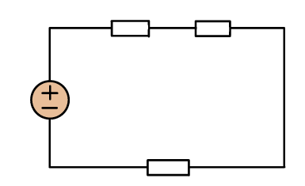
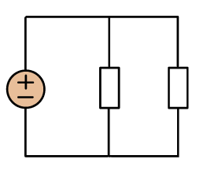

::: {.callout-warning title="Under arbeid"}

Denne siden skrives fortsatt.

:::

:::: {.oppgaver}

Motstand, eller resistanser, R, er komponenter i en krets som har påvirkning på strømmen og spenningen. *Ohm’s lov* viser at spenningen, U, er proporsjonal med resistansen og strømmen.

::: {.callout-note title="Definisjon: Ohm’s lov"}

$U = R\cdot I$
Hvor U er spenningen i volt, *V*, R er resistansen i ohm *$\Omega$* og I er strømmen i ampere, *A*.

:::

Ohm’s lov viser at strømmen, $I = \frac{U}{R}$, er omvendt proporsjonal med resistansen. Det vil si at det høyere motstand, det mindre strøm vil gå. Ved fullstendig motstand, for eksempel ved en åpen krets, er det teoretisk sett ingen strøm som passerer. Ved mindre motstand, er det lettere for strømmen å gå.

## Motstander i seriekobling

Når motstander er seriekoblet, kan man finne den totale motstanden i kretsen ved bruk av Formel .

$$\begin{aligned}
    &\sum R_{tot}= R_1+R_2 +...+ R_n
\end{aligned}$$

::: {.eksempel}

[Eksempel: Sum av motstand i seriekobling]{.eks-tittel}
De to øverste i Figuren mostandende er henholdsvis 6$\Omega$ og 10$\Omega$. Hvis summen av motstander i kretsen er 25 $\Omega$, hva er da verdien til den siste motstanden?

::: center

{.kompendium-bilde}
[Motstander i seriekobling]{.figurtekst}

:::

::: {.losning}

Bruker formelen:\

$$\ R_{tot}=R_1+R_2+R_3$$\
$$\ R_3=R_{tot}-R_1-R_2$$ $$R_3 = 25\,\Omega - 6\,\Omega - 10\,\Omega = \underline{\underline{9\,\Omega}}$$

:::

:::

## Motstander i parallellkobling

Når motstander ligger i parallellkobling, kan man finne den totale motstanden i kretsen ved bruk av Formel . $$\begin{aligned}
    &\sum \frac{1}{R_{tot}}= \frac{1}{R_1} + \frac{1}{R_2} +...+ \frac{1}{R_n}
\end{aligned}$$

:::: figure

{.kompendium-bilde}

::: caption

Motstander i parallellkobling

:::

::::

## Elektrisk strøm og ladning

Elektrisk strøm er definert som elektrisk ladning i bevegelse. Det finnes *vekselstrøm* og *likestrøm*. Vekselstrøm er strøm med varierende retning, mens likestrøm har samme retning. Strømmen i stikkontakten som er knyttet opp mot strømnettet er vekselstrøm. I TRES skal det være fokus på likestrøm. Likestrøm får man fra for eksempel batterier, hvor strømmen går i en retning. Elektronene går fra negativ pol til positiv pol i en lukket krets. En *lukket krets* er en krets som er koblet sammen på begge sider av batteri og komponenter. En *åpen krets* er en krets som har et "hull" i seg, eller som ikke er koblet opp på både positiv og negativ pol.

### Elementærladning

Elementærladningen er den elektriske ladningen til et proton. Elektroner har samme størrelse på ladning som protoner, bare i motsatt retning. Derfor er ladningen til et elektron lik *-e*.\

$$e=1.602 \cdot 10^{-19} C$$

::: {.callout-note title="Definisjon: Strøm og ladning"}

Nedenfor står en formel for strøm, hvor *I* er strøm i Ampere, *q* er ladning i Coulomb og *t* er tid i sekund.\
$I = \frac{q}{t}$
Under står en formel for ladningen *q*, elementærladningen er *e*=1.602$\cdot$ 10$^{-19}$ C og *N* er antall elektroner.\
$q = \mathrm{e}\cdot N$

:::

::: {.eksempel}

[Eksempel: Antall elektroner]{.eks-tittel}
Ladningen på et område er -100 Coulomb. Hvor mange overskudds-elektroner er på området?

::: {.losning}

$$q=e\cdot N$$ $$N=\frac{q}{e}$$ $$N=\frac{-100 C}{-1.602\cdot 10^{-19}\frac{C}{elektroner}}$$ $$N=\underline{\underline{6.24\cdot 10^{20}\text{ elektroner}}}$$

:::

:::

::::

