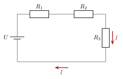
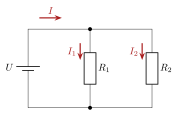
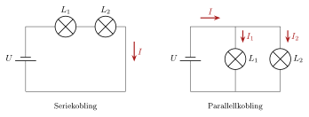

<!-- video: kommer (videoer/fysikk-forkurs/11-04-serie-og-parallellkobling) -->
{fig-alt="Video kommer"}

::: {.callout-tip title="Til ettertanke"}
I et gammeldags julelys slukker hele lenka når én pære går. Men når én lampe i stua går, lyser de andre fortsatt. Hva er forskjellen?
:::

## Seriekobling

I en seriekobling ligger komponentene etter hverandre, slik at strømmen bare har én vei å gå. Da gjelder:

::: {.kort}
- **Strømmen er den samme** gjennom alle komponentene. Ladning kan ikke hope seg opp noe sted.
- **Spenningen fra batteriet deles** mellom komponentene: $U = U_1 + U_2 + \dots$
:::

{.tikz-fig style="width:400px" fig-alt="Tre motstander R1, R2 og R3 koblet etter hverandre i én sløyfe med batteriet U. Den samme strømmen I går gjennom alle tre."}

Bruker vi Ohms lov på hver motstand, får vi $U = R_1I + R_2I + \dots = (R_1 + R_2 + \dots)\,I$. Motstandene virker altså som én motstand $R_\text{tot}$.

## Parallellkobling

I en parallellkobling ligger komponentene ved siden av hverandre, mellom de samme to punktene. Strømmen deler seg og går gjennom komponentene samtidig. Da gjelder:

::: {.kort}
- **Spenningen er den samme** over alle komponentene, fordi de er koblet mellom de samme to punktene.
- **Strømmen deles**: $I = I_1 + I_2 + \dots$
:::

{.tikz-fig style="width:380px" fig-alt="To motstander R1 og R2 i hver sin gren mellom de samme to ledningene fra batteriet U. Strømmen I fra batteriet deler seg i I1 gjennom R1 og I2 gjennom R2."}

Med Ohms lov er $I = U/R_1 + U/R_2 + \dots = U\left(1/R_1 + 1/R_2 + \dots\right)$.

::: {.callout-note title="Definisjon: Serie- og parallellkobling av motstander"}
**Serie:**
$$
R_\text{tot} = R_1 + R_2 + \dots + R_n
$$
**Parallell:**
$$
\frac{1}{R_\text{tot}} = \frac{1}{R_1} + \frac{1}{R_2} + \dots + \frac{1}{R_n}
$$
For to motstander i parallell kan dette skrives $R_\text{tot} = \dfrac{R_1R_2}{R_1 + R_2}$.
:::

::: {.callout-important title="Merk: Parallellkobling gir mindre resistans"}
Når vi kobler en motstand i parallell med en annen, får strømmen en ekstra vei å gå. Den totale resistansen blir derfor alltid *mindre* enn den minste av motstandene.
:::

::: {.eksempel}
**Eksempel: Motstander i serie.** Tre motstander er koblet i serie, som i figuren over. To av dem er $R_1 = 6.0\ \mathrm{\Omega}$ og $R_2 = 10\ \mathrm{\Omega}$. Den totale resistansen er $25\ \mathrm{\Omega}$. Hva er $R_3$?

::: {.losning}
$$
R_\text{tot} = R_1 + R_2 + R_3 \quad\implies\quad R_3 = R_\text{tot} - R_1 - R_2 = 25\ \mathrm{\Omega} - 6.0\ \mathrm{\Omega} - 10\ \mathrm{\Omega} = \underline{\underline{9\ \mathrm{\Omega}}}
$$
:::
:::

::: {.eksempel}
**Eksempel: Spenningsdeling i en seriekobling.** To motstander, $R_1 = 2.0\ \mathrm{\Omega}$ og $R_2 = 4.0\ \mathrm{\Omega}$, er koblet i serie til et batteri på $12\ \mathrm{V}$. Finn strømmen og spenningen over hver motstand.

::: {.losning}
Den totale resistansen er $R_\text{tot} = 2.0\ \mathrm{\Omega} + 4.0\ \mathrm{\Omega} = 6.0\ \mathrm{\Omega}$. Strømmen er den samme overalt:
$$
I = \frac{U}{R_\text{tot}} = \frac{12\ \mathrm{V}}{6.0\ \mathrm{\Omega}} = \underline{\underline{2.0\ \mathrm{A}}}
$$
Spenningene:
$$
U_1 = R_1I = 2.0\ \mathrm{\Omega}\cdot 2.0\ \mathrm{A} = \underline{\underline{4.0\ \mathrm{V}}}, \qquad U_2 = R_2I = 4.0\ \mathrm{\Omega}\cdot 2.0\ \mathrm{A} = \underline{\underline{8.0\ \mathrm{V}}}
$$
Kontroll: $U_1 + U_2 = 12\ \mathrm{V}$. Den største motstanden får den største spenningen.
:::
:::

::: {.eksempel}
**Eksempel: Motstander i parallell.** To motstander, $R_1 = 6.0\ \mathrm{\Omega}$ og $R_2 = 12\ \mathrm{\Omega}$, er koblet i parallell til et batteri på $12\ \mathrm{V}$, som i figuren over. Finn den totale resistansen, strømmen gjennom hver motstand og strømmen fra batteriet.

::: {.losning}
$$
R_\text{tot} = \frac{R_1R_2}{R_1 + R_2} = \frac{6.0\ \mathrm{\Omega}\cdot 12\ \mathrm{\Omega}}{6.0\ \mathrm{\Omega} + 12\ \mathrm{\Omega}} = \underline{\underline{4.0\ \mathrm{\Omega}}}
$$
Spenningen over begge er $12\ \mathrm{V}$:
$$
I_1 = \frac{12\ \mathrm{V}}{6.0\ \mathrm{\Omega}} = \underline{\underline{2.0\ \mathrm{A}}}, \qquad I_2 = \frac{12\ \mathrm{V}}{12\ \mathrm{\Omega}} = \underline{\underline{1.0\ \mathrm{A}}}
$$
Strømmen fra batteriet er $I = I_1 + I_2 = \underline{\underline{3.0\ \mathrm{A}}}$. Kontroll: $U/R_\text{tot} = 12\ \mathrm{V}/4.0\ \mathrm{\Omega} = 3.0\ \mathrm{A}$. Den minste motstanden får den største strømmen.
:::
:::

<!-- tillegg: Claude -->
Programmet regner ut den totale resistansen for motstander i serie og i parallell. Legg til flere motstander i lista og se hvordan $R_\text{tot}$ endrer seg. Blir den parallelle resistansen noen gang større enn den minste motstanden?

```{.python .kjor}
R = [6.0, 12.0]          # motstandene (ohm), legg gjerne til flere

R_serie = sum(R)
R_parallell = 1 / sum(1/r for r in R)

print(f"Serie:     R_tot = {R_serie:.2f} ohm")
print(f"Parallell: R_tot = {R_parallell:.2f} ohm  (minste motstand: {min(R)} ohm)")
```

:::: {.oppgaver}

::: {.oppgave tittel="Spenningsdeling i serie"}
To motstander, $R_1 = 3.0\ \mathrm{\Omega}$ og $R_2 = 6.0\ \mathrm{\Omega}$, er koblet i serie til et batteri på $18\ \mathrm{V}$. Finn strømmen og spenningen over hver motstand. Kontroller at spenningene til sammen blir $18\ \mathrm{V}$.

::: {.losning}
$R_\text{tot} = 9.0\ \mathrm{\Omega}$, så $I = \dfrac{18\ \mathrm{V}}{9.0\ \mathrm{\Omega}} = \underline{\underline{2.0\ \mathrm{A}}}$.

$U_1 = 3.0\ \mathrm{\Omega}\cdot 2.0\ \mathrm{A} = \underline{\underline{6.0\ \mathrm{V}}}$ og $U_2 = 6.0\ \mathrm{\Omega}\cdot 2.0\ \mathrm{A} = \underline{\underline{12\ \mathrm{V}}}$. Kontroll: $6.0\ \mathrm{V} + 12\ \mathrm{V} = 18\ \mathrm{V}$.
:::
:::

::: {.oppgave tittel="Motstander i parallell"}
To motstander, $R_1 = 4.0\ \mathrm{\Omega}$ og $R_2 = 12\ \mathrm{\Omega}$, er koblet i parallell til et batteri på $12\ \mathrm{V}$.

a)  Finn den totale resistansen.

b)  Finn strømmen gjennom hver motstand og strømmen fra batteriet.

::: {.losning}
**a)** $R_\text{tot} = \dfrac{4.0\ \mathrm{\Omega}\cdot 12\ \mathrm{\Omega}}{4.0\ \mathrm{\Omega} + 12\ \mathrm{\Omega}} = \underline{\underline{3.0\ \mathrm{\Omega}}}$

**b)** $I_1 = \dfrac{12\ \mathrm{V}}{4.0\ \mathrm{\Omega}} = \underline{\underline{3.0\ \mathrm{A}}}$, $\quad I_2 = \dfrac{12\ \mathrm{V}}{12\ \mathrm{\Omega}} = \underline{\underline{1.0\ \mathrm{A}}}$, $\quad I = I_1 + I_2 = \underline{\underline{4.0\ \mathrm{A}}}$. Kontroll: $12\ \mathrm{V}/3.0\ \mathrm{\Omega} = 4.0\ \mathrm{A}$.
:::
:::

::: {.oppgave tittel="Julelys i serie"}
Et gammeldags julelys består av 20 like lyspærer koblet i serie. Lenka kobles til $230\ \mathrm{V}$, og strømmen er $0.10\ \mathrm{A}$.

a)  Hva er spenningen over hver pære?

b)  Hva er resistansen i hver pære?

c)  Hvorfor slukner hele lenka når én pære går i stykker?

::: {.losning}
**a)** Spenningen deles likt: $U_1 = \dfrac{230\ \mathrm{V}}{20} = \underline{\underline{11.5\ \mathrm{V}}}$

**b)** $R = \dfrac{U_1}{I} = \dfrac{11.5\ \mathrm{V}}{0.10\ \mathrm{A}} = \underline{\underline{1.2\cdot 10^{2}\ \mathrm{\Omega}}}$

**c)** I en seriekobling har strømmen bare én vei. Når én pære går, blir kretsen åpen, og det går ingen strøm gjennom noen av pærene.
:::
:::

::: {.oppgave tittel="Lamper i parallell" niva="Middels"}
To like lamper med resistans $530\ \mathrm{\Omega}$ hver er koblet i parallell til en stikkontakt med spenningen $230\ \mathrm{V}$.

a)  Hvor stor er strømmen gjennom hver lampe?

b)  Hvor stor er den totale strømmen fra stikkontakten?

c)  Hva er den totale resistansen?

d)  Vi kobler til en tredje lampe i parallell. Hva skjer med strømmen gjennom de to første lampene, og med den totale strømmen?

::: {.losning}
**a)** Hver lampe har hele spenningen: $I_1 = \dfrac{230\ \mathrm{V}}{530\ \mathrm{\Omega}} = \underline{\underline{0.43\ \mathrm{A}}}$

**b)** $I = 2\cdot 0.434\ \mathrm{A} = \underline{\underline{0.87\ \mathrm{A}}}$

**c)** $R_\text{tot} = \dfrac{530\ \mathrm{\Omega}}{2} = \underline{\underline{2.7\cdot 10^{2}\ \mathrm{\Omega}}}$ (eller $U/I$)

**d)** Strømmen gjennom de to første lampene **endres ikke**, for de har fortsatt $230\ \mathrm{V}$ over seg. Den totale strømmen **øker** til $3\cdot 0.434\ \mathrm{A} = 1.3\ \mathrm{A}$, fordi strømmen har fått en vei til.
:::
:::

::: {.oppgave tittel="Lamper i serie og i parallell" niva="Middels"}
<!-- tillegg: Claude -->
To like lamper $L_1$ og $L_2$ kobles til et batteri, først i serie og så i parallell.

{.tikz-fig style="width:520px" fig-alt="Til venstre er lampene L1 og L2 koblet etter hverandre i en sløyfe med batteriet U, og strømmen I går gjennom begge. Til høyre er lampene koblet i hver sin gren mellom de samme ledningene. Strømmen I fra batteriet deler seg i I1 gjennom L1 og I2 gjennom L2."}

a)  Lampe $L_1$ ryker. Hva skjer med $L_2$ i hver av de to koblingene?

b)  I parallellkoblingen går det $0.30\ \mathrm{A}$ gjennom hver lampe. Hvor stor er strømmen $I$ fra batteriet?

c)  Hvorfor er lysene i et hus koblet i parallell?

::: {.losning}
**a)** I **seriekoblingen** er det bare én vei for strømmen. Når $L_1$ ryker, blir kretsen åpen, og $L_2$ slukker også. I **parallellkoblingen** har $L_2$ sin egen gren rett til batteriet, så den lyser videre.

**b)** Strømmen som går inn i forgreningspunktet, er lik summen av strømmene som går ut:
$$
I = I_1 + I_2 = 0.30\ \mathrm{A} + 0.30\ \mathrm{A} = \underline{\underline{0.60\ \mathrm{A}}}
$$

**c)** I parallell får hver lampe hele spenningen fra nettet, og hver lampe kan slås av og på, eller ryke, uten at de andre påvirkes.
:::
:::

::::
