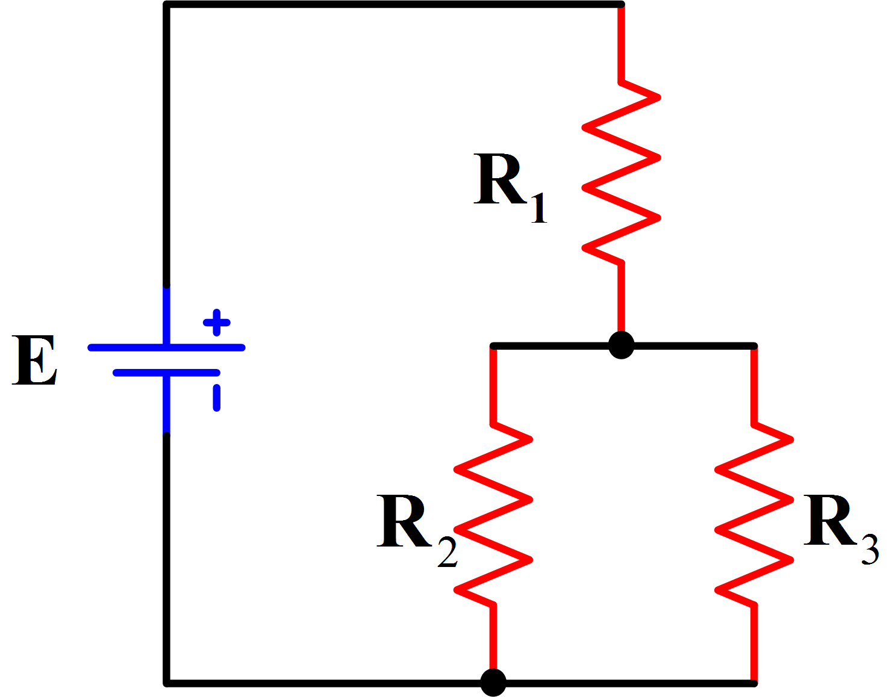

::: {.callout-warning title="Under arbeid"}

Denne siden skrives fortsatt.

:::

:::: {.oppgaver}

Effekt innenfor elektrisitet er elektrisk energi per tidsenhet. Effekten er proporsjonal med strømmen og spenningen.

::: {.callout-note title="Definisjon: Effekt"}

Nedenfor står formelen for effekt, *P*. *U* er spenningen og *I* er strømmen. $$P=U\cdot I$$ Spenningen kan regnes ved: $$U=R\cdot I$$ Dermed kan effekten også skrives som: $$P=R\cdot I^2$$

:::

## Eksempeloppgaver

::: {.callout-tip title="Tips: Hvordan løse oppgaver innen for elektrisitet?"}

Steg for steg over hvordan løse oppgaver innenfor elektrisitet:

1.  **Tegn kretsen** - Start med å visualisere problemet ved å tegne kretsen. Dette gir en klar oversikt og hjelper deg å identifisere hvilke komponenter som er involvert.

2.  **Identifiser koblingstype** - Bestem om kretsen består av en seriekobling, parallellkobling eller en kombinasjon av begge. Dette påvirker hvordan strøm og spenning distribueres gjennom kretsen.

3.  **Forenkel kretsen** - Bruk prinsippene vist i eksemplene om motstand og Kirchhoffs lover for å forenkle kretsen til mer håndterbare deler. Dette kan inkludere å kombinere resistanser i serie eller parallell for å redusere kompleksiteten.

4.  **Løs oppgaven med relevante formler** - Etter at du har forenklet kretsen, bruk relevante elektriske formler for å finne de ønskede verdier som strøm, spenning eller motstand. Sørg for å lese oppgaveteksten nøye for å forstå hva som er spurt om.

:::

::: {.eksempel}

[Eksempel: Krets 1]{.eks-tittel}

Krets 1 består av et batteri som energikilde, med en spenning på 5,0 V. Batteriet er seriekoblet med spenningen R$_1$. R$_1$ er koblet opp med to resistanser i seriekobling R$_2$ og R$_3$. R$_1$ er på 1,0 $\Omega$, R$_2$ er på 2,0 $\Omega$, mens R$_3$ er på 1,4 $\Omega$.

a\) Hva er den totale strømmen i kretsen?

::: center

{.kompendium-bilde}

[Tegning av Krets 1]{.figurtekst}

:::

::: {.losning}

Løsning: 1. **Tegn kretsen.** Se Figuren som eksempel på en tegning.\
2. **Identifiser koblingstype**. R$_1$ er i serie med R$_2$ og R$_3$ i parallellkobling.\
3 **Forenkle kretsen.** Første steg her er å "sette sammen" R$_2$ og R$_3$ slik at de representerer en resistans. Formel viser hvordan det kan regnes ut.

$$\Sigma R_{parallell} = (\frac{1}{R_2}+\frac{1}{R_3})^{-1}$$ $$\Sigma R_{parallell} = (\frac{1}{2}+\frac{1}{1,4})^{-1}$$ $$\Sigma R_{parallell} = 0,82 \Omega$$

4\. **Løs oppgaven med relevante formler.** Kretsen består nå av batteriet koblet opp med to resistanser, R$_1$ og R$_{paralell}$. Den totale resistansen blir da, ved hjelp av formel for seriekoblet resistanser; Formel :

$$\Sigma R_{serie} = \Sigma R_{total} =1 + 0,82$$ $$\Sigma R_{serie} = 1,82$$

Strømmen finner vi ved bruk av $U=RI$: $$I = \frac{U}{R} = \frac{5,0\,\mathrm{V}}{1,82\,\Omega} \approx \underline{\underline{2,7\,\mathrm{A}}}$$

:::

:::

::::

