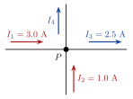
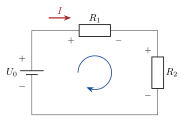
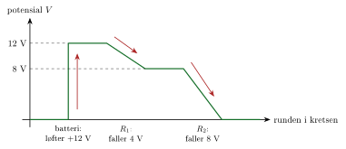
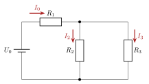
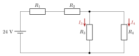

<!-- video: kommer (videoer/fysikk-forkurs/11-05-kirchhoffs-lover) -->
{fig-alt="Video kommer"}

<!-- tillegg: Claude: «Under arbeid» er fjernet, og siden er bygd ut med figurer, framgangsmåte, eksempler og oppgaver. Lærerens tekst er beholdt; stavemåten er rettet fra «Kirchoff’s» til «Kirchhoffs» (Gustav Kirchhoff). -->

<!-- tillegg: Claude -->
I et hus er mange lamper, en vannkoker og en lader koblet til de samme ledningene. Hvor mye strøm går i hovedledningen når alt står på? Og hvorfor blir det like mye spenning igjen til den siste lampa i en lang rekke? To enkle regler svarer på slike spørsmål. De bygger på to ting vi kjenner fra før: Ladning er bevart, og energi er bevart.

Kirchhoffs lover brukes til å regne ut strøm eller spenning i en elektrisk krets.

<!-- tillegg: Claude -->
Vi trenger også Ohms lov, som står under [Resistans og Ohms lov](03-resistans-og-ohms-lov.qmd): Spenningen over en motstand $R$ som strømmen $I$ går gjennom, er
$$
U = R\cdot I
$$

## Kirchhoffs første lov

Denne loven er også omtalt som *Kirchhoffs strømlov*. Denne loven går ut på at strømmen som går inn, eller ut av en node/knutepunkt til sammen blir 0.
$$
\sum{I}=I_1+I_2+\dots+I_n=0
$$

<!-- tillegg: Claude -->
Her regner vi strøm *inn* mot knutepunktet som positiv og strøm *ut* som negativ. Det er ofte enklere å tenke slik:

::: {.callout-important title="Kirchhoffs første lov (strømloven)"}
I et knutepunkt er summen av strømmene inn lik summen av strømmene ut:
$$
\sum I_\text{inn} = \sum I_\text{ut}
$$
:::

<!-- tillegg: Claude -->
Et **knutepunkt** (forgreningspunkt) er et sted der tre eller flere ledninger møtes. Tenk på vannrør: Renner det $3$ liter i sekundet inn i et T-rør, må det renne $3$ liter i sekundet ut til sammen. Vannet kan ikke hope seg opp i røret, og ladningen kan ikke hope seg opp i knutepunktet.

{.tikz-fig style="width:340px" fig-alt="Et knutepunkt P der fire ledninger møtes. Strømmene I1 = 3.0 A og I2 = 1.0 A går inn mot P. Strømmene I3 = 2.5 A og I4 går ut fra P."}

::: {.eksempel}
<!-- tillegg: Claude -->
**Eksempel: Et knutepunkt.** I figuren går strømmene $I_1 = 3.0\ \mathrm{A}$ og $I_2 = 1.0\ \mathrm{A}$ inn i knutepunktet $P$, og $I_3 = 2.5\ \mathrm{A}$ går ut. Finn $I_4$.

::: {.losning}
Strøm inn er lik strøm ut:
$$
I_1 + I_2 = I_3 + I_4 \quad\implies\quad I_4 = I_1 + I_2 - I_3 = 3.0\ \mathrm{A} + 1.0\ \mathrm{A} - 2.5\ \mathrm{A} = \underline{\underline{1.5\ \mathrm{A}}}
$$
Hadde vi fått et negativt svar, ville det bare betydd at strømmen $I_4$ går motsatt vei av pila, altså inn mot $P$.
:::
:::

## Kirchhoffs andre lov

Denne loven er også omtalt som *Kirchhoffs spenningslov*.
$$
\sum{U}=U_1+U_2+\dots+U_n=0
$$

<!-- tillegg: Claude -->
Summen tas rundt en **lukket sløyfe**: Du starter i et punkt, følger ledningene rundt og kommer tilbake til samme punkt. Spenningen er som høyde. Går du en tur i fjellet og kommer tilbake der du startet, har du gått like mye opp som ned. På samme måte løfter batteriet ladningen opp i spenning, og motstandene tar den ned igjen.

::: {.callout-important title="Kirchhoffs andre lov (spenningsloven)"}
Rundt en lukket sløyfe er summen av spenningsøkningene lik summen av spenningsfallene:
$$
\sum U_\text{kilder} = \sum R\cdot I
$$
:::

<!-- tillegg: Claude -->
For å få fortegnene riktig går vi rundt sløyfa i én retning og bruker to regler:

::: {.kort}
- **Gjennom en kilde fra − til +:** spenningen øker med $U_0$. Går du motsatt vei, fra + til −, minker den.
- **Gjennom en motstand med strømmen:** spenningen faller med $RI$. Strømmen går fra høy til lav spenning, så siden der strømmen kommer inn, er +.
:::

{.tikz-fig style="width:380px" fig-alt="En seriekrets med batteriet U0 til venstre, motstanden R1 øverst og motstanden R2 til høyre. Strømmen I går med klokka. Pluss og minus er merket på hver komponent: pluss på batteriets øvre pol og på siden der strømmen går inn i hver motstand. En pil i midten viser at vi går rundt sløyfa med klokka."}

::: {.eksempel}
<!-- tillegg: Claude -->
**Eksempel: Seriekrets.** I kretsen i figuren er $U_0 = 12\ \mathrm{V}$, $R_1 = 4.0\ \mathrm{\Omega}$ og $R_2 = 8.0\ \mathrm{\Omega}$. Finn strømmen og spenningen over hver motstand.

::: {.losning}
I en seriekrets er det samme strøm $I$ overalt (strømloven: det er ingen knutepunkter). Vi går rundt sløyfa med klokka, fra batteriets minuspol:
$$
U_0 - R_1 I - R_2 I = 0 \quad\implies\quad I = \frac{U_0}{R_1 + R_2} = \frac{12\ \mathrm{V}}{4.0\ \mathrm{\Omega} + 8.0\ \mathrm{\Omega}} = \underline{\underline{1.0\ \mathrm{A}}}
$$
Spenningene over motstandene:
$$
U_1 = R_1 I = 4.0\ \mathrm{\Omega}\cdot1.0\ \mathrm{A} = \underline{\underline{4.0\ \mathrm{V}}}, \qquad
U_2 = R_2 I = 8.0\ \mathrm{\Omega}\cdot1.0\ \mathrm{A} = \underline{\underline{8.0\ \mathrm{V}}}
$$
Sjekk: $4.0\ \mathrm{V} + 8.0\ \mathrm{V} = 12\ \mathrm{V}$. Spenningen fra batteriet deles mellom motstandene i samme forhold som motstandene: Den dobbelt så store motstanden får dobbelt så mye spenning.
:::
:::

## Fysisk tolkning

**Kirchhoffs 1. lov** (strømloven) følger av at ladning er bevart: ingen ladning kan «forsvinne» i et forgreningspunkt, så all strøm inn må ut igjen.

**Kirchhoffs 2. lov** (spenningsloven) følger av energibevaring: i en lukket sløyfe må summen av alle spenningsfall (over motstander) være lik summen av alle spenningsstigninger (fra kilder). Tilsvarende: vandrer du i en ring tilbake til startpunktet, er nettohøydeforskjellen null.

<!-- tillegg: Claude -->
En nyttig følge av spenningsloven: Komponenter som er koblet i **parallell**, har alltid **samme spenning**. Går du en sløyfe ned gjennom den ene grenen og opp igjen gjennom den andre, må fallene være like store.

Det er disse lovene som ligger bak reglene for [serie- og parallellkobling](04-serie-og-parallellkobling.qmd). I en seriekobling sier spenningsloven at $U = U_1 + U_2 + \dots$, og i en parallellkobling sier strømloven at $I = I_1 + I_2 + \dots$

{.tikz-fig style="width:520px" fig-alt="Et diagram over potensialet når vi går en runde i seriekretsen med batteriet på 12 V og motstandene på 4.0 og 8.0 ohm. Batteriet løfter potensialet fra 0 til 12 V. Over den første motstanden faller det 4 V, over den andre 8 V, og vi er tilbake på 0."}

## Framgangsmåte for kretser

<!-- tillegg: Claude -->
::: {.steg}
1. Tegn kretsen og sett på en strømpil med navn i hver gren. Retningen kan du gjette; blir svaret negativt, går strømmen andre veien.
2. Bruk strømloven i knutepunktene: inn = ut.
3. Bruk spenningsloven rundt sløyfer: økningene fra kildene er lik fallene $RI$ over motstandene.
4. Løs likningene, og sjekk at både strømloven og spenningsloven stemmer med svarene.
:::

::: {.eksempel}
**Eksempel: Krets med Kirchhoffs lover.** En krets har en spenningskilde $U_0 = 24\ \mathrm{V}$. Motstand $R_1 = 3.0\ \mathrm{\Omega}$ er i serie med en parallellkobling av $R_2 = 6.0\ \mathrm{\Omega}$ og $R_3 = 12\ \mathrm{\Omega}$.

<!-- tillegg: Claude: figuren er tegnet på nytt (den gamle viste koblingen uklart) -->
{.tikz-fig style="width:400px" fig-alt="Batteriet U0 er koblet i serie med motstanden R1. Etter R1 deler kretsen seg i to grener med R2 og R3 i parallell. Strømmen I0 går gjennom R1, og deler seg i I2 gjennom R2 og I3 gjennom R3."}

::: {.losning}
**Steg 1 — Totalmotstand:**

Parallellkoblingen: $\frac{1}{R_p} = \frac{1}{6.0\ \mathrm{\Omega}} + \frac{1}{12\ \mathrm{\Omega}} = \frac{3}{12\ \mathrm{\Omega}}$, så $R_p = 4.0\ \mathrm{\Omega}$.

Totalmotstanden: $R_{\text{tot}} = R_1 + R_p = 3.0\ \mathrm{\Omega} + 4.0\ \mathrm{\Omega} = 7.0\ \mathrm{\Omega}$.

**Steg 2 — Totalstrøm (Kirchhoffs 2. lov + Ohms lov):**
$$
U_0 = R_{\text{tot}}\,I_0 \implies I_0 = \frac{U_0}{R_{\text{tot}}} = \frac{24\ \mathrm{V}}{7.0\ \mathrm{\Omega}} = 3.43\ \mathrm{A} \approx \underline{\underline{3.4\ \mathrm{A}}}
$$

**Steg 3 — Spenning over parallellkoblingen:**
$$
U_p = R_p\,I_0 = 4.0\ \mathrm{\Omega}\cdot3.43\ \mathrm{A} \approx 13.7\ \mathrm{V}
$$

**Steg 4 — Strøm i grenene (Kirchhoffs 1. lov):**
$$
I_2 = \frac{U_p}{R_2} = \frac{13.7\ \mathrm{V}}{6.0\ \mathrm{\Omega}} \approx \underline{\underline{2.3\ \mathrm{A}}}, \qquad
I_3 = \frac{U_p}{R_3} = \frac{13.7\ \mathrm{V}}{12\ \mathrm{\Omega}} \approx \underline{\underline{1.1\ \mathrm{A}}}
$$
Sjekk K1: $I_2 + I_3 \approx 2.3\ \mathrm{A} + 1.1\ \mathrm{A} = 3.4\ \mathrm{A} = I_0$

<!-- tillegg: Claude -->
Sjekk K2: Spenningen over $R_1$ er $R_1 I_0 = 3.0\ \mathrm{\Omega}\cdot3.43\ \mathrm{A} = 10.3\ \mathrm{V}$, og $10.3\ \mathrm{V} + 13.7\ \mathrm{V} = 24\ \mathrm{V} = U_0$.
:::
:::

::: {.eksempel}
**Eksempel: Et lite batteri med tre motstander.** Et batteri på $5.0\ \mathrm{V}$ er koblet i serie med $R_1 = 1.0\ \mathrm{\Omega}$. Etter $R_1$ deler kretsen seg i to grener med $R_2 = 2.0\ \mathrm{\Omega}$ og $R_3 = 1.4\ \mathrm{\Omega}$ i parallell. Hva er strømmen fra batteriet?

::: {.losning}
$R_1$ er i serie med parallellkoblingen av $R_2$ og $R_3$. Parallellkoblingen:
$$
R_p = \frac{R_2R_3}{R_2 + R_3} = \frac{2.0\ \mathrm{\Omega}\cdot 1.4\ \mathrm{\Omega}}{2.0\ \mathrm{\Omega} + 1.4\ \mathrm{\Omega}} = 0.82\ \mathrm{\Omega}
$$
Total resistans: $R_\text{tot} = 1.0\ \mathrm{\Omega} + 0.82\ \mathrm{\Omega} = 1.82\ \mathrm{\Omega}$. Strømmen:
$$
I = \frac{U}{R_\text{tot}} = \frac{5.0\ \mathrm{V}}{1.82\ \mathrm{\Omega}} = 2.75\ \mathrm{A} \approx \underline{\underline{2.7\ \mathrm{A}}}
$$
:::
:::

<!-- tillegg: Claude -->
Programmet under regner ut den samme kretsen. Endre motstandene og se hvordan strømmen fordeler seg. Hva skjer med $I_3$ når du gjør $R_3$ svært stor? Og hva skjer med $I_0$ når $R_2$ blir svært liten (en kortslutning)?

```{.python .kjor}
U0 = 24.0      # spenningen fra kilden (V)
R1 = 3.0       # motstand i serie (ohm)
R2 = 6.0       # første gren (ohm)
R3 = 12.0      # andre gren (ohm)

Rp = 1 / (1/R2 + 1/R3)     # parallellkoblingen
Rtot = R1 + Rp
I0 = U0 / Rtot             # strømmen fra kilden
U1 = R1 * I0               # spenningsfallet over R1
Up = Rp * I0               # spenningen over grenene
I2 = Up / R2
I3 = Up / R3

print(f"I0 = {I0:.2f} A,  I2 = {I2:.2f} A,  I3 = {I3:.2f} A")
print(f"Strømloven:    I2 + I3 = {I2 + I3:.2f} A")
print(f"Spenningsloven: U1 + Up = {U1:.2f} V + {Up:.2f} V = {U1 + Up:.2f} V")
```

:::: {.oppgaver}

::: {.oppgave tittel="Krets med serie og parallell"}
Batteriet har polspenningen $U_0 = 20\ \mathrm{V}$. $R_1 = 4.0\ \mathrm{\Omega}$ er i serie med en parallellkobling av $R_2 = 10\ \mathrm{\Omega}$ og $R_3 = 15\ \mathrm{\Omega}$ (samme kobling som i eksempelet med figur over).

a)  Finn $R_\text{tot}$ og strømmen $I_0$.

b)  Finn spenningen over parallellkoblingen.

c)  Finn $I_2$ og $I_3$. Kontroller med strømloven.

::: {.losning}
**a)** $R_p = \dfrac{10\ \mathrm{\Omega}\cdot 15\ \mathrm{\Omega}}{25\ \mathrm{\Omega}} = 6.0\ \mathrm{\Omega}$, så $R_\text{tot} = 4.0\ \mathrm{\Omega} + 6.0\ \mathrm{\Omega} = \underline{\underline{10\ \mathrm{\Omega}}}$ og $I_0 = \dfrac{20\ \mathrm{V}}{10\ \mathrm{\Omega}} = \underline{\underline{2.0\ \mathrm{A}}}$.

**b)** $U_p = R_pI_0 = 6.0\ \mathrm{\Omega}\cdot 2.0\ \mathrm{A} = \underline{\underline{12\ \mathrm{V}}}$. Kontroll med spenningsloven: Over $R_1$ faller $8.0\ \mathrm{V}$, og $8.0\ \mathrm{V} + 12\ \mathrm{V} = 20\ \mathrm{V}$.

**c)** $I_2 = \dfrac{12\ \mathrm{V}}{10\ \mathrm{\Omega}} = \underline{\underline{1.2\ \mathrm{A}}}$ og $I_3 = \dfrac{12\ \mathrm{V}}{15\ \mathrm{\Omega}} = \underline{\underline{0.80\ \mathrm{A}}}$. Strømloven: $1.2\ \mathrm{A} + 0.80\ \mathrm{A} = 2.0\ \mathrm{A} = I_0$.
:::
:::

::: {.oppgave tittel="Krets med fire motstander" niva="Middels"}
Et batteri har polspenningen $24\ \mathrm{V}$. Motstandene $R_1 = 2.0\ \mathrm{\Omega}$ og $R_2 = 4.0\ \mathrm{\Omega}$ er koblet i serie med en parallellkobling av $R_3 = 10\ \mathrm{\Omega}$ og $R_4 = 15\ \mathrm{\Omega}$.

{.tikz-fig style="width:440px" fig-alt="Et batteri på 24 V i serie med R1 og R2. Etter R2 deler kretsen seg i to grener med R3 og R4 i parallell. Strømmen I3 går gjennom R3 og I4 gjennom R4."}

a)  Vis at den totale resistansen er $12\ \mathrm{\Omega}$.

b)  Finn strømmen fra batteriet.

c)  Finn spenningen over parallellkoblingen.

d)  Finn strømmene $I_3$ og $I_4$ gjennom $R_3$ og $R_4$. Kontroller svaret med Kirchhoffs strømlov.

::: {.losning}
**a)** $R_p = \dfrac{10\ \mathrm{\Omega}\cdot 15\ \mathrm{\Omega}}{10\ \mathrm{\Omega} + 15\ \mathrm{\Omega}} = 6.0\ \mathrm{\Omega}$, og $R_\text{tot} = 2.0\ \mathrm{\Omega} + 4.0\ \mathrm{\Omega} + 6.0\ \mathrm{\Omega} = \underline{\underline{12\ \mathrm{\Omega}}}$.

**b)** $I = \dfrac{24\ \mathrm{V}}{12\ \mathrm{\Omega}} = \underline{\underline{2.0\ \mathrm{A}}}$

**c)** $U_p = R_pI = 6.0\ \mathrm{\Omega}\cdot 2.0\ \mathrm{A} = \underline{\underline{12\ \mathrm{V}}}$

**d)** $I_3 = \dfrac{12\ \mathrm{V}}{10\ \mathrm{\Omega}} = \underline{\underline{1.2\ \mathrm{A}}}$ og $I_4 = \dfrac{12\ \mathrm{V}}{15\ \mathrm{\Omega}} = \underline{\underline{0.80\ \mathrm{A}}}$. Strømloven: $1.2\ \mathrm{A} + 0.80\ \mathrm{A} = 2.0\ \mathrm{A}$, som er strømmen fra batteriet.
:::
:::

::: {.oppgave tittel="Spenningsloven"}
To motstander, $R_1$ og $R_2$, er koblet i serie til et batteri på $9.0\ \mathrm{V}$. Et voltmeter over $R_1$ viser $3.5\ \mathrm{V}$.

a)  Hva er spenningen over $R_2$? Hvilken av Kirchhoffs lover bruker du?

b)  Resistansen $R_1$ er $7.0\ \mathrm{\Omega}$. Hvor stor er strømmen i kretsen?

c)  Finn $R_2$.

::: {.losning}
**a)** Spenningsloven: $U_2 = 9.0\ \mathrm{V} - 3.5\ \mathrm{V} = \underline{\underline{5.5\ \mathrm{V}}}$

**b)** $I = \dfrac{U_1}{R_1} = \dfrac{3.5\ \mathrm{V}}{7.0\ \mathrm{\Omega}} = \underline{\underline{0.50\ \mathrm{A}}}$

**c)** Samme strøm i serie: $R_2 = \dfrac{5.5\ \mathrm{V}}{0.50\ \mathrm{A}} = \underline{\underline{11\ \mathrm{\Omega}}}$
:::
:::

::: {.oppgave tittel="Fire ledninger"}
<!-- tillegg: Claude -->
Fire ledninger møtes i et knutepunkt. Strømmene $2.5\ \mathrm{A}$ og $1.2\ \mathrm{A}$ går inn i punktet, og $0.8\ \mathrm{A}$ går ut gjennom den tredje ledningen. Hvor stor strøm går i den fjerde ledningen, og hvilken vei?

::: {.losning}
Strømloven, med den ukjente strømmen $I$ regnet ut av punktet:
$$
2.5\ \mathrm{A} + 1.2\ \mathrm{A} = 0.8\ \mathrm{A} + I \quad\implies\quad I = \underline{\underline{2.9\ \mathrm{A}}}
$$
Svaret er positivt, så strømmen går **ut** av knutepunktet.
:::
:::

::: {.oppgave tittel="To motstander i serie"}
<!-- tillegg: Claude -->
Et $9.0\ \mathrm{V}$-batteri er koblet til to motstander i serie, $R_1 = 100\ \mathrm{\Omega}$ og $R_2 = 200\ \mathrm{\Omega}$.

a)  Finn strømmen i kretsen.

b)  Finn spenningen over hver motstand, og vis at spenningsloven stemmer.

::: {.losning}
**a)** Spenningsloven rundt sløyfa: $U_0 = R_1 I + R_2 I$, så
$$
I = \frac{U_0}{R_1 + R_2} = \frac{9.0\ \mathrm{V}}{300\ \mathrm{\Omega}} = 0.030\ \mathrm{A} = \underline{\underline{30\ \mathrm{mA}}}
$$

**b)**
$$
U_1 = R_1 I = 100\ \mathrm{\Omega}\cdot0.030\ \mathrm{A} = \underline{\underline{3.0\ \mathrm{V}}}, \qquad
U_2 = R_2 I = 200\ \mathrm{\Omega}\cdot0.030\ \mathrm{A} = \underline{\underline{6.0\ \mathrm{V}}}
$$
Sjekk: $3.0\ \mathrm{V} + 6.0\ \mathrm{V} = 9.0\ \mathrm{V}$, som er spenningen fra batteriet.
:::
:::

::: {.oppgave tittel="To motstander i parallell"}
<!-- tillegg: Claude -->
To motstander, $R_1 = 4.0\ \mathrm{\Omega}$ og $R_2 = 6.0\ \mathrm{\Omega}$, er koblet i parallell til en kilde på $12\ \mathrm{V}$.

a)  Hvor stor er spenningen over hver motstand?

b)  Finn strømmen gjennom hver motstand og strømmen fra kilden.

c)  Hvilken enkelt motstand ville gitt samme strøm fra kilden?

::: {.losning}
**a)** Parallelle grener har samme spenning, så begge har $\underline{\underline{12\ \mathrm{V}}}$.

**b)**
$$
I_1 = \frac{12\ \mathrm{V}}{4.0\ \mathrm{\Omega}} = \underline{\underline{3.0\ \mathrm{A}}}, \qquad
I_2 = \frac{12\ \mathrm{V}}{6.0\ \mathrm{\Omega}} = \underline{\underline{2.0\ \mathrm{A}}}
$$
Strømloven gir strømmen fra kilden: $I = I_1 + I_2 = \underline{\underline{5.0\ \mathrm{A}}}$. Mest strøm går gjennom den minste motstanden.

**c)**
$$
R = \frac{U}{I} = \frac{12\ \mathrm{V}}{5.0\ \mathrm{A}} = \underline{\underline{2.4\ \mathrm{\Omega}}}
$$
Det stemmer med formelen for parallellkobling: $\dfrac{1}{R} = \dfrac{1}{4.0\ \mathrm{\Omega}} + \dfrac{1}{6.0\ \mathrm{\Omega}}$ gir $R = 2.4\ \mathrm{\Omega}$. To motstander i parallell gir *mindre* total motstand enn hver av dem, fordi strømmen får to veier.
:::
:::

::: {.oppgave tittel="Spenningsdeleren" niva="Middels"}
<!-- tillegg: Claude -->
Du har et batteri på $9.0\ \mathrm{V}$, men en sensor trenger $3.0\ \mathrm{V}$. Du kobler to motstander i serie over batteriet og tar ut spenningen over den ene, $R_2 = 1.0\ \mathrm{k\Omega}$. Hvor stor må den andre motstanden $R_1$ være? (Se bort fra strømmen som går inn i sensoren.)

::: {.losning}
Strømmen gjennom $R_2$ (og dermed gjennom hele seriekretsen) er
$$
I = \frac{U_2}{R_2} = \frac{3.0\ \mathrm{V}}{1.0\cdot10^{3}\ \mathrm{\Omega}} = 3.0\ \mathrm{mA}
$$
Spenningsloven: Over $R_1$ må resten ligge, $U_1 = 9.0\ \mathrm{V} - 3.0\ \mathrm{V} = 6.0\ \mathrm{V}$. Da er
$$
R_1 = \frac{U_1}{I} = \frac{6.0\ \mathrm{V}}{3.0\cdot10^{-3}\ \mathrm{A}} = 2.0\cdot10^{3}\ \mathrm{\Omega} = \underline{\underline{2.0\ \mathrm{k\Omega}}}
$$
Spenningen deles i forholdet $6.0 : 3.0 = 2 : 1$, det samme som motstandene.
:::
:::

::: {.oppgave tittel="Lading av et bilbatteri" niva="Utfordrende"}
<!-- tillegg: Claude -->
En lader med spenningen $14.0\ \mathrm{V}$ lader et bilbatteri med spenningen $12.0\ \mathrm{V}$. Pluss er koblet til pluss og minus til minus, så de to kildene «skyver» mot hverandre. Ledningene og kontaktene har til sammen motstanden $0.50\ \mathrm{\Omega}$.

a)  Skriv opp spenningsloven for sløyfa.

b)  Finn ladestrømmen.

c)  Hva skjer med strømmen når batteriet etter hvert får spenningen $13.5\ \mathrm{V}$?

::: {.losning}
**a)** Vi går rundt sløyfa i den retningen laderen driver strømmen. Gjennom laderen går vi fra − til + og får en økning på $14.0\ \mathrm{V}$. Gjennom batteriet går vi fra + til − og får et fall på $12.0\ \mathrm{V}$. I tillegg faller spenningen med $RI$ over ledningene:
$$
14.0\ \mathrm{V} - 12.0\ \mathrm{V} - R I = 0
$$

**b)**
$$
I = \frac{14.0\ \mathrm{V} - 12.0\ \mathrm{V}}{0.50\ \mathrm{\Omega}} = \underline{\underline{4.0\ \mathrm{A}}}
$$
Strømmen går inn i batteriets pluss-pol, altså «baklengs» gjennom batteriet. Det er det som lader det opp.

**c)** Med $13.5\ \mathrm{V}$ er forskjellen bare $0.5\ \mathrm{V}$, og strømmen blir $I = 0.5\ \mathrm{V}/0.50\ \mathrm{\Omega} = 1\ \mathrm{A}$. Strømmen avtar mens batteriet lades, og den stopper helt når batteriet har samme spenning som laderen.
:::
:::

::::
