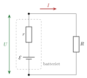
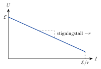

<!-- video: kommer (videoer/fysikk-forkurs/11-08-elektromotorisk-spenning) -->
{fig-alt="Video kommer"}

::: {.callout-tip title="Til ettertanke"}
<!-- tillegg: Claude -->
Når du starter en bil med lysene på, blir lysene svakere et øyeblikk. Batteriet er det samme, og lampene er de samme. Hvorfor synker spenningen?
:::

## Hva et batteri gjør

<!-- tillegg: Claude -->
Et batteri er en «ladningspumpe». Kjemiske reaksjoner inni batteriet flytter ladning fra den negative til den positive polen, mot den elektriske kraften. Energien som batteriet gir hver coulomb ladning, kalles **elektromotorisk spenning**, eller **emf**.

::: {.callout-note title="Definisjon: Elektromotorisk spenning"}
<!-- tillegg: Claude -->
Den elektromotoriske spenningen $\mathcal E$ er energien batteriet gir per ladning:
$$
\mathcal E = \frac{W}{q}
$$
Enheten er volt, som for vanlig spenning. Emf er spenningen mellom polene når det **ikke** går strøm.
:::

## Indre resistans

<!-- tillegg: Claude -->
Ladningen må også gjennom selve batteriet, og der møter den motstand. Vi tenker oss derfor batteriet som en ideell spenningskilde $\mathcal E$ i serie med en liten **indre resistans** $r$.

{.tikz-fig style="width:300px"}

<!-- tillegg: Claude -->
Når strømmen $I$ går, taper vi spenningen $rI$ inne i batteriet. Spenningen som er igjen mellom polene, kalles **polspenningen**:

::: {.callout-important title="Polspenning"}
<!-- tillegg: Claude -->
$$
U = \mathcal E - rI
$$
Med en ytre motstand $R$ er strømmen
$$
I = \frac{\mathcal E}{R + r}
$$
:::

<!-- tillegg: Claude -->
Jo større strøm, desto lavere polspenning. Det er svaret på spørsmålet øverst: Startmotoren trekker en enorm strøm, så spenningen over lysene synker.

{.tikz-fig style="width:360px"}

::: {.eksempel}
<!-- tillegg: Claude -->
**Eksempel: Batteri med last.** Et batteri har emf $9.0\ \mathrm{V}$ og indre resistans $0.50\ \mathrm{\Omega}$. Det kobles til en motstand på $4.0\ \mathrm{\Omega}$.

a)  Finn strømmen og polspenningen.

b)  Hva blir strømmen hvis polene kortsluttes ($R = 0$)?

::: {.losning}
**a)**
$$
I = \frac{\mathcal E}{R+r} = \frac{9.0\ \mathrm{V}}{4.5\ \mathrm{\Omega}} = \underline{\underline{2.0\ \mathrm{A}}}, \qquad U = \mathcal E - rI = 9.0\ \mathrm{V} - 0.50\ \mathrm{\Omega}\cdot2.0\ \mathrm{A} = \underline{\underline{8.0\ \mathrm{V}}}
$$
Sjekk: $U = RI = 4.0\ \mathrm{\Omega}\cdot2.0\ \mathrm{A} = 8.0\ \mathrm{V}$. ✓

**b)** $I = \dfrac{\mathcal E}{r} = \dfrac{9.0\ \mathrm{V}}{0.50\ \mathrm{\Omega}} = \underline{\underline{18\ \mathrm{A}}}$. All energien blir varme inne i batteriet – det kan bli farlig varmt.
:::
:::

::: {.eksempel}
<!-- tillegg: Claude -->
**Eksempel: Bilbatteriet.** Et bilbatteri har emf $12.6\ \mathrm{V}$. Når startmotoren trekker $150\ \mathrm{A}$, synker polspenningen til $10.5\ \mathrm{V}$. Finn den indre resistansen.

::: {.losning}
$$
r = \frac{\mathcal E - U}{I} = \frac{12.6\ \mathrm{V} - 10.5\ \mathrm{V}}{150\ \mathrm{A}} = \underline{\underline{0.014\ \mathrm{\Omega}}}
$$
Svært liten – ellers kunne ikke batteriet levert så stor strøm.
:::
:::

## Måle emf og indre resistans

<!-- tillegg: Claude -->
Vi kobler batteriet til en motstand vi kan variere, og måler polspenningen $U$ og strømmen $I$ for flere verdier. Punktene ligger på en rett linje $U = \mathcal E - rI$. Skjæringen med $U$-aksen gir $\mathcal E$, og stigningstallet gir $-r$. Programmet under gjør det med målinger fra et AA-batteri.

```{.python .kjor}
import numpy as np
import matplotlib.pyplot as plt

I = np.array([0.10, 0.20, 0.30, 0.40, 0.50])        # strøm (A)
U = np.array([1.50, 1.45, 1.40, 1.36, 1.30])        # polspenning (V)

a, b = np.polyfit(I, U, 1)                           # rett linje U = a*I + b
print(f"emf = {b:.2f} V,  indre resistans r = {-a:.2f} ohm")

Ix = np.linspace(0, 0.6, 50)
plt.plot(I, U, "o", label="målinger")
plt.plot(Ix, a*Ix + b, label="tilpasset linje")
plt.xlabel("$I$ (A)"); plt.ylabel("$U$ (V)"); plt.legend(); plt.grid(); plt.show()
```

:::: {.oppgaver}

::: {.oppgave tittel="Lommelykt"}
<!-- tillegg: Claude -->
Et batteri med emf $4.5\ \mathrm{V}$ og indre resistans $0.30\ \mathrm{\Omega}$ er koblet til en lyspære med resistans $8.7\ \mathrm{\Omega}$. Finn strømmen og polspenningen.

::: {.fasit}
$0.50\ \mathrm{A}$ · $4.35\ \mathrm{V}$
:::
:::

::: {.oppgave tittel="To målinger"}
<!-- tillegg: Claude -->
Et batteri gir polspenningen $1.45\ \mathrm{V}$ når strømmen er $0.20\ \mathrm{A}$, og $1.30\ \mathrm{V}$ når strømmen er $0.50\ \mathrm{A}$. Finn den indre resistansen og emf.

::: {.fasit}
$0.50\ \mathrm{\Omega}$ · $1.55\ \mathrm{V}$
:::
:::

::: {.oppgave tittel="Batterier i serie" niva="Middels"}
<!-- tillegg: Claude -->
Tre batterier, hvert med emf $1.5\ \mathrm{V}$ og indre resistans $0.20\ \mathrm{\Omega}$, kobles i serie og til en motstand på $2.4\ \mathrm{\Omega}$. Finn strømmen og polspenningen over hele batteripakken.

::: {.fasit}
$1.5\ \mathrm{A}$ · $3.6\ \mathrm{V}$
:::
:::

::: {.oppgave tittel="Størst mulig effekt" niva="Utfordrende"}
<!-- tillegg: Claude -->
Batteriet fra det første eksempelet ($\mathcal E = 9.0\ \mathrm{V}$, $r = 0.50\ \mathrm{\Omega}$) kobles til en motstand $R$. Effekten i motstanden er $P = RI^2 = \dfrac{R\,\mathcal E^2}{(R+r)^2}$. Regn ut $P$ for $R = 0.25$, $0.50$, $1.0$ og $2.0\ \mathrm{\Omega}$ (gjerne med Python). For hvilken $R$ blir effekten størst?

::: {.fasit}
$R = r = 0.50\ \mathrm{\Omega}$
:::
:::

::::
