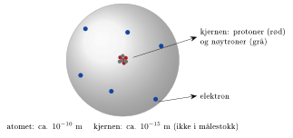

<!-- video: kommer (videoer/fysikk-forkurs/12-01-atomets-oppbygning) -->
{fig-alt="Video kommer"}

::: {.callout-tip title="Til ettertanke"}
<!-- tillegg: Claude -->
Du består nesten bare av tomrom. Hvis alle atomkjernene i kroppen din ble presset sammen, ville de fått plass i et støvkorn – men det støvkornet ville veid like mye som deg. Hvordan kan det ha seg?
:::

## Kjernen og elektronene

<!-- tillegg: Claude -->
Et atom har en liten, tung **kjerne** i midten, og rundt den en sky av lette **elektroner**. Kjernen er bygd av **protoner** og **nøytroner**, som med et felles navn kalles **nukleoner**.

{.tikz-fig style="width:520px"}

::: {.callout-note title="Partiklene i atomet" .graa}
<!-- tillegg: Claude -->
| Partikkel | Ladning | Masse |
|---|---|---|
| proton | $+\mathrm{e}$ | $1.673\cdot10^{-27}\ \mathrm{kg}$ |
| nøytron | $0$ | $1.675\cdot10^{-27}\ \mathrm{kg}$ |
| elektron | $-\mathrm{e}$ | $9.11\cdot10^{-31}\ \mathrm{kg}$ |

Elementærladningen er $\mathrm{e} = 1.60\cdot10^{-19}\ \mathrm{C}$. Et proton er omtrent $1800$ ganger så tungt som et elektron. Nesten all massen sitter derfor i kjernen.
:::

<!-- tillegg: Claude -->
Et nøytralt atom har like mange elektroner som protoner. Mister det ett eller flere elektroner, blir det et positivt **ion**. Får det ekstra elektroner, blir det et negativt ion.

## Hvordan vi vet det: Rutherfords forsøk

<!-- tillegg: Claude -->
I 1909 sendte Geiger og Marsden alfapartikler (heliumkjerner) mot en tynn gullfolie. Nesten alle gikk rett gjennom. Men omtrent én av 8000 ble bøyd kraftig av, noen rett tilbake. Rutherford forklarte det slik: All den positive ladningen og nesten all massen må sitte samlet i en bitte liten kjerne. Bare de få alfapartiklene som kommer svært nær kjernen, blir frastøtt kraftig. Resten av atomet er nesten tomt.

## Atomnummer, nukleontall og isotoper

::: {.callout-note title="Definisjon: Atomnummer og nukleontall"}
<!-- tillegg: Claude -->
- **Atomnummeret** $Z$ er antall protoner. Det bestemmer hvilket grunnstoff atomet er.
- **Nukleontallet** $A$ er antall protoner og nøytroner til sammen.
- Antall nøytroner er $N = A - Z$.

Vi skriver en kjerne slik: $^{A}_{Z}\mathrm{X}$, for eksempel $^{12}_{\ 6}\mathrm{C}$ eller $^{235}_{\ 92}\mathrm{U}$.
:::

<!-- tillegg: Claude -->
Atomer av samme grunnstoff kan ha forskjellig antall nøytroner. De kalles **isotoper**. Isotopene har samme kjemi (samme antall elektroner), men forskjellig masse, og noen av dem er radioaktive.

::: {.eksempel}
<!-- tillegg: Claude -->
**Eksempel: Karbonisotoper.** Hvor mange protoner, nøytroner og elektroner har et nøytralt atom av $^{12}_{\ 6}\mathrm{C}$ og av $^{14}_{\ 6}\mathrm{C}$?

::: {.losning}
Begge har $Z = 6$: **6 protoner og 6 elektroner**.

- $^{12}\mathrm{C}$: $N = 12 - 6 = \underline{\underline{6}}$ nøytroner.
- $^{14}\mathrm{C}$: $N = 14 - 6 = \underline{\underline{8}}$ nøytroner.

Karbon-14 er radioaktivt og brukes til å datere gamle ting (se *radioaktivitet og stråling*).
:::
:::

## Hva holder kjernen sammen?

<!-- tillegg: Claude -->
Protonene i kjernen er positive og frastøter hverandre med en enorm elektrisk kraft. Likevel holder kjernen sammen. Det må altså finnes en kraft som er enda sterkere: **den sterke kjernekraften**. Den virker mellom alle nukleoner, både protoner og nøytroner, men bare over svært korte avstander, omtrent $10^{-15}\ \mathrm{m}$. Nøytronene «limer» kjernen sammen uten å bidra til frastøtningen.

::: {.eksempel}
<!-- tillegg: Claude -->
**Eksempel: Frastøtningen i kjernen.** To protoner i en kjerne er omtrent $2.0\cdot10^{-15}\ \mathrm{m}$ fra hverandre. Hvor stor er den elektriske kraften mellom dem?

::: {.losning}
Coulombs lov:
$$
F = \mathrm{k_e}\frac{\mathrm{e}^2}{r^2} = 8.99\cdot10^{9}\cdot\frac{(1.60\cdot10^{-19})^2}{(2.0\cdot10^{-15})^2}\ \mathrm{N} = \underline{\underline{58\ \mathrm{N}}}
$$
Det er som tyngden av en sekk poteter – på én eneste partikkel med masse $10^{-27}\ \mathrm{kg}$! Den sterke kjernekraften må være enda større.
:::
:::

:::: {.oppgaver}

::: {.oppgave tittel="Tell partiklene"}
<!-- tillegg: Claude -->
Hvor mange protoner, nøytroner og elektroner har et nøytralt atom av $^{56}_{26}\mathrm{Fe}$ og av $^{235}_{\ 92}\mathrm{U}$?

::: {.losning}
- Jern-56: **26 protoner, 30 nøytroner, 26 elektroner**.
- Uran-235: **92 protoner, 143 nøytroner, 92 elektroner**.
:::
:::

::: {.oppgave tittel="Ioner"}
<!-- tillegg: Claude -->
Et natriumatom ($Z = 11$) mister ett elektron. Hva blir ladningen til ionet, og hvor mange elektroner har det?

::: {.losning}
Ionet har 11 protoner og **10 elektroner**, så ladningen er $\underline{\underline{+\mathrm{e} = 1.60\cdot10^{-19}\ \mathrm{C}}}$.
:::
:::

::: {.oppgave tittel="Tettheten i kjernen" niva="Middels"}
<!-- tillegg: Claude -->
En karbon-12-kjerne har radius ca. $2.7\cdot10^{-15}\ \mathrm{m}$ og masse $2.0\cdot10^{-26}\ \mathrm{kg}$. Finn tettheten til kjernen. Sammenlign med vann, $1.0\cdot10^{3}\ \mathrm{kg/m^3}$.

::: {.losning}
$$
V = \tfrac43\pi r^3 = \tfrac43\pi(2.7\cdot10^{-15}\ \mathrm{m})^3 = 8.2\cdot10^{-44}\ \mathrm{m^3}
$$
$$
\rho = \frac mV = \frac{2.0\cdot10^{-26}\ \mathrm{kg}}{8.2\cdot10^{-44}\ \mathrm{m^3}} = \underline{\underline{2.4\cdot10^{17}\ \mathrm{kg/m^3}}}
$$
Omtrent $10^{14}$ ganger tettere enn vann. En teskje med kjernestoff ville veid like mye som et fjell. (Nøytronstjerner består av slikt stoff.)
:::
:::

::: {.oppgave tittel="Elektrisk mot tyngdekraft" niva="Utfordrende"}
<!-- tillegg: Claude -->
I et hydrogenatom er elektronet i gjennomsnitt $5.3\cdot10^{-11}\ \mathrm{m}$ fra protonet. Finn den elektriske kraften og gravitasjonskraften mellom dem, og forholdet mellom kreftene.

::: {.losning}
$$
F_e = \mathrm{k_e}\frac{\mathrm{e}^2}{r^2} = 8.99\cdot10^{9}\cdot\frac{(1.60\cdot10^{-19})^2}{(5.3\cdot10^{-11})^2}\ \mathrm{N} = \underline{\underline{8.2\cdot10^{-8}\ \mathrm{N}}}
$$
$$
F_G = \mathrm{G}\frac{\mathrm{m_p}\mathrm{m_e}}{r^2} = 6.67\cdot10^{-11}\cdot\frac{1.67\cdot10^{-27}\cdot9.11\cdot10^{-31}}{(5.3\cdot10^{-11})^2}\ \mathrm{N} = \underline{\underline{3.6\cdot10^{-47}\ \mathrm{N}}}
$$
Forholdet er $F_e/F_G \approx \underline{\underline{2\cdot10^{39}}}$. I atomer er tyngdekraften helt uten betydning.
:::
:::

::::
