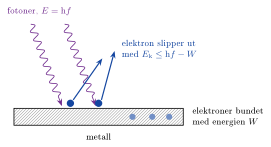
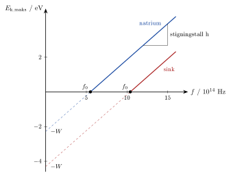

<!-- video: kommer (videoer/fysikk-forkurs/12-02-kvanter-og-fotoner) -->
{fig-alt="Video kommer"}

::: {.callout-tip title="Til ettertanke"}
<!-- tillegg: Claude -->
Lyser du med en svak ultrafiolett lampe på en ren sinkplate, slipper det elektroner ut av metallet med en gang. Lyser du med en kraftig rød lyskaster, skjer det ingenting, samme hvor lenge du venter. Hvordan kan et svakt lys klare noe som et sterkt lys ikke klarer?
:::

## Energien kommer i pakker

<!-- tillegg: Claude -->
Rundt år 1900 trodde fysikerne at lys var ferdig forstått: en elektromagnetisk bølge (se [elektromagnetisk stråling](../10-bolger-og-straling/02-straling-og-drivhuseffekten.qmd)). En bølge kan ha hvilken som helst energi. Den kan bli litt sterkere eller litt svakere, akkurat som en vannbølge.

Men to forsøk ville ikke passe inn. Det ene var [varmestrålingen](../10-bolger-og-straling/03-varmestraling.qmd) fra glødende legemer. Max Planck fikk formelen for strålingen til å stemme bare ved å anta at energien sendes ut i bestemte porsjoner, **kvanter**. Det andre forsøket var den fotoelektriske effekten, som vi ser på under. Einstein tok Plancks idé på alvor og sa at lyset *selv* består av kvanter. Et lyskvant kalles et **foton**.

::: {.callout-important title="Energien til et foton"}
<!-- tillegg: Claude -->
$$
E = \mathrm{h}f = \frac{\mathrm{h}\mathrm{c}}{\lambda}
$$
der $\mathrm{h} = 6.63\cdot10^{-34}\ \mathrm{J\,s}$ er Plancks konstant. Lys med frekvensen $f$ kan bare gi fra seg energi i hele porsjoner på $\mathrm{h}f$, aldri en halv porsjon.
:::

<!-- tillegg: Claude -->
Tenk på en automat som bare tar imot hele mynter. Sterkere lys betyr *flere* mynter, men hver mynt har samme verdi. Verdien bestemmes av frekvensen: Blått og ultrafiolett lys gir store mynter, rødt lys små. Under [spektre og energinivåer](03-spektre-og-energinivaer.qmd) bruker vi fotonene til å forklare lyset fra atomer, og der står også enheten elektronvolt: $1\ \mathrm{eV} = 1.60\cdot10^{-19}\ \mathrm{J}$ og $\mathrm{h}\mathrm{c} = 1240\ \mathrm{eV\,nm}$.

## Den fotoelektriske effekten

<!-- tillegg: Claude -->
Elektronene i et metall kan bevege seg fritt inne i metallet, men de er bundet til det. Det koster en viss energi å rive et elektron ut gjennom overflaten. Den minste energien som trengs, kalles **løsrivningsarbeidet** $W$ og er en egenskap ved metallet.

Når lys treffer metallet, kan et foton gi *hele* energien sin til *ett* elektron. Er fotonenergien større enn $W$, slipper elektronet ut, og resten av energien blir kinetisk energi.

{.tikz-fig style="width:500px" fig-alt="Bølgete piler, merket fotoner med energi h f, kommer ovenfra og treffer en metallplate. Fra platen går to elektroner ut skrått oppover, merket «elektron slipper ut med kinetisk energi høyst h f minus W». Inne i platen ligger flere elektroner, merket «elektroner bundet med energien W»."}

::: {.callout-important title="Einsteins likning for den fotoelektriske effekten"}
<!-- tillegg: Claude -->
$$
E_\text{k,maks} = \mathrm{h}f - W
$$
Elektronene som ligger lettest til, får den største kinetiske energien $E_\text{k,maks}$. Andre mister litt energi på veien ut og får mindre.
:::

<!-- tillegg: Claude -->
Nå kan vi svare på spørsmålet øverst:

::: {.kort}
- **Frekvensen bestemmer om det skjer.** Hvert elektron får energi fra bare ett foton. Er $\mathrm{h}f < W$, er hver «mynt» for liten, og det hjelper ikke å sende flere.
- **Lysstyrken bestemmer hvor mye.** Sterkere lys betyr flere fotoner per sekund og dermed flere elektroner, men hvert elektron får ikke mer energi.
- **Det skjer med en gang.** Elektronet trenger ikke samle opp energi over tid. Ett foton er nok.
:::

<!-- tillegg: Claude -->
Med bølgemodellen skulle sterkt rødt lys før eller siden ha gitt elektronene nok energi. Forsøkene viser at det ikke skjer. Det var dette Einstein fikk Nobelprisen for i 1921.

::: {.callout-note title="Definisjon: Grensefrekvens"}
<!-- tillegg: Claude -->
**Grensefrekvensen** $f_0$ er den laveste frekvensen som kan løsrive elektroner. Da er $E_\text{k,maks} = 0$, så
$$
f_0 = \frac{W}{\mathrm{h}}, \qquad \lambda_0 = \frac{\mathrm{h}\mathrm{c}}{W}
$$
Lys med *kortere* bølgelengde enn $\lambda_0$ (høyere frekvens enn $f_0$) løsriver elektroner.
:::

::: {.graa}
<!-- tillegg: Claude -->
| Metall | Løsrivningsarbeid $W$ |
|---|---|
| cesium | $2.1\ \mathrm{eV}$ |
| natrium | $2.28\ \mathrm{eV}$ |
| sink | $4.3\ \mathrm{eV}$ |
| kobber | $4.7\ \mathrm{eV}$ |
:::

::: {.eksempel}
<!-- tillegg: Claude -->
**Eksempel: Fiolett lys på natrium.** Fiolett lys med bølgelengde $400\ \mathrm{nm}$ treffer en natriumplate. Finn den største kinetiske energien og den største farten til elektronene som slipper ut.

::: {.losning}
Fotonenergien er
$$
E = \frac{\mathrm{h}\mathrm{c}}{\lambda} = \frac{1240\ \mathrm{eV\,nm}}{400\ \mathrm{nm}} = 3.10\ \mathrm{eV}
$$
Det er mer enn $W = 2.28\ \mathrm{eV}$, så elektroner slipper ut. Einsteins likning gir
$$
E_\text{k,maks} = 3.10\ \mathrm{eV} - 2.28\ \mathrm{eV} = \underline{\underline{0.82\ \mathrm{eV}}} = 0.82\cdot1.60\cdot10^{-19}\ \mathrm{J} = 1.31\cdot10^{-19}\ \mathrm{J}
$$
Farten finner vi fra $E_\text{k} = \tfrac12 \mathrm{m_e} v^2$:
$$
v = \sqrt{\frac{2E_\text{k}}{\mathrm{m_e}}} = \sqrt{\frac{2\cdot1.31\cdot10^{-19}\ \mathrm{J}}{9.11\cdot10^{-31}\ \mathrm{kg}}} = \underline{\underline{5.4\cdot10^{5}\ \mathrm{m/s}}}
$$
Over 500 km i sekundet, men bare en liten brøkdel av lysfarten.
:::
:::

## Grafen avslører Plancks konstant

<!-- tillegg: Claude -->
Måler vi $E_\text{k,maks}$ for lys med forskjellige frekvenser og tegner resultatet, får vi en rett linje. Det er ikke rart: $E_\text{k,maks} = \mathrm{h}f - W$ har samme form som $y = ax + b$, med stigningstall $\mathrm{h}$ og konstantledd $-W$.

{.tikz-fig style="width:500px" fig-alt="Graf med frekvensen i enheter av 10 i fjortende hertz langs x-aksen og største kinetiske energi i elektronvolt langs y-aksen. To parallelle rette linjer stiger mot høyre. Linja for natrium starter på frekvensaksen ved omtrent 5.5, og linja for sink ved omtrent 10.4. Stiplede forlengelser treffer y-aksen i minus 2.28 og minus 4.3. En liten trekant markerer at stigningstallet er h."}

<!-- tillegg: Claude -->
Grafen forteller tre ting:

::: {.kort}
- **Stigningstallet er $\mathrm{h}$**, det samme for alle metaller. Slik ble Plancks konstant målt nøyaktig for første gang.
- **Skjæringen med frekvensaksen** er grensefrekvensen $f_0$.
- **Forlenget bakover** treffer linja energiaksen i $-W$.
:::

<!-- tillegg: Claude -->
Programmet regner ut $E_\text{k,maks}$ for noen bølgelengder. Bytt metall ved å endre `W`, eller prøv andre bølgelengder.

```{.python .kjor}
hc = 1240      # eV nm
W = 2.28       # løsrivningsarbeid i eV (natrium)

print(f"Grensebølgelengde: {hc/W:.0f} nm")
for lam in [700, 600, 500, 400, 300, 200]:      # bølgelengder i nm
    E = hc/lam                                   # fotonenergi i eV
    Ek = E - W
    if Ek > 0:
        print(f"{lam} nm: foton {E:.2f} eV, Ek,maks = {Ek:.2f} eV")
    else:
        print(f"{lam} nm: foton {E:.2f} eV, ingen elektroner")
```

## Bølge eller partikkel?

<!-- tillegg: Claude -->
Er lys en bølge eller en strøm av partikler? Svaret er at lys oppfører seg som **begge deler**, avhengig av hva vi måler:

::: {.kort}
- **Som bølge** når lyset brer seg: Lys gjennom to smale spalter gir et mønster av lyse og mørke striper, interferens (se [bølger](../10-bolger-og-straling/01-bolger.qmd)). Det kan bare bølger gjøre.
- **Som partikkel** når lyset gir fra seg energi: I den fotoelektriske effekten, i øyet og i et kamera tas energien opp i hele fotoner, ett om gangen.
:::

<!-- tillegg: Claude -->
Dette kalles **bølge–partikkel-dualiteten**. Det er ikke slik at vi ikke vet hva lys er. Lys er rett og slett noe annet enn både vannbølger og biljardkuler, og hverdagsbildene våre passer bare halvveis.

I 1924 snudde Louis de Broglie på det: Hvis bølger kan oppføre seg som partikler, kan kanskje partikler oppføre seg som bølger? Han foreslo at en partikkel med masse $m$ og fart $v$ har bølgelengden
$$
\lambda = \frac{\mathrm{h}}{mv}
$$
Noen år senere sendte forskere elektroner mot en krystall og fikk akkurat det interferensmønsteret formelen forutsa.

::: {.eksempel}
<!-- tillegg: Claude -->
**Eksempel: Elektron og fotball.** Finn de Broglie-bølgelengden til **a)** et elektron med farten $1.0\cdot10^{6}\ \mathrm{m/s}$ og **b)** en fotball med masse $0.45\ \mathrm{kg}$ og fart $20\ \mathrm{m/s}$.

::: {.losning}
**a)**
$$
\lambda = \frac{\mathrm{h}}{\mathrm{m_e} v} = \frac{6.63\cdot10^{-34}\ \mathrm{J\,s}}{9.11\cdot10^{-31}\ \mathrm{kg}\cdot1.0\cdot10^{6}\ \mathrm{m/s}} = \underline{\underline{7.3\cdot10^{-10}\ \mathrm{m}}} = 0.73\ \mathrm{nm}
$$
Det er omtrent like stort som et atom. Derfor merker elektroner bølgenaturen sin i atomer og krystaller, og det er derfor elektronmikroskoper kan se mye mindre ting enn lysmikroskoper.

**b)**
$$
\lambda = \frac{6.63\cdot10^{-34}\ \mathrm{J\,s}}{0.45\ \mathrm{kg}\cdot20\ \mathrm{m/s}} = \underline{\underline{7.4\cdot10^{-35}\ \mathrm{m}}}
$$
Langt mindre enn en atomkjerne. Ingen åpning i verden er så smal at fotballen kan vise interferens, og derfor ser vi aldri bølgenaturen til hverdagsting.
:::
:::

:::: {.oppgaver}

::: {.oppgave tittel="Rødt lys på cesium"}
<!-- tillegg: Claude -->
Cesium har løsrivningsarbeidet $2.1\ \mathrm{eV}$.

a) Finn grensebølgelengden for cesium.

b) Slipper det ut elektroner når cesium belyses med rødt lys med bølgelengde $650\ \mathrm{nm}$?

::: {.losning}
a)
$$
\lambda_0 = \frac{\mathrm{h}\mathrm{c}}{W} = \frac{1240\ \mathrm{eV\,nm}}{2.1\ \mathrm{eV}} = \underline{\underline{5.9\cdot10^{2}\ \mathrm{nm}}}
$$
Det er gult lys.

b) Fotonene i rødt lys har energien $\dfrac{1240\ \mathrm{eV\,nm}}{650\ \mathrm{nm}} = 1.9\ \mathrm{eV}$, som er mindre enn $2.1\ \mathrm{eV}$. Bølgelengden $650\ \mathrm{nm}$ er også lengre enn grensebølgelengden. **Nei, det slipper ikke ut elektroner**, uansett hvor sterkt lyset er.
:::
:::

::: {.oppgave tittel="Dobbelt så sterkt lys"}
<!-- tillegg: Claude -->
En natriumplate belyses med fiolett lys, og elektroner slipper ut. Så gjør vi lyset dobbelt så sterkt, men med samme farge. Hva skjer med

a) antall elektroner som slipper ut per sekund?

b) den største kinetiske energien til elektronene?

::: {.losning}
a) Dobbelt så sterkt lys med samme farge betyr dobbelt så mange fotoner per sekund. Hvert foton kan løsrive ett elektron, så **antall elektroner per sekund blir omtrent dobbelt så stort**.

b) Hvert foton har fortsatt energien $\mathrm{h}f$, og hvert elektron får energi fra bare ett foton. $E_\text{k,maks} = \mathrm{h}f - W$ er derfor **uendret**.
:::
:::

::: {.oppgave tittel="Ultrafiolett lys på kobber"}
<!-- tillegg: Claude -->
Kobber belyses med ultrafiolett lys med bølgelengde $200\ \mathrm{nm}$. Kobber har løsrivningsarbeidet $4.7\ \mathrm{eV}$. Finn den største kinetiske energien til elektronene, i elektronvolt og i joule.

::: {.losning}
Fotonenergien er
$$
E = \frac{1240\ \mathrm{eV\,nm}}{200\ \mathrm{nm}} = 6.20\ \mathrm{eV}
$$
$$
E_\text{k,maks} = 6.20\ \mathrm{eV} - 4.7\ \mathrm{eV} = \underline{\underline{1.5\ \mathrm{eV}}} = 1.5\cdot1.60\cdot10^{-19}\ \mathrm{J} = \underline{\underline{2.4\cdot10^{-19}\ \mathrm{J}}}
$$
Svaret har én desimal fordi $W$ er oppgitt med én desimal.
:::
:::

::: {.oppgave tittel="Mål Plancks konstant" niva="Middels"}
<!-- tillegg: Claude -->
I et forsøk med en metallplate måler en elevgruppe den største kinetiske energien til elektronene for to frekvenser:

| $f$ | $E_\text{k,maks}$ |
|---|---|
| $6.0\cdot10^{14}\ \mathrm{Hz}$ | $0.20\ \mathrm{eV}$ |
| $9.0\cdot10^{14}\ \mathrm{Hz}$ | $1.44\ \mathrm{eV}$ |

a) Bruk målingene til å finne Plancks konstant, i $\mathrm{eV\,s}$ og i $\mathrm{J\,s}$.

b) Finn løsrivningsarbeidet. Hvilket metall er det trolig?

::: {.losning}
a) Punktene ligger på linja $E_\text{k,maks} = \mathrm{h}f - W$, så $\mathrm{h}$ er stigningstallet:
$$
\mathrm{h} = \frac{\Delta E_\text{k,maks}}{\Delta f} = \frac{1.44\ \mathrm{eV} - 0.20\ \mathrm{eV}}{9.0\cdot10^{14}\ \mathrm{Hz} - 6.0\cdot10^{14}\ \mathrm{Hz}} = \frac{1.24\ \mathrm{eV}}{3.0\cdot10^{14}\ \mathrm{Hz}} = \underline{\underline{4.1\cdot10^{-15}\ \mathrm{eV\,s}}}
$$
I joulesekund: $4.13\cdot10^{-15}\cdot1.60\cdot10^{-19}\ \mathrm{J\,s} = \underline{\underline{6.6\cdot10^{-34}\ \mathrm{J\,s}}}$, som stemmer med tabellverdien.

b) Fra det første punktet:
$$
W = \mathrm{h}f - E_\text{k,maks} = 4.13\cdot10^{-15}\ \mathrm{eV\,s}\cdot6.0\cdot10^{14}\ \mathrm{Hz} - 0.20\ \mathrm{eV} = \underline{\underline{2.3\ \mathrm{eV}}}
$$
Det passer med **natrium** ($2.28\ \mathrm{eV}$).
:::
:::

::: {.oppgave tittel="Elektroner som bølger" niva="Utfordrende"}
<!-- tillegg: Claude -->
I et elektronmikroskop akselereres elektroner fra ro gjennom spenningen $100\ \mathrm{V}$. Da får hvert elektron den kinetiske energien $100\ \mathrm{eV}$.

a) Finn farten til elektronene.

b) Finn de Broglie-bølgelengden. Sammenlign med bølgelengden til synlig lys.

::: {.losning}
a) Den kinetiske energien er $E_\text{k} = 100\cdot1.60\cdot10^{-19}\ \mathrm{J} = 1.60\cdot10^{-17}\ \mathrm{J}$. Fra $E_\text{k} = \tfrac12 \mathrm{m_e} v^2$:
$$
v = \sqrt{\frac{2E_\text{k}}{\mathrm{m_e}}} = \sqrt{\frac{2\cdot1.60\cdot10^{-17}\ \mathrm{J}}{9.11\cdot10^{-31}\ \mathrm{kg}}} = \underline{\underline{5.93\cdot10^{6}\ \mathrm{m/s}}}
$$

b)
$$
\lambda = \frac{\mathrm{h}}{\mathrm{m_e} v} = \frac{6.63\cdot10^{-34}\ \mathrm{J\,s}}{9.11\cdot10^{-31}\ \mathrm{kg}\cdot5.93\cdot10^{6}\ \mathrm{m/s}} = \underline{\underline{1.23\cdot10^{-10}\ \mathrm{m}}} = 0.123\ \mathrm{nm}
$$
Synlig lys har bølgelengder på $400$–$700\ \mathrm{nm}$, altså noen tusen ganger lengre. Jo kortere bølgelengde, desto mindre detaljer kan et mikroskop skille. Derfor kan elektronmikroskoper se enkeltmolekyler, mens lysmikroskoper ikke kan.
:::
:::

::::
