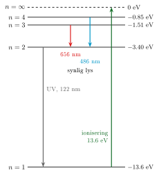
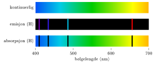

<!-- video: kommer (videoer/fysikk-forkurs/12-02-spektre-og-energinivaer) -->
{fig-alt="Video kommer"}

::: {.callout-tip title="Til ettertanke"}
<!-- tillegg: Claude -->
Grunnstoffet helium ble oppdaget i sola i 1868, nesten 30 år før det ble funnet på jorda. Hvordan kan vi vite hva sola er laget av, uten å reise dit?
:::

## Fotoner

<!-- tillegg: Claude -->
Lys er en elektromagnetisk bølge (se *bølger og stråling*). Men når lys sendes ut eller tas opp av atomer, skjer det i små, udelelige energipakker: **fotoner** (se [kvanter og fotoner](02-kvanter-og-fotoner.qmd)).

::: {.callout-important title="Energien til et foton"}
<!-- tillegg: Claude -->
$$
E = \mathrm{h}f = \frac{\mathrm{h}\mathrm{c}}{\lambda}
$$
der $\mathrm{h} = 6.63\cdot10^{-34}\ \mathrm{J\,s}$ er Plancks konstant, $f$ er frekvensen og $\lambda$ er bølgelengden. Kort bølgelengde gir energirike fotoner.
:::

<!-- tillegg: Claude -->
Fotonenergiene er så små at vi ofte bruker enheten **elektronvolt**: energien et elektron får når det akselereres gjennom spenningen $1\ \mathrm{V}$.
$$
1\ \mathrm{eV} = 1.60\cdot10^{-19}\ \mathrm{J}
$$
En nyttig snarvei er $\mathrm{h}\mathrm{c} = 1240\ \mathrm{eV\,nm}$, så $E = \dfrac{1240\ \mathrm{eV\,nm}}{\lambda}$.

::: {.eksempel}
<!-- tillegg: Claude -->
**Eksempel: Laserpeker.** En rød laserpeker sender ut lys med bølgelengde $650\ \mathrm{nm}$ og har effekten $1.0\ \mathrm{mW}$. Finn energien til ett foton og hvor mange fotoner som sendes ut per sekund.

::: {.losning}
$$
E = \frac{\mathrm{h}\mathrm{c}}{\lambda} = \frac{6.63\cdot10^{-34}\ \mathrm{J\,s}\cdot3.00\cdot10^{8}\ \mathrm{m/s}}{650\cdot10^{-9}\ \mathrm{m}} = \underline{\underline{3.1\cdot10^{-19}\ \mathrm{J}}} = 1.9\ \mathrm{eV}
$$
Antall fotoner per sekund er effekten delt på energien til ett foton:
$$
n = \frac{1.0\cdot10^{-3}\ \mathrm{J/s}}{3.1\cdot10^{-19}\ \mathrm{J}} = \underline{\underline{3.3\cdot10^{15}\ \mathrm{per\ sekund}}}
$$
:::
:::

## Energinivåer

<!-- tillegg: Claude -->
Elektronene i et atom kan ikke ha hvilken som helst energi. De kan bare være i bestemte **energinivåer**. Det laveste kalles **grunntilstanden**. Når atomet får tilført energi (ved oppvarming, en elektrisk utladning eller et foton), kan elektronet hoppe opp til et høyere nivå. Etter kort tid faller det ned igjen og sender ut et foton med nøyaktig energiforskjellen:
$$
E_\text{foton} = E_\text{øvre} - E_\text{nedre}
$$

<!-- tillegg: Claude -->
For hydrogen er energinivåene
$$
E_n = -\frac{13.6\ \mathrm{eV}}{n^2}, \qquad n = 1, 2, 3, \dots
$$
Energien er negativ fordi elektronet er bundet: Vi må tilføre $13.6\ \mathrm{eV}$ for å rive det løs fra grunntilstanden (**ionisere** atomet).

{.tikz-fig style="width:380px"}

::: {.eksempel}
<!-- tillegg: Claude -->
**Eksempel: Den røde linja i hydrogen.** Et elektron i hydrogen faller fra $n = 3$ til $n = 2$. Finn energien og bølgelengden til fotonet.

::: {.losning}
$$
E_3 = -\frac{13.6}{9}\ \mathrm{eV} = -1.51\ \mathrm{eV}, \qquad E_2 = -\frac{13.6}{4}\ \mathrm{eV} = -3.40\ \mathrm{eV}
$$
$$
E_\text{foton} = -1.51\ \mathrm{eV} - (-3.40\ \mathrm{eV}) = \underline{\underline{1.89\ \mathrm{eV}}}, \qquad \lambda = \frac{1240\ \mathrm{eV\,nm}}{1.89\ \mathrm{eV}} = \underline{\underline{656\ \mathrm{nm}}}
$$
Rødt lys. Det er denne linja som gir den rosa-røde fargen i bilder av gasståker i verdensrommet.
:::
:::

## Linjespektre

<!-- tillegg: Claude -->
Sender vi lyset fra en glødende gass gjennom et prisme eller et gitter, ser vi ikke en sammenhengende regnbue, men noen få skarpe linjer: et **emisjonsspekter**. Hvert grunnstoff har sine egne energinivåer og dermed sitt eget mønster av linjer – et fingeravtrykk.

Sender vi hvitt lys **gjennom** en kald gass, tar atomene opp akkurat de samme bølgelengdene. Da ser vi mørke linjer i en ellers sammenhengende regnbue: et **absorpsjonsspekter**.

{.tikz-fig style="width:520px"}

<!-- tillegg: Claude -->
Lyset fra sola har mange mørke absorpsjonslinjer. Ved å sammenligne dem med spektrene fra grunnstoffer på jorda vet vi hva sola og stjernene er laget av. I 1868 fant astronomer en gul linje som ikke passet med noe kjent grunnstoff. Det nye stoffet fikk navnet helium, etter *helios*, som er gresk for sol.

::: {.callout-note title="Fotonenergi og hverdagen" .graa}
<!-- tillegg: Claude -->
Synlig lys har fotonenergier på ca. $1.6$–$3.3\ \mathrm{eV}$. Det er akkurat nok til å endre molekyler i netthinnen (vi kan se) og i bladgrønt (fotosyntese). Ultrafiolette fotoner har så mye energi at de kan bryte bindinger i DNA – derfor gir UV solbrenthet, men ikke rødt lys, uansett hvor sterkt det er.
:::

<!-- tillegg: Claude -->
Programmet regner ut alle linjene der elektronet faller ned til et gitt nivå. Prøv å endre `n_ned` til 1 eller 3.

```{.python .kjor}
hc = 1240          # eV nm
n_ned = 2          # nivået elektronet faller ned til

for n in range(n_ned + 1, n_ned + 7):
    E = 13.6*(1/n_ned**2 - 1/n**2)        # fotonenergi i eV
    print(f"{n} -> {n_ned}:  E = {E:5.2f} eV,  bølgelengde = {hc/E:6.1f} nm")
```

:::: {.oppgaver}

::: {.oppgave tittel="Fiolett lys"}
<!-- tillegg: Claude -->
Finn energien til et foton med bølgelengde $400\ \mathrm{nm}$, i elektronvolt og i joule.

::: {.fasit}
$3.1\ \mathrm{eV}$ · $5.0\cdot10^{-19}\ \mathrm{J}$
:::
:::

::: {.oppgave tittel="Den blågrønne linja"}
<!-- tillegg: Claude -->
Finn bølgelengden til fotonet når elektronet i hydrogen faller fra $n = 4$ til $n = 2$.

::: {.fasit}
$486\ \mathrm{nm}$
:::
:::

::: {.oppgave tittel="Ionisering" niva="Middels"}
<!-- tillegg: Claude -->
Hva er den lengste bølgelengden et foton kan ha og fortsatt ionisere et hydrogenatom i grunntilstanden? Hvilken del av spekteret er det?

::: {.fasit}
$91\ \mathrm{nm}$
:::
:::

::: {.oppgave tittel="Hvor mange linjer?" niva="Utfordrende"}
<!-- tillegg: Claude -->
Et hydrogenatom er eksitert til $n = 4$. Elektronet kan falle ned i ett hopp eller i flere. Hvor mange forskjellige fotonenergier kan atomet sende ut? Hvilke av dem er synlige?

:::

::::
