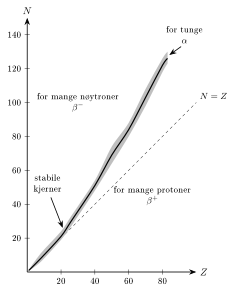

<!-- video: kommer (videoer/fysikk-forkurs/12-04-atomkjernen) -->
{fig-alt="Video kommer"}

::: {.callout-tip title="Til ettertanke"}
<!-- tillegg: Claude -->
En heliumkjerne har like mange nøytroner som protoner: to av hver. En gullkjerne har 79 protoner, men hele 118 nøytroner. Hvorfor trenger store kjerner så mange flere nøytroner enn protoner?
:::

<!-- tillegg: Claude -->
Under [atomets oppbygning](01-atomets-oppbygning.qmd) så vi at kjernen er bygd av protoner og nøytroner, og at den sterke kjernekraften holder dem sammen. Her ser vi nærmere på kjernen selv: hvor stor den er, hvordan kreftene i den konkurrerer, og hvilke kjerner som er stabile.

## Hvor stor er en kjerne?

<!-- tillegg: Claude -->
Kjerner er så små at vi bruker enheten **femtometer**: $1\ \mathrm{fm} = 10^{-15}\ \mathrm{m}$. Forsøk der elektroner og alfapartikler sendes mot kjerner, viser at radien følger en enkel regel.

::: {.callout-important title="Radien til en kjerne"}
<!-- tillegg: Claude -->
$$
r = r_0 A^{1/3}, \qquad r_0 = 1.2\ \mathrm{fm}
$$
der $A$ er nukleontallet.
:::

<!-- tillegg: Claude -->
Hvorfor tredjeroten? Tenk på nukleonene som klinkekuler som ligger tett i en pose. Hver kule tar like stor plass, så volumet av posen er proporsjonalt med antall kuler: $V \propto A$. Volumet av en kule er $\tfrac43\pi r^3$, så $r^3 \propto A$, og dermed $r \propto A^{1/3}$.

Det har en overraskende følge. Massen er omtrent $A$ ganger massen til ett nukleon, og volumet er også proporsjonalt med $A$. Da blir **tettheten den samme i alle kjerner**, fra helium til uran:
$$
\rho = \frac{m}{V} = \frac{A\cdot m_\text{nukleon}}{\tfrac43\pi r_0^3 A} = \frac{m_\text{nukleon}}{\tfrac43\pi r_0^3} \approx 2.3\cdot10^{17}\ \mathrm{kg/m^3}
$$
$A$ forkortes bort. Kjernestoff er like tett overalt, omtrent som en dråpe væske der molekylene ligger helt inntil hverandre.

::: {.eksempel}
<!-- tillegg: Claude -->
**Eksempel: Helium og uran.** Finn radien til en helium-4-kjerne og en uran-238-kjerne. Hvor mange ganger større er uranradien?

::: {.losning}
$$
r_\text{He} = 1.2\ \mathrm{fm}\cdot4^{1/3} = \underline{\underline{1.9\ \mathrm{fm}}}, \qquad r_\text{U} = 1.2\ \mathrm{fm}\cdot238^{1/3} = \underline{\underline{7.4\ \mathrm{fm}}}
$$
Forholdet er $\left(\dfrac{238}{4}\right)^{1/3} = \underline{\underline{3.9}}$. Uran har nesten 60 ganger så mange nukleoner, men radien er bare fire ganger så stor, fordi det er *volumet* som vokser i takt med $A$.
:::
:::

## To krefter som konkurrerer

<!-- tillegg: Claude -->
I kjernen virker to krefter som drar hver sin vei:

::: {.kort}
- **Den sterke kjernekraften** trekker alle nukleoner mot hverandre, både protoner og nøytroner. Men den rekker bare ca. $2\ \mathrm{fm}$, så hvert nukleon merker bare de nærmeste naboene.
- **Den elektriske kraften** skyver protonene fra hverandre. Den rekker langt, så hvert proton blir frastøtt av *alle* de andre protonene i kjernen.
:::

<!-- tillegg: Claude -->
Forskjellen i rekkevidde er nøkkelen. Legger vi til ett nukleon i en stor kjerne, får det tiltrekning bare fra naboene, omtrent like mye som i en liten kjerne. Men et nytt proton blir frastøtt av alle protonene som er der fra før. Jo større kjernen er, desto mer koster hvert nytt proton.

Nøytronene er løsningen. De gir tiltrekning med den sterke kjernekraften, men har ingen ladning og bidrar ikke til frastøtningen. Store kjerner trenger derfor flere nøytroner enn protoner for å holde sammen. Det er svaret på spørsmålet øverst.

::: {.callout-note title="Hvorfor ikke bare nøytroner?" .graa}
<!-- tillegg: Claude -->
Nøytroner alene holder ikke sammen. Et fritt nøytron er faktisk ustabilt og blir til et proton og et elektron i løpet av noen minutter. I en kjerne med altfor mange nøytroner skjer det samme. Kjernen må ha en balanse: nok nøytroner til å lime, nok protoner til at nøytronene ikke henfaller.
:::

## Hvilke kjerner er stabile?

<!-- tillegg: Claude -->
Det finnes rundt 250 stabile kjerner og flere tusen ustabile. Tegner vi hver kjerne som et punkt med protontallet $Z$ bortover og nøytrontallet $N$ oppover, får vi et **nuklidekart**. De stabile kjernene ligger i et smalt belte.

{.tikz-fig style="width:420px" fig-alt="Koordinatsystem med protontallet Z bortover fra 0 til 90 og nøytrontallet N oppover fra 0 til 140. En stiplet rett linje viser N lik Z. Et smalt, skyggelagt belte med stabile kjerner følger linja N lik Z for små Z, men bøyer oppover og ender ved Z lik 83 og N omtrent 126. Området over beltet er merket «for mange nøytroner, beta minus», området under er merket «for mange protoner, beta pluss», og ved enden av beltet står «for tunge, alfa»."}

<!-- tillegg: Claude -->
Kartet viser tre ting:

::: {.kort}
- **Lette kjerner** har omtrent like mange nøytroner som protoner. Eksempler er $^{4}_{2}\mathrm{He}$, $^{12}_{\ 6}\mathrm{C}$ og $^{16}_{\ 8}\mathrm{O}$.
- **Tunge kjerner** har flere nøytroner enn protoner. Forholdet $N/Z$ øker til ca. $1.5$ for bly.
- **Ingen kjerner med $Z > 83$** er stabile. Uran, radium og plutonium er alle radioaktive.
:::

<!-- tillegg: Claude -->
Plasseringen på kartet forteller hvilken stråling en ustabil kjerne sender ut (se [radioaktivitet og stråling](05-radioaktivitet-og-straling.qmd)). Kjernen henfaller slik at den kommer nærmere beltet:

::: {.kort}
- **Over beltet (for mange nøytroner):** Et nøytron blir til et proton og et elektron, som skytes ut. Det er $\beta^-$-stråling. $N$ minker med 1 og $Z$ øker med 1.
- **Under beltet (for mange protoner):** Et proton blir til et nøytron og et **positron**, et positivt elektron. Det er $\beta^+$-stråling. $Z$ minker med 1 og $N$ øker med 1.
- **For tunge kjerner:** Kjernen sender ut en alfapartikkel, $^{4}_{2}\mathrm{He}$, og blir både lettere og mindre.
:::

::: {.eksempel}
<!-- tillegg: Claude -->
**Eksempel: Karbon-14.** Den stabile karbonkjernen er $^{12}_{\ 6}\mathrm{C}$. Hvilken type stråling vil du tro at $^{14}_{\ 6}\mathrm{C}$ sender ut, og hva blir datterkjernen?

::: {.losning}
Karbon-14 har $Z = 6$ og $N = 14 - 6 = 8$. Den stabile kjernen har $N = 6$, så karbon-14 har **for mange nøytroner** og ligger over beltet. Vi venter derfor $\beta^-$-stråling: Et nøytron blir til et proton.

Da øker $Z$ fra 6 til 7, og $A$ er uendret:
$$
^{14}_{\ 6}\mathrm{C} \;\to\; \underline{\underline{^{14}_{\ 7}\mathrm{N}}} + {}^{\ \ 0}_{-1}\mathrm{e}
$$
Datterkjernen nitrogen-14 har $Z = 7$ og $N = 7$ og er stabil. Det er dette henfallet som brukes til karbondatering.
:::
:::

<!-- tillegg: Claude -->
Programmet regner ut radien og forholdet $N/Z$ for noen kjerner. Legg til flere kjerner i lista, og se hvordan $N/Z$ vokser med størrelsen.

```{.python .kjor}
r0 = 1.2     # fm

kjerner = [("He-4", 2, 4), ("C-12", 6, 12), ("Fe-56", 26, 56),
           ("Ag-107", 47, 107), ("Au-197", 79, 197), ("Pb-208", 82, 208), ("U-238", 92, 238)]

for navn, Z, A in kjerner:
    N = A - Z
    r = r0 * A**(1/3)
    print(f"{navn:7}  Z = {Z:3}  N = {N:3}  N/Z = {N/Z:.2f}  r = {r:.1f} fm")
```

:::: {.oppgaver}

::: {.oppgave tittel="Radien til en jernkjerne"}
<!-- tillegg: Claude -->
Finn radien til en $^{56}_{26}\mathrm{Fe}$-kjerne i femtometer og i meter.

::: {.fasit}
$4.6\ \mathrm{fm}$ · $4.6\cdot10^{-15}\ \mathrm{m}$
:::
:::

::: {.oppgave tittel="Nøytroner per proton"}
<!-- tillegg: Claude -->
Finn forholdet $N/Z$ for de stabile kjernene $^{16}_{\ 8}\mathrm{O}$, $^{56}_{26}\mathrm{Fe}$ og $^{208}_{\ 82}\mathrm{Pb}$. Forklar hvorfor forholdet øker.

::: {.fasit}
$1.00$ · $1.15$ · $1.54$
:::
:::

::: {.oppgave tittel="Hvorfor ikke to protoner alene?"}
<!-- tillegg: Claude -->
Det finnes ingen stabil kjerne med to protoner og ingen nøytroner. Men helium-4, med to protoner og to nøytroner, er svært stabil. Forklar forskjellen.

:::

::: {.oppgave tittel="Hvilken stråling?" niva="Middels"}
<!-- tillegg: Claude -->
Bruk nuklidekartet til å anslå hvilken type stråling disse ustabile kjernene sender ut, og finn datterkjernen:

a) tritium, $^{3}_{1}\mathrm{H}$ (den stabile hydrogenkjernen er $^{1}_{1}\mathrm{H}$)

b) karbon-11, $^{11}_{\ 6}\mathrm{C}$

c) uran-238, $^{238}_{\ 92}\mathrm{U}$

::: {.fasit}
a) $^{3}_{2}\mathrm{He}$ · b) $^{11}_{\ 5}\mathrm{B}$ · c) $^{234}_{\ 90}\mathrm{Th}$
:::
:::

::: {.oppgave tittel="Jorda som kjernestoff" niva="Utfordrende"}
<!-- tillegg: Claude -->
Tenk deg at all massen i jorda, $5.97\cdot10^{24}\ \mathrm{kg}$, ble presset sammen til samme tetthet som i en atomkjerne.

a) Vis at tettheten i en kjerne er omtrent $2.3\cdot10^{17}\ \mathrm{kg/m^3}$. Bruk at massen til ett nukleon er ca. $1.66\cdot10^{-27}\ \mathrm{kg}$ og $r_0 = 1.2\ \mathrm{fm}$.

b) Hvor stor radius ville jorda fått?

::: {.fasit}
a) $2.3\cdot10^{17}\ \mathrm{kg/m^3}$ · b) $1.8\cdot10^{2}\ \mathrm{m}$
:::
:::

::::
