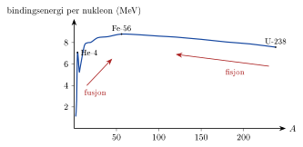
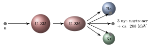

<!-- video: kommer (videoer/fysikk-forkurs/12-04-kjernereaksjoner-og-kjerneenergi) -->
{fig-alt="Video kommer"}

::: {.callout-tip title="Til ettertanke"}
<!-- tillegg: Claude -->
Ett kilogram uran i et kjernekraftverk gir like mye energi som nesten 3000 tonn kull. Hvor kommer all den energien fra?
:::

## Masse er energi

<!-- tillegg: Claude -->
Einstein viste i 1905 at masse og energi er to sider av samme sak. En masse $m$ tilsvarer energien

::: {.callout-important title="Masse og energi"}
<!-- tillegg: Claude -->
$$
E = m\mathrm{c}^2
$$
der $\mathrm{c} = 3.00\cdot10^{8}\ \mathrm{m/s}$ er lysfarten. Når et system gir fra seg energien $E$, minker massen med $\Delta m = E/\mathrm{c}^2$.
:::

<!-- tillegg: Claude -->
Fordi $\mathrm{c}^2$ er et enormt tall, svarer en liten masse til mye energi. I kjemiske reaksjoner er masseendringen så liten at vi ikke kan måle den. I kjernereaksjoner er den stor nok til å regne med.

I kjernefysikken bruker vi gjerne **atommasseenheten** $1\ \mathrm{u} = 1.6605\cdot10^{-27}\ \mathrm{kg}$, som svarer til energien $931.5\ \mathrm{MeV}$.

## Bindingsenergi

<!-- tillegg: Claude -->
En heliumkjerne veier **mindre** enn de to protonene og to nøytronene den består av, hver for seg. Massen som mangler, kalles **massedefekten**. Den tilsvarer **bindingsenergien**: energien som ble frigjort da kjernen ble dannet, og som vi må tilføre for å dele den opp igjen.

::: {.eksempel}
<!-- tillegg: Claude -->
**Eksempel: Bindingsenergien i helium-4.** Bruk massene $m(^1\mathrm{H}) = 1.007825\ \mathrm{u}$, $m_n = 1.008665\ \mathrm{u}$ og $m(^4\mathrm{He}) = 4.002603\ \mathrm{u}$. (Vi bruker atommasser for hydrogen og helium, så elektronene går opp i opp.) Finn bindingsenergien, totalt og per nukleon.

::: {.losning}
$$
\Delta m = 2\cdot1.007825\ \mathrm{u} + 2\cdot1.008665\ \mathrm{u} - 4.002603\ \mathrm{u} = 0.030377\ \mathrm{u}
$$
$$
E_b = 0.030377\cdot931.5\ \mathrm{MeV} = \underline{\underline{28.3\ \mathrm{MeV}}}, \qquad \frac{E_b}{A} = \frac{28.3\ \mathrm{MeV}}{4} = \underline{\underline{7.07\ \mathrm{MeV}}}
$$
:::
:::

{.tikz-fig style="width:520px"}

<!-- tillegg: Claude -->
Kurven er nøkkelen til kjerneenergi. Kjernene rundt jern er de mest stabile. Det betyr at vi kan hente ut energi på to måter:

::: {.kort}
- **Fisjon:** Dele en tung kjerne (som uran) i to mellomstore.
- **Fusjon:** Slå sammen lette kjerner (som hydrogen) til tyngre.
:::

## Fisjon: kjernekraft

{.tikz-fig style="width:520px"}

<!-- tillegg: Claude -->
Når uran-235 fanger et langsomt nøytron, deler kjernen seg, for eksempel i barium og krypton:
$$
^{1}_{0}\mathrm{n} + {}^{235}_{\ 92}\mathrm{U} \;\to\; ^{141}_{\ 56}\mathrm{Ba} + {}^{92}_{36}\mathrm{Kr} + 3\,{}^{1}_{0}\mathrm{n}
$$
Hver spalting gir omtrent $200\ \mathrm{MeV}$. De nye nøytronene kan spalte flere urankjerner: en **kjedereaksjon**. I en reaktor holdes den under kontroll med styrestaver som fanger overflødige nøytroner, slik at hver spalting i snitt gir nøyaktig én ny.

::: {.eksempel}
<!-- tillegg: Claude -->
**Eksempel: Energien i ett kilogram uran-235.** Hvor mye energi gir $1.0\ \mathrm{kg}$ uran-235 hvis alle kjernene spaltes? Sammenlign med kull, som gir ca. $3\cdot10^{7}\ \mathrm{J/kg}$.

::: {.losning}
Antall kjerner: $N = \dfrac{1000\ \mathrm{g}}{235\ \mathrm{g/mol}}\cdot6.02\cdot10^{23}\ \mathrm{mol^{-1}} = 2.56\cdot10^{24}$.
$$
E = 2.56\cdot10^{24}\cdot200\ \mathrm{MeV}\cdot1.60\cdot10^{-13}\ \mathrm{J/MeV} = \underline{\underline{8.2\cdot10^{13}\ \mathrm{J}}}
$$
Det er omtrent $3\cdot10^{6}$ ganger så mye som fra ett kilogram kull.
:::
:::

## Fusjon: sola

<!-- tillegg: Claude -->
I kjernen av sola er temperaturen ca. 15 millioner kelvin. Der går hydrogenkjernene så fort at de kommer nær nok til at den sterke kjernekraften tar over, og de smelter sammen. Netto blir fire protoner til én heliumkjerne. Sola stråler ut $3.8\cdot10^{26}\ \mathrm{W}$, og massen minker med
$$
\frac{\Delta m}{\Delta t} = \frac{P}{\mathrm{c}^2} = \frac{3.8\cdot10^{26}\ \mathrm{W}}{(3.00\cdot10^{8}\ \mathrm{m/s})^2} = 4.2\cdot10^{9}\ \mathrm{kg/s}
$$
over fire millioner tonn hvert sekund – men sola er så stor at den holder i milliarder av år til.

På jorda forsøker forskere å lage fusjonsreaktorer med deuterium og tritium (tunge hydrogenisotoper). Det er vanskelig, fordi gassen må holdes på over 100 millioner kelvin.

:::: {.oppgaver}

::: {.oppgave tittel="Et kraftverk"}
<!-- tillegg: Claude -->
Et kjernekraftverk leverer $1.0\ \mathrm{GW}$ varme i ett år. Hvor stor masse blir omdannet til energi?

::: {.losning}
$E = Pt = 1.0\cdot10^{9}\ \mathrm{W}\cdot3.16\cdot10^{7}\ \mathrm{s} = 3.2\cdot10^{16}\ \mathrm{J}$.
$$
m = \frac{E}{\mathrm{c}^2} = \frac{3.2\cdot10^{16}\ \mathrm{J}}{9.0\cdot10^{16}\ \mathrm{m^2/s^2}} = \underline{\underline{0.35\ \mathrm{kg}}}
$$
:::
:::

::: {.oppgave tittel="Balanser likningen"}
<!-- tillegg: Claude -->
Finn $X$ i reaksjonen $\;^{1}_{0}\mathrm{n} + {}^{235}_{\ 92}\mathrm{U} \to {}^{140}_{\ 54}\mathrm{Xe} + X + 2\,{}^{1}_{0}\mathrm{n}$. (Grunnstoff 38 er strontium.)

::: {.losning}
Nukleontall: $1 + 235 = 140 + A + 2$ gir $A = 94$. Ladning: $92 = 54 + Z$ gir $Z = 38$.
$$
X = \underline{\underline{^{94}_{38}\mathrm{Sr}}}
$$
:::
:::

::: {.oppgave tittel="Deuterium og tritium" niva="Middels"}
<!-- tillegg: Claude -->
I en fusjonsreaktor skal reaksjonen $\;^2_1\mathrm{H} + {}^3_1\mathrm{H} \to {}^4_2\mathrm{He} + {}^1_0\mathrm{n}$ gi energi. Massene er $2.014102\ \mathrm{u}$, $3.016049\ \mathrm{u}$, $4.002603\ \mathrm{u}$ og $1.008665\ \mathrm{u}$. Hvor mye energi frigjøres per reaksjon?

::: {.losning}
$$
\Delta m = (2.014102 + 3.016049 - 4.002603 - 1.008665)\ \mathrm{u} = 0.018883\ \mathrm{u}
$$
$$
E = 0.018883\cdot931.5\ \mathrm{MeV} = \underline{\underline{17.6\ \mathrm{MeV}}}
$$
:::
:::

::: {.oppgave tittel="Fusjon mot fisjon per kilogram" niva="Utfordrende"}
<!-- tillegg: Claude -->
Sammenlign energien per kilogram brensel for D–T-fusjon (oppgaven over) og fisjon av uran-235 ($200\ \mathrm{MeV}$ per spalting). Hvilken gir mest per kilogram?

::: {.losning}
Per nukleon: Fusjon gir $17.6\ \mathrm{MeV}/5 = 3.5\ \mathrm{MeV}$, fisjon gir $200\ \mathrm{MeV}/236 = 0.85\ \mathrm{MeV}$. Siden massen er omtrent proporsjonal med antall nukleoner, gir **fusjon omtrent 4 ganger så mye** energi per kilogram.

Med tall: $1\ \mathrm{kg}$ D–T inneholder $\dfrac{1000}{5.03}\cdot6.02\cdot10^{23} = 1.2\cdot10^{26}$ reaksjoner à $17.6\ \mathrm{MeV}$, altså $\underline{\underline{3.4\cdot10^{14}\ \mathrm{J}}}$, mot $8.2\cdot10^{13}\ \mathrm{J}$ for uran.
:::
:::

::::
