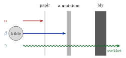
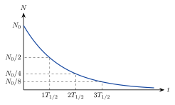

<!-- video: kommer (videoer/fysikk-forkurs/12-03-radioaktivitet-og-straling) -->
{fig-alt="Video kommer"}

::: {.callout-tip title="Til ettertanke"}
<!-- tillegg: Claude -->
Et bein fra en mammut inneholder bare en fjerdedel så mye karbon-14 som et bein fra et dyr som døde i år. Hvor gammelt er mammutbeinet?
:::

## Ustabile kjerner

<!-- tillegg: Claude -->
De fleste atomkjerner er stabile og varer evig. Men noen har for mange eller for få nøytroner i forhold til protoner, eller er rett og slett for store. Slike kjerner er **radioaktive**: Før eller senere omdannes de av seg selv og sender ut stråling. Vi kan ikke si *når* en bestemt kjerne henfaller, bare hvor sannsynlig det er.

## Tre typer stråling

::: {.kort}
<!-- tillegg: Claude -->
- **Alfastråling ($\alpha$)** er heliumkjerner, $^4_2\mathrm{He}$: to protoner og to nøytroner. Tung og sterkt ioniserende, men stoppes av et papirark eller ytterste hudlag. Farlig hvis stoffet kommer *inn* i kroppen.
- **Betastråling ($\beta^-$)** er elektroner. Et nøytron i kjernen blir til et proton og et elektron, og elektronet skytes ut. Stoppes av noen millimeter aluminium.
- **Gammastråling ($\gamma$)** er energirike fotoner som sendes ut når kjernen faller ned fra et eksitert nivå. Svært gjennomtrengende; svekkes av tykt bly eller betong.
:::

{.tikz-fig style="width:460px"}

## Reaksjonslikninger

<!-- tillegg: Claude -->
I en kjernereaksjon er både **ladningen** (summen av $Z$) og **antall nukleoner** (summen av $A$) bevart. Det lar oss finne datterkjernen.

::: {.eksempel}
<!-- tillegg: Claude -->
**Eksempel: Alfa- og betahenfall.** Skriv reaksjonslikningene for

a)  alfahenfall av uran-238 ($Z = 92$)

b)  betahenfall av karbon-14 ($Z = 6$)

::: {.losning}
**a)** Kjernen mister 2 protoner og 2 nøytroner: $Z = 92 - 2 = 90$ (thorium) og $A = 238 - 4 = 234$.
$$
^{238}_{\ 92}\mathrm{U} \;\to\; ^{234}_{\ 90}\mathrm{Th} + {}^{4}_{2}\mathrm{He}
$$

**b)** Et nøytron blir til et proton: $Z$ øker med 1 til 7 (nitrogen), mens $A$ er uendret.
$$
^{14}_{\ 6}\mathrm{C} \;\to\; ^{14}_{\ 7}\mathrm{N} + {}^{\ 0}_{-1}\mathrm{e} + \bar\nu
$$
Den siste partikkelen, $\bar\nu$, er et antinøytrino. Den har ingen ladning og nesten ingen masse, men tar med seg en del av energien.
:::
:::

## Halveringstid

<!-- tillegg: Claude -->
Hver radioaktiv isotop har en fast **halveringstid** $T_{1/2}$: tiden det tar før halvparten av kjernene har henfalt. Etter to halveringstider er en fjerdedel igjen, etter tre en åttendedel, og så videre.

{.tikz-fig style="width:420px"}

::: {.callout-important title="Henfallsloven"}
<!-- tillegg: Claude -->
$$
N = N_0\left(\frac12\right)^{t/T_{1/2}}
$$
Det samme gjelder **aktiviteten** $A$, antall henfall per sekund. Enheten er becquerel: $1\ \mathrm{Bq} = 1$ henfall per sekund.
:::

::: {.callout-note title="Noen halveringstider" .graa}
<!-- tillegg: Claude -->
| Isotop | Halveringstid | Brukes til / kjent fra |
|---|---|---|
| jod-131 | 8.0 døgn | behandling av skjoldbruskkjertelen |
| radon-222 | 3.8 døgn | radon i boliger |
| cesium-137 | 30 år | nedfall fra Tsjernobyl |
| karbon-14 | 5730 år | datering av organisk materiale |
| uran-238 | $4.5\cdot10^{9}$ år | jordas alder |
:::

::: {.eksempel}
<!-- tillegg: Claude -->
**Eksempel: Mammutbeinet.** Et bein inneholder 25 % av karbon-14-innholdet i levende vev. Hvor gammelt er det?

::: {.losning}
$25\ \% = \tfrac14 = \left(\tfrac12\right)^2$. Det har gått to halveringstider:
$$
t = 2\cdot5730\ \text{år} = \underline{\underline{1.15\cdot10^{4}\ \text{år}}}
$$
:::
:::

<!-- tillegg: Claude -->
Når andelen ikke er en pen potens av $\tfrac12$, kan vi løse likningen med logaritmer: $t = T_{1/2}\cdot\dfrac{\ln(N_0/N)}{\ln2}$. Eller vi lar Python gjøre det:

```{.python .kjor}
import numpy as np
import matplotlib.pyplot as plt

T = 5730            # halveringstid (år)
andel = 0.30        # andel C-14 som er igjen

t = T*np.log(1/andel)/np.log(2)
print(f"Alderen er {t:.0f} år")

tt = np.linspace(0, 4*T, 300)
plt.plot(tt, 0.5**(tt/T))
plt.plot(t, andel, "o")
plt.xlabel("tid (år)"); plt.ylabel("andel C-14 igjen"); plt.grid(); plt.show()
```

## Stråledoser og strålevern

<!-- tillegg: Claude -->
Stråling som treffer kroppen, kan ionisere molekyler og skade celler og DNA. Hvor skadelig den er, måles som **effektiv dose**, med enheten **sievert** (Sv). Den tar hensyn både til energien som avsettes per kilogram og til hvor skadelig strålingstypen og organet er.

::: {.kort}
<!-- tillegg: Claude -->
- I Norge får vi i gjennomsnitt noen få **millisievert per år** fra naturlige kilder. Den største delen kommer fra **radon** i inneluft.
- Et røntgenbilde av tennene gir omtrent $0.01\ \mathrm{mSv}$. En CT av magen gir noen få mSv.
- Vi verner oss med **avstand** (intensiteten avtar med kvadratet av avstanden), **tid** (kortere tid gir mindre dose) og **skjerming** (bly, betong, vann).
:::

:::: {.oppgaver}

::: {.oppgave tittel="Jod-131"}
<!-- tillegg: Claude -->
En pasient får en dose jod-131 med aktiviteten $400\ \mathrm{MBq}$. Hva er aktiviteten etter $24$ døgn ($T_{1/2} = 8.0$ døgn)?

::: {.losning}
$24$ døgn er tre halveringstider:
$$
A = 400\ \mathrm{MBq}\cdot\left(\tfrac12\right)^3 = \underline{\underline{50\ \mathrm{MBq}}}
$$
:::
:::

::: {.oppgave tittel="Finn datterkjernen"}
<!-- tillegg: Claude -->
Radium-226 ($Z = 88$) henfaller med alfastråling. Skriv reaksjonslikningen. (Grunnstoff 86 er radon.)

::: {.losning}
$$
^{226}_{\ 88}\mathrm{Ra} \;\to\; ^{222}_{\ 86}\mathrm{Rn} + {}^{4}_{2}\mathrm{He}
$$
Det er slik radon dannes i berggrunnen.
:::
:::

::: {.oppgave tittel="Cesium fra Tsjernobyl" niva="Middels"}
<!-- tillegg: Claude -->
Tsjernobyl-ulykken skjedde i 1986. Hvor stor andel av cesium-137 fra nedfallet er igjen i 2026? Hvor lenge må vi vente til bare 10 % er igjen?

::: {.losning}
Det har gått $40$ år:
$$
\frac{N}{N_0} = \left(\tfrac12\right)^{40/30} = \underline{\underline{0.40}}
$$
Til 10 % er igjen:
$$
t = 30\ \text{år}\cdot\frac{\ln10}{\ln2} = \underline{\underline{100\ \text{år}}}
$$
altså rundt år 2086.
:::
:::

::: {.oppgave tittel="Finn halveringstiden" niva="Utfordrende"}
<!-- tillegg: Claude -->
Aktiviteten til en kilde måles hvert tiende minutt: $800$, $580$, $420$, $305$, $220$ og $160$ Bq. Plott målingene, og finn halveringstiden. Tips: Plott $\ln A$ mot $t$ – da blir det en rett linje med stigningstall $-\ln2/T_{1/2}$.

::: {.losning}
```{.python .kjor}
import numpy as np
t = np.array([0, 10, 20, 30, 40, 50])           # min
A = np.array([800, 580, 420, 305, 220, 160])    # Bq
a, b = np.polyfit(t, np.log(A), 1)
print(f"stigningstall {a:.4f} per min, halveringstid {np.log(2)/-a:.1f} min")
```
Halveringstiden blir $\underline{\underline{21.5\ \mathrm{min}}}$, altså ca. $22$ minutter. (Aktiviteten halveres fra $800$ til ca. $400$ på litt over $20$ minutter, som stemmer.)
:::
:::

::::
