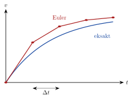

<!-- tillegg: Claude -->
Bevegelseslikningene ($s = v_0t + \tfrac12at^2$ og de andre) gjelder bare når akselerasjonen er **konstant**. Men i virkeligheten endrer kreftene seg ofte underveis: Luftmotstanden øker med farten, fjærkraften med utstrekningen. Da kan vi la datamaskinen regne ut bevegelsen **steg for steg**.

## Eulers metode

<!-- tillegg: Claude -->
Idéen er enkel. Vi deler tiden opp i små steg $\Delta t$. I hvert steg later vi som akselerasjonen og farten er konstante:

::: {.steg}
<!-- tillegg: Claude -->
1. Finn kraftsummen $\sum F$ ut fra posisjonen og farten nå.
2. Regn ut akselerasjonen: $a = \sum F/m$.
3. Ny fart: $v_\text{ny} = v + a\,\Delta t$.
4. Ny posisjon: $s_\text{ny} = s + v\,\Delta t$.
5. Øk tiden med $\Delta t$, og gjenta.
:::

{.tikz-fig style="width:420px"}

<!-- tillegg: Claude -->
Feilen i hvert steg er liten hvis $\Delta t$ er liten. Halverer vi steget, blir feilen omtrent halvert – men programmet må gjøre dobbelt så mange steg.

::: {.eksempel}
<!-- tillegg: Claude -->
**Eksempel: Eulers metode for hånd.** En stein slippes fra ro. Bruk Eulers metode med $\Delta t = 0.50\ \mathrm{s}$ og finn farten og posisjonen etter $1.0\ \mathrm{s}$. Sammenlign med det eksakte svaret.

::: {.losning}
Akselerasjonen er $a = \mathrm{g} = 9.81\ \mathrm{m/s^2}$ hele tiden.

| $t$ (s) | $v$ (m/s) | $s$ (m) |
|---|---|---|
| 0 | 0 | 0 |
| 0.50 | $0 + 9.81\cdot0.50 = 4.91$ | $0 + 0\cdot0.50 = 0$ |
| 1.00 | $4.91 + 9.81\cdot0.50 = 9.81$ | $0 + 4.91\cdot0.50 = 2.45$ |

Farten blir riktig, $\underline{\underline{9.81\ \mathrm{m/s}}}$. Posisjonen blir $\underline{\underline{2.45\ \mathrm{m}}}$, mens det eksakte svaret er $\tfrac12\mathrm{g}t^2 = 4.91\ \mathrm{m}$. Steget er altfor stort: Vi brukte den gamle, for lave farten gjennom hvert steg.
:::
:::

## Fritt fall i Python

<!-- tillegg: Claude -->
Med en løkke kan vi ta tusenvis av små steg. Programmet sammenligner Eulers metode med det eksakte svaret. Prøv å endre `dt`.

```{.python .kjor}
import numpy as np
import matplotlib.pyplot as plt

g = 9.81
dt = 0.1                 # tidssteg (s) – prøv 0.01
t, v, s = 0.0, 0.0, 0.0
T, S = [t], [s]

while t < 3.0:
    a = g
    s = s + v*dt         # bruker farten FØR den oppdateres
    v = v + a*dt
    t = t + dt
    T.append(t); S.append(s)

T = np.array(T)
plt.plot(T, S, "o-", ms=3, label=f"Euler, dt = {dt} s")
plt.plot(T, 0.5*g*T**2, label="eksakt")
plt.xlabel("$t$ (s)"); plt.ylabel("falt strekning $s$ (m)"); plt.legend(); plt.grid(); plt.show()
print(f"Etter {t:.1f} s: Euler {s:.2f} m, eksakt {0.5*g*t**2:.2f} m")
```

## Fall med luftmotstand

<!-- tillegg: Claude -->
Nå kommer det problemet vi ikke kan løse med bevegelseslikningene. En fallskjermhopper med masse $m = 80\ \mathrm{kg}$ faller med luftmotstanden $L = kv^2$, der $k = 0.25\ \mathrm{kg/m}$. Newtons andre lov gir
$$
a = \frac{m\mathrm{g} - kv^2}{m} = \mathrm{g} - \frac km v^2
$$
Akselerasjonen avtar etter hvert som farten øker. Til slutt er luftmotstanden like stor som tyngden, og farten blir konstant: **terminalfarten**,
$$
kv_t^2 = m\mathrm{g} \quad\Rightarrow\quad v_t = \sqrt{\frac{m\mathrm{g}}{k}} = \sqrt{\frac{80\cdot9.81}{0.25}}\ \mathrm{m/s} = 56\ \mathrm{m/s}
$$
Men *hvordan* farten nærmer seg terminalfarten, må vi regne ut numerisk. Den eneste endringen fra fritt fall er linja med `a`:

```{.python .kjor}
import numpy as np
import matplotlib.pyplot as plt

g, m, k = 9.81, 80.0, 0.25
dt = 0.01
t, v, s = 0.0, 0.0, 0.0
T, V, S = [t], [v], [s]

while t < 25:
    a = g - k/m*v**2          # akselerasjonen avhenger av farten
    s = s + v*dt
    v = v + a*dt
    t = t + dt
    T.append(t); V.append(v); S.append(s)

vt = np.sqrt(m*g/k)
plt.plot(T, V, label="med luftmotstand")
plt.plot(T, g*np.array(T), "--", label="uten luftmotstand")
plt.axhline(vt, color="gray", ls=":", label=f"terminalfart {vt:.0f} m/s")
plt.ylim(0, 80); plt.xlabel("$t$ (s)"); plt.ylabel("$v$ (m/s)"); plt.legend(); plt.grid(); plt.show()
print(f"Etter 25 s: v = {v:.1f} m/s, falt {s:.0f} m")
```

<!-- tillegg: Claude -->
Uten luftmotstand ville hopperen nådd $56\ \mathrm{m/s}$ etter under $6\ \mathrm{s}$. Med luftmotstand tar det rundt $10\ \mathrm{s}$ å nå $95\ \%$ av terminalfarten – og den nås aldri helt.

:::: {.oppgaver}

::: {.oppgave tittel="Mindre tidssteg"}
<!-- tillegg: Claude -->
Kjør programmet for fritt fall med `dt = 0.1`, `0.01` og `0.001`. Hvor stor er feilen i posisjonen etter $3\ \mathrm{s}$ i hvert tilfelle? Hva skjer med feilen når steget blir ti ganger mindre?

:::

::: {.oppgave tittel="Lettere hopper"}
<!-- tillegg: Claude -->
Endre massen i fallskjermprogrammet til $50\ \mathrm{kg}$. Hva blir terminalfarten? Bruk både formelen og programmet.

::: {.fasit}
$44\ \mathrm{m/s}$
:::
:::

::: {.oppgave tittel="Fallskjermen utløses" niva="Middels"}
<!-- tillegg: Claude -->
Etter $20\ \mathrm{s}$ utløses fallskjermen, og $k$ øker til $30\ \mathrm{kg/m}$. Endre programmet slik at `k` avhenger av tiden (bruk `if t < 20:`), og plott farten fram til $t = 30\ \mathrm{s}$. Hva blir den nye terminalfarten? Tips: Med stor $k$ må `dt` være liten, for eksempel $0.001\ \mathrm{s}$.

::: {.fasit}
$5.1\ \mathrm{m/s}$
:::
:::

::: {.oppgave tittel="Fjær og masse" niva="Utfordrende"}
<!-- tillegg: Claude -->
En kloss med masse $0.50\ \mathrm{kg}$ henger i en fjær med fjærkonstant $k = 20\ \mathrm{N/m}$. Den trekkes $0.10\ \mathrm{m}$ ut fra likevekt og slippes. Kraften er $F = -kx$. Simuler bevegelsen i $5\ \mathrm{s}$ og plott $x(t)$. Sammenlign med $x = 0.10\cos(\omega t)$, der $\omega = \sqrt{k/m}$.

Tips: Vanlig Euler gir en svingning som vokser. Bytt rekkefølgen – oppdater farten **før** posisjonen, og bruk den nye farten (Euler–Cromer).

:::

::::
