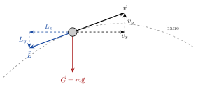

<!-- video: kommer (videoer/fysikk-forkurs/13-04-skratt-kast-med-luftmotstand) -->
{fig-alt="Video kommer"}

<!-- tillegg: Claude -->
Uten luftmotstand er banen til en ball en perfekt parabel, og vi kan regne ut alt med bevegelseslikningene. Men se på en badmintonball: Den stuper nesten rett ned på slutten av banen. Og en fotball som sparkes langt, lander mye nærmere enn formelen for kastlengde sier. Luftmotstanden bremser hele tiden, og den endrer retning etter hvert som ballen snur. Det problemet klarer vi ikke med blyant og papir, men datamaskinen løser det steg for steg.

## Kreftene på ballen

<!-- tillegg: Claude -->
Mens ballen er i lufta, virker to krefter på den:

::: {.kort}
- **Tyngden** $G = m\mathrm{g}$, rett nedover, alltid like stor.
- **Luftmotstanden** $L = kv^2$, rett *mot* fartsretningen. Den vokser med farten, og den snur når ballen snur.
:::

{.tikz-fig style="width:440px" fig-alt="En ball på vei oppover langs en krum bane. Fartsvektoren v peker skrått opp til høyre og er delt i komponentene v x og v y. Luftmotstanden L peker skrått ned til venstre, motsatt av farten, og er delt i komponentene L x og L y. Tyngden G peker rett ned."}

<!-- tillegg: Claude -->
Luftmotstanden peker motsatt av farten, så den har samme form som fartsvektoren, bare snudd og skalert. Fartsvektoren har lengden $v = \sqrt{v_x^2 + v_y^2}$. Komponentene til luftmotstanden er derfor
$$
L_x = -kv\,v_x, \qquad L_y = -kv\,v_y
$$
Sjekk: Lengden blir $\sqrt{L_x^2 + L_y^2} = kv\sqrt{v_x^2 + v_y^2} = kv^2$, som den skal. Newtons andre lov i hver retning gir akselerasjonen:

::: {.graa}
$$
a_x = -\frac km\,v\,v_x, \qquad a_y = -\mathrm{g} - \frac km\,v\,v_y, \qquad v = \sqrt{v_x^2 + v_y^2}
$$
:::

<!-- tillegg: Claude -->
Her ser vi hvorfor problemet er vanskelig: Den vannrette akselerasjonen avhenger av den loddrette farten (gjennom $v$), og omvendt. De to retningene er ikke lenger uavhengige, slik de er i [bevegelse i to dimensjoner](../03-kinematikk/06-bevegelse-i-to-dimensjoner.qmd) uten luftmotstand.

## Eulers metode i to dimensjoner

<!-- tillegg: Claude -->
Vi bruker samme idé som for fall rett ned: Del tiden i små steg $\Delta t$, og la akselerasjonen være konstant gjennom hvert steg. Nå gjør vi det for $x$ og $y$ samtidig:

::: {.steg}
<!-- tillegg: Claude -->
1. Regn ut farten $v = \sqrt{v_x^2 + v_y^2}$.
2. Regn ut akselerasjonen $a_x$ og $a_y$ fra formlene over.
3. Ny posisjon: $x_\text{ny} = x + v_x\,\Delta t$ og $y_\text{ny} = y + v_y\,\Delta t$.
4. Ny fart: $v_{x,\text{ny}} = v_x + a_x\,\Delta t$ og $v_{y,\text{ny}} = v_y + a_y\,\Delta t$.
5. Øk tiden med $\Delta t$, og gjenta til ballen er nede ($y < 0$).
:::

::: {.eksempel}
<!-- tillegg: Claude -->
**Eksempel: Ett steg for hånd.** En fotball med masse $m = 0.43\ \mathrm{kg}$ sparkes fra bakken med farten $25.0\ \mathrm{m/s}$, $35^\circ$ over vannrett. Luftmotstandstallet er $k = 0.0060\ \mathrm{kg/m}$. Ta ett Euler-steg med $\Delta t = 0.10\ \mathrm{s}$.

::: {.losning}
Startfarten dekomponeres:
$$
v_x = 25.0\ \mathrm{m/s}\cdot\cos35^\circ = 20.5\ \mathrm{m/s}, \qquad v_y = 25.0\ \mathrm{m/s}\cdot\sin35^\circ = 14.3\ \mathrm{m/s}
$$
Med $k/m = 0.0060/0.43\ \mathrm{m^{-1}} = 0.0140\ \mathrm{m^{-1}}$ og $v = 25.0\ \mathrm{m/s}$ blir akselerasjonen
$$
a_x = -0.0140\cdot25.0\cdot20.5\ \mathrm{m/s^2} = -7.1\ \mathrm{m/s^2}, \qquad a_y = -9.81\ \mathrm{m/s^2} - 0.0140\cdot25.0\cdot14.3\ \mathrm{m/s^2} = -14.8\ \mathrm{m/s^2}
$$
Luftmotstanden er her $kv^2 = 3.8\ \mathrm{N}$, nesten like stor som tyngden ($4.2\ \mathrm{N}$). Etter ett steg:
$$
x = 20.5\ \mathrm{m/s}\cdot0.10\ \mathrm{s} = \underline{\underline{2.0\ \mathrm{m}}}, \qquad y = 14.3\ \mathrm{m/s}\cdot0.10\ \mathrm{s} = \underline{\underline{1.4\ \mathrm{m}}}
$$
$$
v_x = 20.5\ \mathrm{m/s} - 7.1\ \mathrm{m/s^2}\cdot0.10\ \mathrm{s} = \underline{\underline{19.8\ \mathrm{m/s}}}, \qquad v_y = 14.3\ \mathrm{m/s} - 14.8\ \mathrm{m/s^2}\cdot0.10\ \mathrm{s} = \underline{\underline{12.9\ \mathrm{m/s}}}
$$
Uten luftmotstand ville $v_x$ vært uendret, og $v_y$ ville bare ha sunket til $13.4\ \mathrm{m/s}$. Neste steg starter med de nye tallene. Hundrevis av slike steg overlater vi til datamaskinen.
:::
:::

## Banen i Python

<!-- tillegg: Claude -->
Programmet regner ut banen til fotballen, både med og uten luftmotstand, og skriver ut kastlengden og den største høyden. Endre `k`, `v0` og `vinkel` og trykk **Kjør**.

```{.python .kjor}
import numpy as np
import matplotlib.pyplot as plt

g = 9.81
m = 0.43          # masse (kg)
v0 = 25.0         # startfart (m/s)
vinkel = 35       # grader over vannrett
dt = 0.001        # tidssteg (s)

def bane(k):
    x, y = 0.0, 0.0
    vx = v0 * np.cos(np.radians(vinkel))
    vy = v0 * np.sin(np.radians(vinkel))
    X, Y = [x], [y]
    while y >= 0:
        v = np.sqrt(vx**2 + vy**2)
        ax = -k / m * v * vx
        ay = -g - k / m * v * vy
        x = x + vx * dt
        y = y + vy * dt
        vx = vx + ax * dt
        vy = vy + ay * dt
        X.append(x); Y.append(y)
    return np.array(X), np.array(Y)

for k, navn in [(0.0, "uten luftmotstand"), (0.0060, "med luftmotstand")]:
    X, Y = bane(k)
    plt.plot(X, Y, label=navn)
    print(f"{navn}: kastlengde {X[-1]:.1f} m, største høyde {Y.max():.1f} m")

plt.xlabel("$x$ (m)"); plt.ylabel("$y$ (m)")
plt.axis("equal"); plt.ylim(bottom=0); plt.legend(); plt.grid(); plt.show()
```

<!-- tillegg: Claude -->
Uten luftmotstand gir programmet kastlengden $59.9\ \mathrm{m}$, som stemmer med formelen $v_0^2\sin(2\alpha)/\mathrm{g}$. Med luftmotstand blir kastlengden bare $38.7\ \mathrm{m}$, og banen er ikke lenger symmetrisk: Ballen går slakt opp og brattere ned, fordi den har mistet mye av den vannrette farten når den er på vei ned.

::: {.callout-tip title="Til ettertanke"}
Uten luftmotstand gir $45^\circ$ lengst kast. Hvorfor er den beste vinkelen lavere når luftmotstanden er med? (Hint: En høy bane bruker lang tid i lufta, og hele tiden bremser lufta den vannrette farten.)
:::

:::: {.oppgaver}

::: {.oppgave tittel="Ett steg til"}
<!-- tillegg: Claude -->
Fortsett eksempelet over: Ta ett Euler-steg til med $\Delta t = 0.10\ \mathrm{s}$, fra $x = 2.0\ \mathrm{m}$, $y = 1.4\ \mathrm{m}$, $v_x = 19.8\ \mathrm{m/s}$ og $v_y = 12.9\ \mathrm{m/s}$. Bruk $k/m = 0.0140\ \mathrm{m^{-1}}$.

::: {.losning}
Farten er
$$
v = \sqrt{19.8^2 + 12.9^2}\ \mathrm{m/s} = 23.6\ \mathrm{m/s}
$$
Akselerasjonen:
$$
a_x = -0.0140\cdot23.6\cdot19.8\ \mathrm{m/s^2} = -6.5\ \mathrm{m/s^2}, \qquad a_y = -9.81\ \mathrm{m/s^2} - 0.0140\cdot23.6\cdot12.9\ \mathrm{m/s^2} = -14.1\ \mathrm{m/s^2}
$$
Nye verdier:
$$
x = 2.0\ \mathrm{m} + 19.8\cdot0.10\ \mathrm{m} = \underline{\underline{4.0\ \mathrm{m}}}, \qquad y = 1.4\ \mathrm{m} + 12.9\cdot0.10\ \mathrm{m} = \underline{\underline{2.7\ \mathrm{m}}}
$$
$$
v_x = 19.8\ \mathrm{m/s} - 0.65\ \mathrm{m/s} = \underline{\underline{19.1\ \mathrm{m/s}}}, \qquad v_y = 12.9\ \mathrm{m/s} - 1.41\ \mathrm{m/s} = \underline{\underline{11.5\ \mathrm{m/s}}}
$$
Akselerasjonen er litt mindre enn i første steg, fordi farten og dermed luftmotstanden har avtatt.
:::
:::

::: {.oppgave tittel="Kontroll uten luft"}
<!-- tillegg: Claude -->
Sett `k = 0` og `vinkel = 45` i programmet. Sammenlikn kastlengden med formelen $R = v_0^2\sin(2\alpha)/\mathrm{g}$. Hvorfor er det lurt å teste et program på et tilfelle der vi kjenner svaret?

::: {.losning}
Formelen gir
$$
R = \frac{(25.0\ \mathrm{m/s})^2\cdot\sin90^\circ}{9.81\ \mathrm{m/s^2}} = \underline{\underline{63.7\ \mathrm{m}}}
$$
Programmet gir det samme (avviket er noen centimeter, fordi det siste steget går litt under bakken). Stemmer programmet i et tilfelle vi kan regne ut for hånd, er det trolig at formlene og løkka er riktige. Da kan vi stole mer på svaret i tilfellene vi *ikke* kan regne ut for hånd.
:::
:::

::: {.oppgave tittel="Den beste vinkelen" niva="Middels"}
<!-- tillegg: Claude -->
Lag en løkke som prøver alle hele vinkler fra $20^\circ$ til $50^\circ$ for fotballen med luftmotstand, og finn vinkelen som gir lengst kast.

::: {.losning}
Vi gjør `vinkel` til en parameter i funksjonen og lagrer kastlengden for hver vinkel:

```{.python .kjor}
import numpy as np
g, m, k, v0, dt = 9.81, 0.43, 0.0060, 25.0, 0.001

def kastlengde(vinkel):
    x, y = 0.0, 0.0
    vx = v0 * np.cos(np.radians(vinkel))
    vy = v0 * np.sin(np.radians(vinkel))
    while y >= 0:
        v = np.sqrt(vx**2 + vy**2)
        x, y = x + vx * dt, y + vy * dt
        vx, vy = vx - k / m * v * vx * dt, vy + (-g - k / m * v * vy) * dt
    return x

vinkler = range(20, 51)
lengder = [kastlengde(a) for a in vinkler]
beste = vinkler[int(np.argmax(lengder))]
print(f"Beste vinkel: {beste} grader, kastlengde {max(lengder):.1f} m")
```

Den beste vinkelen er omtrent $\underline{\underline{41^\circ}}$, med kastlengden $39.5\ \mathrm{m}$. Den er lavere enn $45^\circ$: En lavere bane er kortere tid i lufta, og da rekker luftmotstanden å bremse mindre.
:::
:::

::: {.oppgave tittel="Badmintonballen" niva="Middels"}
<!-- tillegg: Claude -->
En badmintonball har massen $5.0\ \mathrm{g}$ og en terminalfart (største fart i fritt fall) på omtrent $6.8\ \mathrm{m/s}$.

a) Bruk at luftmotstanden er lik tyngden ved terminalfarten, og finn $k$.

b) Ballen slås med $30\ \mathrm{m/s}$, $45^\circ$ over vannrett. Endre programmet og finn kastlengden. Sammenlikn med kastlengden uten luftmotstand.

c) Beskriv formen på banen.

::: {.losning}
**a)** Ved terminalfarten er $kv_t^2 = m\mathrm{g}$:
$$
k = \frac{m\mathrm{g}}{v_t^2} = \frac{0.0050\ \mathrm{kg}\cdot9.81\ \mathrm{m/s^2}}{(6.8\ \mathrm{m/s})^2} = \underline{\underline{1.1\cdot10^{-3}\ \mathrm{kg/m}}}
$$

**b)** Med `m = 0.0050`, `k = 0.00106`, `v0 = 30`, `vinkel = 45` (og gjerne `dt = 0.0005`, fordi akselerasjonen er stor i starten) gir programmet en kastlengde på omtrent $\underline{\underline{8.9\ \mathrm{m}}}$. Uten luftmotstand ville den vært
$$
R = \frac{(30\ \mathrm{m/s})^2}{9.81\ \mathrm{m/s^2}} = 92\ \mathrm{m}
$$
Luftmotstanden gjør kastet ti ganger kortere.

**c)** Banen er sterkt usymmetrisk. Ballen går nesten rett fram og opp i starten, mister så nesten all vannrett fart og faller til slutt nesten loddrett ned med en fart nær terminalfarten. Det er derfor et langt slag i badminton lander så bratt.
:::
:::

::: {.oppgave tittel="Motvind" niva="Utfordrende"}
<!-- tillegg: Claude -->
Luftmotstanden avhenger av farten *i forhold til lufta*. Blåser det en motvind med farten $w$ (mot $x$-retningen), er ballens fart i forhold til lufta $[v_x + w,\ v_y]$.

a) Skriv opp $a_x$ og $a_y$ med motvind.

b) Endre programmet og finn kastlengden for fotballen ($25.0\ \mathrm{m/s}$, $35^\circ$) i motvind med $w = 5.0\ \mathrm{m/s}$.

::: {.losning}
**a)** Med den relative farten $\vec u = [v_x + w,\ v_y]$ og $u = \sqrt{(v_x + w)^2 + v_y^2}$ peker luftmotstanden motsatt av $\vec u$:
$$
a_x = -\frac km\,u\,(v_x + w), \qquad a_y = -\mathrm{g} - \frac km\,u\,v_y
$$
Posisjonen oppdateres fortsatt med ballens egen fart $v_x$ og $v_y$.

**b)** I løkka byttes linjene for akselerasjonen ut med
```python
u = np.sqrt((vx + w)**2 + vy**2)
ax = -k / m * u * (vx + w)
ay = -g - k / m * u * vy
```
Med `w = 5.0` gir programmet en kastlengde på omtrent $\underline{\underline{33\ \mathrm{m}}}$, mot $38.7\ \mathrm{m}$ i stille luft.
:::
:::

::::
