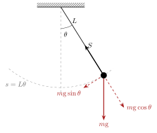

<!-- video: kommer (videoer/fysikk-forkurs/13-05-svingninger-numerisk) -->
{fig-alt="Video kommer"}

<!-- tillegg: Claude -->
Formelen $T = 2\pi\sqrt{L/\mathrm{g}}$ for svingetiden til en pendel gjelder bare for *små* utslag. Slipper du en huske fra nesten vannrett, tar svingningen merkbart lengre tid. Hvor mye lengre? Det finnes ingen enkel formel for det, men datamaskinen kan finne svaret steg for steg. Underveis oppdager vi en felle: Den enkleste metoden gir svingninger som vokser og vokser, selv om energien skal være bevart. Et lite bytte av rekkefølge i programmet fikser det.

## Fjærpendelen steg for steg

<!-- tillegg: Claude -->
Vi starter med en svingning vi kjenner svaret på: et lodd med massen $m$ i en fjær med fjærkonstanten $k$, på et glatt underlag. Kraften er $F = -kx$, så akselerasjonen er
$$
a = -\frac km\,x
$$
Akselerasjonen endrer seg hele tiden, men innenfor et lite tidssteg $\Delta t$ kan vi late som den er konstant. Det er idéen bak **Eulers metode**:

::: {.graa}
| Eulers metode | Euler–Cromers metode |
|---|---|
| $a = -\dfrac km\,x$ | $a = -\dfrac km\,x$ |
| $x_\text{ny} = x + v\,\Delta t$ | $v_\text{ny} = v + a\,\Delta t$ |
| $v_\text{ny} = v + a\,\Delta t$ | $x_\text{ny} = x + v_\text{ny}\,\Delta t$ |
:::

Den eneste forskjellen er rekkefølgen. I Eulers metode flyttes loddet med den *gamle* farten. I **Euler–Cromers metode** regner vi ut den nye farten først og flytter loddet med den.

::: {.eksempel}
<!-- tillegg: Claude -->
**Eksempel: Tre steg med hver metode.** Et lodd med massen $0.50\ \mathrm{kg}$ henger i en fjær med $k = 20\ \mathrm{N/m}$. Det trekkes $0.10\ \mathrm{m}$ ut og slippes. Ta tre steg med $\Delta t = 0.05\ \mathrm{s}$ med begge metodene, og regn ut den mekaniske energien $E = \tfrac12 mv^2 + \tfrac12 kx^2$ etter hvert steg.

::: {.losning}
Her er $k/m = 40\ \mathrm{s^{-2}}$, så $a = -40\,x$. Startenergien er $E_0 = \tfrac12\cdot20\cdot0.10^2\ \mathrm{J} = 0.100\ \mathrm{J}$.

**Eulers metode.** Første steg: $a = -4.0\ \mathrm{m/s^2}$, $x = 0.10 + 0\cdot0.05 = 0.10\ \mathrm{m}$ og $v = 0 - 4.0\cdot0.05 = -0.20\ \mathrm{m/s}$. Slik fortsetter vi:

| Steg | $x$ (m) | $v$ (m/s) | $E$ (J) |
|---|---|---|---|
| 0 | 0.100 | 0 | 0.100 |
| 1 | 0.100 | −0.200 | 0.110 |
| 2 | 0.090 | −0.400 | 0.121 |
| 3 | 0.070 | −0.580 | 0.133 |

**Euler–Cromers metode.** Første steg: $v = 0 - 4.0\cdot0.05 = -0.20\ \mathrm{m/s}$, og så $x = 0.10 + (-0.20)\cdot0.05 = 0.090\ \mathrm{m}$:

| Steg | $x$ (m) | $v$ (m/s) | $E$ (J) |
|---|---|---|---|
| 0 | 0.100 | 0 | 0.100 |
| 1 | 0.090 | −0.200 | 0.091 |
| 2 | 0.071 | −0.380 | 0.087 |
| 3 | 0.045 | −0.522 | 0.088 |

Med Eulers metode vokser energien med nøyaktig $10\ \%$ i hvert steg. Med Euler–Cromer svinger energien litt opp og ned, men den løper ikke av gårde.
:::
:::

<!-- tillegg: Claude -->
Hvorfor vokser energien i Eulers metode? Loddet flyttes med farten fra *starten* av steget. På vei mot likevekt øker farten gjennom steget, så loddet flyttes for kort. På vei ut fra likevekt avtar farten, så loddet flyttes for langt. Det skjer hver gang loddet er på vei ut, og utslaget blir større for hver svingning. Euler–Cromer bruker farten fra *slutten* av steget, og da veier feilene i de to retningene opp for hverandre.

Kjør programmet og se forskjellen. Prøv også et mindre tidssteg: Eulers metode blir bedre, men energien vokser fortsatt.

```{.python .kjor}
import numpy as np
import matplotlib.pyplot as plt

m, k = 0.50, 20.0      # masse (kg) og fjærkonstant (N/m)
x0 = 0.10              # startutslag (m)
dt = 0.01              # tidssteg (s) – prøv 0.001
tmax = 10.0

def simuler(cromer):
    x, v, t = x0, 0.0, 0.0
    T, X, E = [t], [x], [0.5*k*x**2]
    while t < tmax:
        a = -k/m * x
        if cromer:
            v = v + a*dt
            x = x + v*dt          # bruker den NYE farten
        else:
            x = x + v*dt          # bruker den GAMLE farten
            v = v + a*dt
        t = t + dt
        T.append(t); X.append(x); E.append(0.5*m*v**2 + 0.5*k*x**2)
    return np.array(T), np.array(X), np.array(E)

fig, (ax1, ax2) = plt.subplots(2, 1, sharex=True)
for cromer, navn in [(False, "Euler"), (True, "Euler–Cromer")]:
    T, X, E = simuler(cromer)
    ax1.plot(T, X, label=navn)
    ax2.plot(T, E, label=navn)
    print(f"{navn}: energi etter {tmax:.0f} s er {E[-1]:.3f} J (start {E[0]:.3f} J)")
ax1.plot(T, x0*np.cos(np.sqrt(k/m)*T), "k:", label="eksakt")
ax1.set_ylabel("$x$ (m)"); ax1.legend(); ax1.grid()
ax2.set_ylabel("$E$ (J)"); ax2.set_xlabel("$t$ (s)"); ax2.grid()
plt.show()
```

::: {.callout-tip}
Bruk Euler–Cromer for alle svingninger og baner der energien skal være bevart. Det koster ingenting: Det er de samme linjene i en annen rekkefølge.
:::

## Pendelen med store utslag

<!-- tillegg: Claude -->
En pendel med lengden $L$ har utslagsvinkelen $\theta$. Tyngden $m\mathrm{g}$ deles i en komponent langs snora og en komponent langs banen. Snorkraften og komponenten langs snora holder loddet på sirkelbuen. Komponenten **langs banen**, $m\mathrm{g}\sin\theta$, drar loddet tilbake mot likevekt.

{.tikz-fig style="width:340px" fig-alt="En pendel med lengden L henger fra et tak og har utslaget theta fra loddlinja. På loddet virker snorkraften S langs snora og tyngden mg rett ned. Tyngden er delt i mg cosinus theta langs snora og mg sinus theta langs banen, mot likevekt. Banen er en sirkelbue, og buelengden er s = L theta."}

<!-- tillegg: Claude -->
Langs banen er akselerasjonen derfor $a = -\mathrm{g}\sin\theta$. Buelengden er $s = L\theta$ (med $\theta$ i radianer), så vi kan skrive alt med vinkelen. Vinkelfarten er $\omega = v/L$, og vinkelakselerasjonen er $a/L$:

::: {.graa}
$$
\text{vinkelakselerasjon} = -\frac{\mathrm{g}}{L}\sin\theta
$$
:::

<!-- tillegg: Claude -->
For små vinkler er $\sin\theta \approx \theta$. Da er den tilbakeførende kraften proporsjonal med utslaget, akkurat som for fjæra, og vi får den vanlige formelen $T_0 = 2\pi\sqrt{L/\mathrm{g}}$. Men for store vinkler er $\sin\theta$ *mindre* enn $\theta$: Kraften tilbake er svakere enn i den forenklede modellen, så pendelen bruker lengre tid. Euler–Cromer med vinkler ser slik ut:

::: {.steg}
<!-- tillegg: Claude -->
1. Vinkelakselerasjon: $\alpha = -\dfrac{\mathrm{g}}{L}\sin\theta$.
2. Ny vinkelfart: $\omega_\text{ny} = \omega + \alpha\,\Delta t$.
3. Ny vinkel: $\theta_\text{ny} = \theta + \omega_\text{ny}\,\Delta t$.
:::

<!-- tillegg: Claude -->
Programmet slipper pendelen fra startvinkelen og måler tiden til loddet passerer bunnen første gang. Det er en fjerdedel av svingetiden. Endre startvinkelen og trykk **Kjør**.

```{.python .kjor}
import numpy as np
import matplotlib.pyplot as plt

g, L = 9.81, 1.00
dt = 1e-4
T0 = 2*np.pi*np.sqrt(L/g)          # svingetid for små utslag

def svingetid(startvinkel):
    th, w, t = np.radians(startvinkel), 0.0, 0.0
    while th > 0:                  # til loddet passerer bunnen
        w = w - g/L*np.sin(th)*dt
        th = th + w*dt
        t = t + dt
    return 4*t

startvinkel = 60                   # grader – prøv 10, 90 og 170
T = svingetid(startvinkel)
print(f"Startvinkel {startvinkel}°: T = {T:.3f} s, T0 = {T0:.3f} s, forhold {T/T0:.3f}")

vinkler = np.arange(5, 176, 5)
plt.plot(vinkler, [svingetid(v)/T0 for v in vinkler], "o-")
plt.xlabel("startvinkel (grader)"); plt.ylabel("$T/T_0$"); plt.grid(); plt.show()
```

<!-- tillegg: Claude -->
Resultatet: Ved $10^\circ$ er svingetiden bare $0.2\ \%$ lengre enn $T_0$, så formelen for små utslag er svært god der. Ved $60^\circ$ er den $7\ \%$ lengre, ved $90^\circ$ $18\ \%$, og nær $180^\circ$ (pendelen står nesten rett opp) vokser den mot uendelig.

:::: {.oppgaver}

::: {.oppgave tittel="Ett steg til"}
<!-- tillegg: Claude -->
Fortsett tabellen for Euler–Cromer i eksempelet med ett steg til ($k/m = 40\ \mathrm{s^{-2}}$, $\Delta t = 0.05\ \mathrm{s}$), fra $x = 0.0449\ \mathrm{m}$ og $v = -0.522\ \mathrm{m/s}$. Regn også ut energien.

::: {.losning}
$$
a = -40\ \mathrm{s^{-2}}\cdot0.0449\ \mathrm{m} = -1.80\ \mathrm{m/s^2}
$$
$$
v = -0.522\ \mathrm{m/s} - 1.80\ \mathrm{m/s^2}\cdot0.05\ \mathrm{s} = \underline{\underline{-0.612\ \mathrm{m/s}}}, \qquad x = 0.0449\ \mathrm{m} - 0.612\ \mathrm{m/s}\cdot0.05\ \mathrm{s} = \underline{\underline{0.0143\ \mathrm{m}}}
$$
$$
E = \tfrac12\cdot0.50\cdot0.612^2\ \mathrm{J} + \tfrac12\cdot20\cdot0.0143^2\ \mathrm{J} = \underline{\underline{0.096\ \mathrm{J}}}
$$
Energien er fortsatt nær $0.100\ \mathrm{J}$. Loddet nærmer seg likevekt, og nesten all energien er bevegelsesenergi.
:::
:::

::: {.oppgave tittel="Hvorfor 10 prosent?" niva="Middels"}
<!-- tillegg: Claude -->
Vis at Eulers metode for fjærpendelen gir
$$
E_\text{ny} = \Big(1 + \frac km\,\Delta t^2\Big)E
$$
der $E = \tfrac12 mv^2 + \tfrac12 kx^2$. Forklar tallet $10\ \%$ i eksempelet. Tips: Sett inn $x_\text{ny} = x + v\,\Delta t$ og $v_\text{ny} = v - \tfrac km x\,\Delta t$ i $\tfrac12 mv_\text{ny}^2 + \tfrac12 kx_\text{ny}^2$, og gang ut.

::: {.losning}
Vi ganger ut hvert ledd:
$$
\tfrac12 m v_\text{ny}^2 = \tfrac12 m\Big(v^2 - 2\frac km xv\,\Delta t + \frac{k^2}{m^2}x^2\Delta t^2\Big) = \tfrac12 mv^2 - kxv\,\Delta t + \tfrac12\frac{k^2}{m}x^2\Delta t^2
$$
$$
\tfrac12 k x_\text{ny}^2 = \tfrac12 k\big(x^2 + 2xv\,\Delta t + v^2\Delta t^2\big) = \tfrac12 kx^2 + kxv\,\Delta t + \tfrac12 kv^2\Delta t^2
$$
Leddene med $kxv\,\Delta t$ forsvinner når vi legger sammen. Det som er igjen, er
$$
E_\text{ny} = \tfrac12 mv^2 + \tfrac12 kx^2 + \frac km\,\Delta t^2\Big(\tfrac12 kx^2 + \tfrac12 mv^2\Big) = \Big(1 + \frac km\,\Delta t^2\Big)E
$$
I eksempelet er $\tfrac km\Delta t^2 = 40\cdot0.05^2 = 0.10$, så energien vokser med $\underline{\underline{10\ \%}}$ i hvert steg. Faktoren er alltid større enn $1$, så energien vokser uansett hvor lite steget er. Et mindre steg gjør bare veksten langsommere.
:::
:::

::: {.oppgave tittel="Huska" niva="Middels"}
<!-- tillegg: Claude -->
En huske har tauene $2.5\ \mathrm{m}$ lange. Bruk programmet for pendelen (endre `L`) og finn svingetiden når husken slippes fra $10^\circ$ og fra $70^\circ$. Hvor mange prosent lengre er den største svingetiden?

::: {.losning}
For små utslag er
$$
T_0 = 2\pi\sqrt{\frac{2.5\ \mathrm{m}}{9.81\ \mathrm{m/s^2}}} = 3.17\ \mathrm{s}
$$
Programmet gir $T = \underline{\underline{3.18\ \mathrm{s}}}$ ved $10^\circ$ og $T = \underline{\underline{3.50\ \mathrm{s}}}$ ved $70^\circ$. Den største er omtrent $\underline{\underline{10\ \%}}$ lengre. Svingetiden for en huske avhenger altså litt av hvor høyt du husker, men ikke av hvor tung du er.
:::
:::

::: {.oppgave tittel="Demping" niva="Middels"}
<!-- tillegg: Claude -->
Luftmotstand og friksjon kan modelleres med en kraft $-bv$ som bremser loddet. Da blir akselerasjonen $a = \big(-kx - bv\big)/m$.

a) Endre programmet for fjærpendelen (Euler–Cromer) og bruk $b = 0.10\ \mathrm{kg/s}$. Plott $x(t)$ i $10\ \mathrm{s}$.

b) Teorien sier at amplituden avtar som $A = 0.10\ \mathrm{m}\cdot\mathrm{e}^{-bt/(2m)}$. Hva blir amplituden etter $10\ \mathrm{s}$? Stemmer det med plottet?

::: {.losning}
**a)** Bare linja med akselerasjonen endres:
```{.python .kjor}
import numpy as np
import matplotlib.pyplot as plt
m, k, b, dt = 0.50, 20.0, 0.10, 0.001
x, v, t = 0.10, 0.0, 0.0
T, X = [t], [x]
while t < 10:
    a = (-k*x - b*v) / m
    v = v + a*dt
    x = x + v*dt
    t = t + dt
    T.append(t); X.append(x)
T = np.array(T)
plt.plot(T, X, label="numerisk")
plt.plot(T, 0.10*np.exp(-b*T/(2*m)), "k--", label="amplitude, teori")
plt.xlabel("$t$ (s)"); plt.ylabel("$x$ (m)"); plt.legend(); plt.grid(); plt.show()
```

**b)**
$$
A = 0.10\ \mathrm{m}\cdot\mathrm{e}^{-0.10\cdot10/(2\cdot0.50)} = 0.10\ \mathrm{m}\cdot\mathrm{e}^{-1.0} = \underline{\underline{3.7\ \mathrm{cm}}}
$$
Toppene i plottet ligger på den stiplede kurven. Svingetiden endres nesten ikke, slik det skal være ved svak demping.
:::
:::

::: {.oppgave tittel="Pendelklokka" niva="Utfordrende"}
<!-- tillegg: Claude -->
En pendelklokke er justert etter formelen $T_0 = 2\pi\sqrt{L/\mathrm{g}}$, men pendelen svinger med utslaget $10^\circ$.

a) Bruk programmet til å finne forholdet $T/T_0$ ved $10^\circ$.

b) Går klokka for fort eller for sakte? Hvor mye feil viser den etter ett døgn?

::: {.losning}
**a)** Programmet gir $T/T_0 = 1.0020$ (mer nøyaktig $1.00196$).

**b)** Hver svingning tar litt for lang tid, så klokka teller for få svingninger og går **for sakte**. Ett døgn er $24\cdot3600\ \mathrm{s} = 8.64\cdot10^4\ \mathrm{s}$. I løpet av den tiden teller klokka bare svingninger for $8.64\cdot10^4\ \mathrm{s}/1.00196$, så den viser for lite med
$$
8.64\cdot10^4\ \mathrm{s}\cdot\Big(1 - \frac{1}{1.00196}\Big) = 169\ \mathrm{s} \approx \underline{\underline{2.8\ \mathrm{min}}}
$$
Derfor har gode pendelklokker små utslag, og derfor justeres de etter at de er satt i gang.
:::
:::

::::
