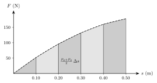

<!-- video: kommer (videoer/fysikk-forkurs/13-06-arbeid-og-numerisk-integrasjon) -->
{fig-alt="Video kommer"}

<!-- tillegg: Claude -->
En bueskytter trekker strengen bakover. Jo lenger hun trekker, jo hardere må hun dra. Hvor mye energi ligger lagret i buen når den er spent, og hvor fort går pila? For en konstant kraft er arbeidet bare $W = F\cdot s$. Men her endrer kraften seg hele veien, og det finnes ingen formel for den. Alt vi har, er en tabell med målinger. Da regner vi ut arbeidet som et **areal under en graf**, bit for bit, med datamaskinen.

## Arbeid er arealet under $F(s)$-grafen

<!-- tillegg: Claude -->
Vi har sett under [arbeid](../05-energi/01-arbeid.qmd) at arbeidet til en konstant kraft langs bevegelsen er $W = F\cdot s$. I en $F(s)$-graf er det arealet av et rektangel med høyde $F$ og bredde $s$. Er kraften en rett linje, som fjærkraften $F = kx$, blir arealet en trekant, og $W = \tfrac12 kx^2$.

Når kraften varierer på en mer innviklet måte, deler vi strekningen i små biter $\Delta s$. Over hver liten bit er kraften nesten konstant, og arbeidet er omtrent $F\cdot\Delta s$. Arbeidet over hele strekningen er summen av alle bitene, altså arealet under grafen.

## Trapesmetoden

<!-- tillegg: Claude -->
Har vi målt kraften $F_0, F_1, F_2, \dots, F_n$ i punkter med avstanden $\Delta s$, trekker vi rette linjer mellom målepunktene. Da blir arealet under grafen en rekke trapeser. Hvert trapes har arealet *gjennomsnittet av de to kantene ganger bredden*:

{.tikz-fig style="width:480px" fig-alt="Graf av trekkraften F i newton mot uttrekket s i meter for en bue, målt i seks punkter fra s = 0 til s = 0.50 m. Kraften øker fra 0 til 178 N og flater litt ut. Arealet under grafen er delt i fem trapeser med bredde 0.10 m. Det tredje trapeset er merket med arealet F2 pluss F3 delt på 2 ganger delta s."}

::: {.graa}
$$
W \approx \frac{F_0 + F_1}{2}\,\Delta s + \frac{F_1 + F_2}{2}\,\Delta s + \dots + \frac{F_{n-1} + F_n}{2}\,\Delta s
$$
:::

Legger vi sammen, ser vi at alle målingene i midten telles to ganger og deles på to, mens de to ytterste bare telles én gang:
$$
W \approx \Delta s\Big(\tfrac12 F_0 + F_1 + F_2 + \dots + F_{n-1} + \tfrac12 F_n\Big)
$$

::: {.eksempel}
<!-- tillegg: Claude -->
**Eksempel: Energien i en bue.** En bueskytter måler trekkraften med en kraftmåler for hver tiende centimeter:

| $s$ (m) | 0 | 0.10 | 0.20 | 0.30 | 0.40 | 0.50 |
|---|---|---|---|---|---|---|
| $F$ (N) | 0 | 52 | 96 | 132 | 160 | 178 |

a) Finn arbeidet hun gjør når hun trekker strengen $0.50\ \mathrm{m}$ tilbake.

b) Pila har massen $25\ \mathrm{g}$. Hvor stor fart får den hvis all energien går over til pila?

::: {.losning}
**a)** Trapesene har bredden $\Delta s = 0.10\ \mathrm{m}$:

| Trapes | Gjennomsnittskraft (N) | Arbeid (J) |
|---|---|---|
| 0–0.10 m | $(0 + 52)/2 = 26$ | $2.6$ |
| 0.10–0.20 m | $(52 + 96)/2 = 74$ | $7.4$ |
| 0.20–0.30 m | $(96 + 132)/2 = 114$ | $11.4$ |
| 0.30–0.40 m | $(132 + 160)/2 = 146$ | $14.6$ |
| 0.40–0.50 m | $(160 + 178)/2 = 169$ | $16.9$ |

Summen er
$$
W = (2.6 + 7.4 + 11.4 + 14.6 + 16.9)\ \mathrm{J} = 52.9\ \mathrm{J} \approx \underline{\underline{53\ \mathrm{J}}}
$$
Med formelen: $0.10\ \mathrm{m}\cdot\big(0 + 52 + 96 + 132 + 160 + \tfrac12\cdot178\big)\ \mathrm{N} = 52.9\ \mathrm{J}$.

**b)** Arbeidet blir lagret som energi i buen og går over til bevegelsesenergi i pila: $\tfrac12 mv^2 = W$.
$$
v = \sqrt{\frac{2W}{m}} = \sqrt{\frac{2\cdot52.9\ \mathrm{J}}{0.025\ \mathrm{kg}}} = \underline{\underline{65\ \mathrm{m/s}}}
$$
I virkeligheten går noe av energien til å sette selve buen og strengen i bevegelse, så pila får litt mindre fart.
:::
:::

::: {.callout-tip title="Til ettertanke"}
Trapesmetoden trekker rette linjer mellom punktene. Buekurven bøyer seg litt nedover (den blir slakere). Ligger de rette linjene da over eller under den virkelige kurven? Gir metoden for mye eller for lite arbeid her?
:::

## Trapesmetoden i Python

<!-- tillegg: Claude -->
Med mange målinger blir det tungvint for hånd. I Python legger vi målingene i to lister og summerer trapesene i en løkke. Funksjonen `np.trapezoid` fra numpy gjør det samme på én linje. Legg til flere målinger eller endre tallene, og trykk **Kjør**.

```{.python .kjor}
import numpy as np
import matplotlib.pyplot as plt

s = np.array([0, 0.10, 0.20, 0.30, 0.40, 0.50])   # uttrekk (m)
F = np.array([0, 52, 96, 132, 160, 178])          # kraft (N)
m = 0.025                                         # pilas masse (kg)

W = 0.0
for i in range(len(s) - 1):
    ds = s[i+1] - s[i]
    W = W + (F[i] + F[i+1]) / 2 * ds              # ett trapes

print(f"Arbeid, egen løkke:  {W:.1f} J")
print(f"Arbeid, np.trapezoid: {np.trapezoid(F, s):.1f} J")
print(f"Farten til pila: {np.sqrt(2 * W / m):.0f} m/s")

plt.fill_between(s, F, alpha=0.3)
plt.plot(s, F, "o-")
plt.xlabel("$s$ (m)"); plt.ylabel("$F$ (N)"); plt.grid(); plt.show()
```

<!-- tillegg: Claude -->
Løkka fungerer også når målepunktene ikke ligger like langt fra hverandre, fordi den regner ut `ds` for hvert trapes.

## Hvor nøyaktig er det?

<!-- tillegg: Claude -->
Når vi kjenner kraften som en formel, kan vi velge så mange punkter vi vil, og sjekke mot det eksakte svaret. Et godt eksempel er tyngdekraften fra jorda på en satellitt. Kraften avtar med kvadratet av avstanden $r$ fra jordsentrum:
$$
F = \frac{\mathrm{G}Mm}{r^2}
$$
Programmet regner ut arbeidet som trengs for å løfte en satellitt fra jordoverflaten ($r = R$) til $r = 2R$, med stadig flere trapeser, og sammenlikner med det eksakte svaret $\mathrm{G}Mm/(2R)$.

```{.python .kjor}
import numpy as np

G = 6.674e-11       # gravitasjonskonstanten (N m^2/kg^2)
M = 5.97e24         # jordas masse (kg)
R = 6.37e6          # jordradien (m)
m = 1000            # satellittens masse (kg)

F = lambda r: G * M * m / r**2
eksakt = G * M * m / (2 * R)

for n in [1, 2, 4, 10, 100]:
    r = np.linspace(R, 2 * R, n + 1)            # n trapeser
    W = np.trapezoid(F(r), r)
    print(f"{n:4d} trapeser: W = {W/1e9:7.3f} GJ, feil {100*(W - eksakt)/eksakt:6.2f} %")
print(f"Eksakt:        W = {eksakt/1e9:7.3f} GJ")
```

<!-- tillegg: Claude -->
Med ett trapes bommer vi med $25\ \%$, med ti trapeser med $0.29\ \%$, og med hundre med $0.003\ \%$. Ti ganger så mange trapeser gir omtrent hundre ganger mindre feil. Trapesmetoden blir altså raskt svært god, så lenge grafen ikke har knekker eller hopp.

:::: {.oppgaver}

::: {.oppgave tittel="Fjæra – et tilfelle der trapesene treffer"}
<!-- tillegg: Claude -->
En fjær har fjærkonstanten $k = 200\ \mathrm{N/m}$ og trykkes sammen $0.30\ \mathrm{m}$.

a) Lag en tabell over kraften $F = kx$ for $x = 0$, $0.10$, $0.20$ og $0.30\ \mathrm{m}$, og bruk trapesmetoden til å finne arbeidet.

b) Sammenlikn med $W = \tfrac12 kx^2$. Hvorfor blir svaret helt nøyaktig her?

::: {.fasit}
$9.0\ \mathrm{J}$
:::
:::

::: {.oppgave tittel="Rektangler eller trapeser?"}
<!-- tillegg: Claude -->
En enklere metode er å bruke rektangler: Gang kraften i *starten* av hver bit med $\Delta s$, eller kraften i *slutten*.

a) Regn ut arbeidet for buen i eksempelet med begge rektangelmetodene.

b) Sammenlikn med trapesmetoden. Hvordan henger de tre svarene sammen?

::: {.fasit}
$44.0\ \mathrm{J}$ · $61.8\ \mathrm{J}$
:::
:::

::: {.oppgave tittel="Strikken" niva="Middels"}
<!-- tillegg: Claude -->
En gummistrikk strekkes, og kraften måles:

| Forlengelse $x$ (cm) | 0 | 2.0 | 4.0 | 6.0 | 8.0 | 10.0 |
|---|---|---|---|---|---|---|
| $F$ (N) | 0 | 1.8 | 2.6 | 3.1 | 3.7 | 4.8 |

a) Hvorfor kan vi ikke bruke $W = \tfrac12 kx^2$ for strikken?

b) Finn arbeidet som trengs for å strekke strikken $10.0\ \mathrm{cm}$. Bruk Python eller regn for hånd.

::: {.fasit}
$0.27\ \mathrm{J}$
:::
:::

::: {.oppgave tittel="Hvor mange trapeser trengs?" niva="Middels"}
<!-- tillegg: Claude -->
Bruk programmet for satellitten. Hvor mange trapeser trengs for at feilen skal bli mindre enn $0.1\ \%$? Prøv deg fram, eller lag en løkke som dobler antallet til feilen er liten nok.

::: {.fasit}
$18\ \text{trapeser}$
:::
:::

::: {.oppgave tittel="Bremsing med varierende kraft" niva="Utfordrende"}
<!-- tillegg: Claude -->
En bil med massen $1200\ \mathrm{kg}$ bremser fra $20.0\ \mathrm{m/s}$. Bremsekraften $F$ måles mot strekningen $s$:

| $s$ (m) | 0 | 5.0 | 10.0 | 15.0 | 20.0 | 25.0 |
|---|---|---|---|---|---|---|
| $F$ (kN) | 4.0 | 7.5 | 8.0 | 8.0 | 7.8 | 7.6 |

a) Finn arbeidet bremsekraften gjør på de første $25.0\ \mathrm{m}$.

b) Bruk arbeid–energi-setningen, $W = \Delta E_k$, til å finne farten etter $25.0\ \mathrm{m}$.

::: {.fasit}
a) $-1.9\cdot10^2\ \mathrm{kJ}$ · b) $9.5\ \mathrm{m/s}$
:::
:::

::::
